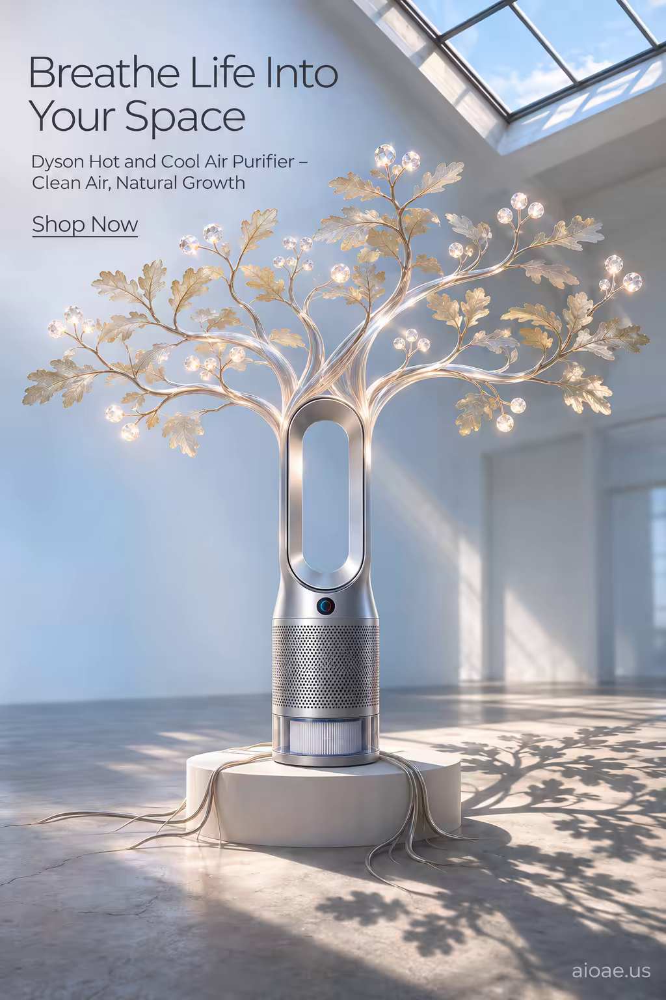

# 案例 143：Dyson 淨化器綻放水晶樹冠 | Case 143: Dyson Purifier Blossoms into a Crystal Canopy



Dyson 冷暖空氣清淨機化作一棵會呼吸的樹：銀色機身舒展成半透明橡樹，出風口變成枝椏，枝頭結出一顆顆發光的水晶花粉球，陽光從天窗灑下，枝影落在水泥地上。

A Dyson Hot and Cool air purifier morphs into a living tree: its silver body unfurls into a translucent oak, vents becoming branches tipped with glowing crystal pollen spheres, a single shaft of skylight casting sharp branch shadows across the concrete floor.

## 完整提示詞 / Full Prompt

```
SUBJECT & IDEA: Dyson Hot and Cool Air Purifier. A sleek Dyson purifier morphs into a living tree, its vents becoming branches that sprout crystal pollen, illustrating breath-cleaning power as natural growth.

PRODUCT: The Dyson Hot and Cool Air Purifier sits on a minimalist white pedestal, its silver motor housing gleaming. The unit's iconic airblade fan is visible, with the original filter cartridge subtly exposed, maintaining brand recognisability.

SCENE: In a sunlit loft, the purifier has transformed into a translucent oak tree. Its polished metal body unfurls into a branching canopy, each branch ending in a crystal pollen sphere that glows softly. The tree's roots are cables that curl into the floor, anchoring the unit. A single, focused beam of daylight from a high skylight illuminates the scene, casting sharp shadows of the branches across the concrete floor. The background is a soft gradient of sky blue, keeping the focus on the tree-purifier.

LIGHTING & COLOR: High-contrast, directional natural light from above, with a subtle rim glow around the tree's edges to enhance the crystal pollen glow. Shadows fall sharply to the right of the unit, emphasizing depth.

CAMERA: Wide-angle, slightly low angle to capture the full height of the tree-purifier; the lens is set to a focal length of 35mm, creating a slight depth of field that keeps the entire tree sharp while blurring the distant loft walls.

ON-IMAGE COPY: Headline "Breathe Life Into Your Space"; subheadline "Dyson Hot and Cool Air Purifier – Clean Air, Natural Growth"; CTA "Shop Now". Modern sans serif, thin weight for headline area, positioned in the upper left corner. The font is a cool charcoal color, contrasting with the white background. Subheadline appears in a smaller size directly beneath the headline, both left-aligned. All text is crisp, with a subtle drop shadow for legibility.

WATERMARK: Add the exact text "aioae.us" in the bottom-right corner at 70% transparency (30% opacity), with enough contrast to remain readable.
```

## 適用模型 / Recommended Models

擅長產品海報與高對比自然光的模型：GPT Image（Image2）、Flux Pro、Midjourney（建議加 `--ar 3:4`）。

Models strong at product posters and high-contrast natural light: GPT Image (Image2), Flux Pro, Midjourney (add `--ar 3:4`).

## 修改說明 / How to Adapt

- 換產品：淨化器換成風扇或加濕器，機身與出風口的描述跟著改。
- 換變形：橡樹換成櫻花樹或松樹，枝椏與花粉球的造型跟著改。
- 換場景：陽光閣樓換成雨夜溫室，天窗光改成暖黃燈光，氛圍轉靜謐。

- Change the product: swap the purifier for a fan or a humidifier, and update the body and vent descriptions.
- Change the morph: swap the oak for a cherry tree or a pine, and update the branches and pollen spheres.
- Change the setting: swap the sunlit loft for a rainy-night greenhouse, the skylight for warm lamps, and the mood turns quiet.

---
直達本案例 / Direct link: https://aioae.us/prompt?title=Dyson%20Purifier%20Blossoms%20into%20a%20Crystal%20Canopy
更多同類提示詞 / More prompts like this: [AIOAE 免費 AI 圖片提示詞庫](https://aioae.us/prompts)
