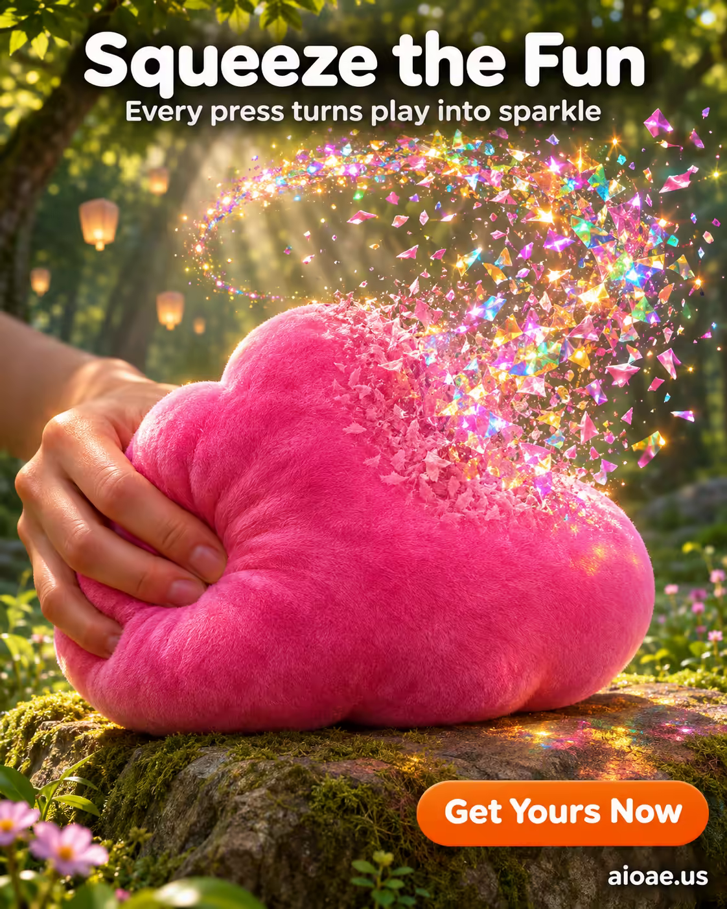

# 案例 144：捏捏雲朵解壓玩具海報 | Case 144: Squeeze the Fun Squishy Cloud Toy Poster



捏捏雲朵解壓玩具：一捏就爆出七彩紙屑！粉紅雲朵絨毛玩具躺在林間青苔石上，半邊仍是絨毛、半邊化作向上飛揚的亮片光暈，陽光透過林冠灑下斑駁光影，療癒又好玩。

A squishy cloud toy that bursts into glittering confetti when squeezed: a bright pink plush cloud rests on a mossy stone in a sunlit forest clearing, half still plush, half dissolving into a rising halo of iridescent confetti - tactile, magical, joyful.

## 完整提示詞 / Full Prompt

```
SUBJECT & IDEA: Squishy Toy. A vibrant poster that celebrates the playful magic of a squishy toy turning into a burst of glittering confetti whenever it’s squeezed. The image captures the moment of transformation, turning tactile play into a dazzling visual spectacle that invites the viewer to imagine the joy of pressing the toy’s soft surface.

PRODUCT: A single, plush Squishy Toy—a round, cloud‑shaped plush in bright pink, velvety texture—rests on a mossy stone in a sunlit clearing. The toy’s surface is smooth and slightly translucent, with a subtle sheen that catches light. It is the clear focus of the composition, positioned centrally and slightly elevated on the stone.

SCENE: In a whimsical forest clearing bathed in dappled sunlight, the Squishy Toy sits on a mossy stone. As a hand (blurred in the background) squeezes the toy, its interior erupts into a cascading shower of iridescent confetti that rises upward, forming a luminous halo around the toy. The confetti glints with rainbow colors, casting soft reflections on the toy’s surface. The background is a gentle blur of green trees and floating lanterns, creating depth and focus on the toy and its transformation. The toy itself remains half intact, with one half still plush and the other half dissolving into confetti, visually linking the physical act of squeezing to the magical output.

LIGHTING & COLOR: Soft, diffused sunlight streams through the canopy, creating dappled shadows across the mossy stone and the toy. A subtle rim light outlines the toy’s edges, while the confetti halo emits a gentle, warm glow that illuminates the surrounding foliage with a soft amber tint. The overall lighting is warm and inviting, highlighting the toy’s plush texture and the glittering confetti.

CAMERA: A slightly low angle shot using a 35mm lens, with a shallow depth of field that keeps the toy and the confetti halo sharply in focus while gently blurring the forest background. The camera framing places the toy slightly off‑center to the right, creating a dynamic diagonal composition that guides the eye from the foreground to the rising confetti.

ON-IMAGE COPY: Headline "Squeeze the Fun"; subheadline "Every press turns play into sparkle"; CTA "Get Yours Now". The headline uses a bold, rounded sans‑serif typeface in white, placed at the top center over a subtle dark gradient that ensures readability. The subheadline appears below the headline in a lighter weight of the same font, also in white. The CTA is a bright orange button‑style shape with rounded corners, positioned at the bottom right, featuring white text. All text elements are surrounded by a slight drop shadow to separate them from the background.

WATERMARK: Small readable "aioae.us" in the bottom-right corner.
```

## 適用模型 / Recommended Models

擅長廣告海報與奇幻森林場景的模型：GPT Image（Image2）、Flux Pro、Midjourney（建議加 `--ar 3:4`）。

Models strong at advertising posters and whimsical forest scenes: GPT Image (Image2), Flux Pro, Midjourney (add `--ar 3:4`).

## 修改說明 / How to Adapt

- 換產品：雲朵捏捏換成貓爪捏捏或星星捏捏，造型與絨毛質感的描述跟著改。
- 換變形：紙屑換成星光或花瓣，光暈的顏色與飄散方向跟著改。
- 換場景：森林空地換成兒童房地毯或海邊沙灘，背景光線與氛圍跟著改。

- Change the product: swap the cloud squishy for a cat-paw or star squishy, and update the shape and plush texture.
- Change the morph: swap the confetti for starlight or petals, and update the halo's colours and drift.
- Change the setting: swap the forest clearing for a children's bedroom rug or a beach, and update the background light and mood.

---
直達本案例 / Direct link: https://aioae.us/prompt?title=Squeeze%20the%20Fun%20Squishy%20Cloud%20Toy%20Poster
更多同類提示詞 / More prompts like this: [AIOAE 免費 AI 圖片提示詞庫](https://aioae.us/prompts)
