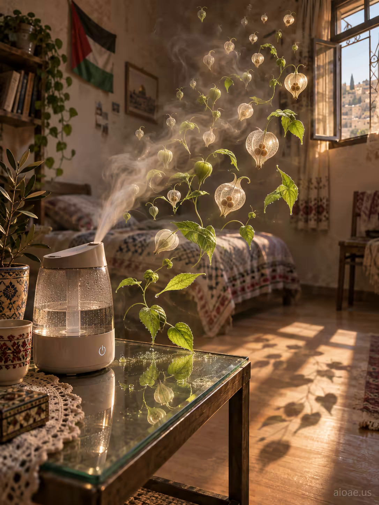

# 案例 145：床頭加濕器發光種子莢 | Case 145: Bedside Humidifier Glowing Seedpods



午後陽光灑進樸素臥室，加濕器的水霧化作一顆顆發光的種子莢，懸浮綻放，把尋常小家電變成空中迷你溫室；暖調顆粒膠片感，日常中帶著奇幻。

A bedside humidifier's vapor coalesces into dozens of glowing seedpods that hover and unfurl in late-afternoon sun, turning an ordinary device into a miniature greenhouse suspended in air; warm, grainy film aesthetic with muted earth tones.

## 完整提示詞 / Full Prompt

```
SUBJECT: Bedside Humidifier

SCENE: In a modest bedroom lit by late-afternoon sun spilling through a half‑open window, a sleek bedside humidifier releases a gentle cloud of vapor that, instead of dissipating, coalesces into dozens of delicate, glowing seedpods that hover and begin to unfurl, their emerald leaves brushing against the glass nightstand; the mist‑laden seeds cast soft shadows on the wooden floor, and their reflected glimmer catches the faint light, turning the ordinary device into a miniature greenhouse suspended in air.

STYLE & LIGHT: A warm, grainy film aesthetic reminiscent of everyday Palestinian cinema, with muted earth tones and soft natural lighting.

CAMERA: A low-angle, shallow‑depth‑of‑field shot focusing on the humidifier, with the mist and seedpods rendered in crisp detail against a gently blurred background.

WATERMARK: Add the exact text "aioae.us" in the bottom-right corner at 90% transparency (10% opacity), with enough contrast to remain visible.
```

## 適用模型 / Recommended Models

擅長寫實場景與柔光氛圍的模型：GPT Image（Image2）、Flux Pro、Midjourney（建議加 `--ar 3:4`）。

Models strong at realistic scenes and soft natural light: GPT Image (Image2), Flux Pro, Midjourney (add `--ar 3:4`).

## 修改說明 / How to Adapt

- 換產品：把加濕器換成香薰機或檯燈，SUBJECT 與 SCENE 首句一起換，種子莢意象保留。
- 換時段：午後陽光改成清晨或黃昏，STYLE & LIGHT 的色溫描述跟著改。
- 換種子意象：發光種子莢改成螢火蟲或花瓣，SCENE 中段的發光物描寫整組換。

- Change the product: swap the humidifier for a diffuser or desk lamp; rewrite SUBJECT and the first sentence of SCENE together, keep the seedpod idea.
- Change the time of day: swap late-afternoon sun for dawn or dusk, and adjust the colour temperature in STYLE & LIGHT to match.
- Change the floating motif: swap glowing seedpods for fireflies or petals, rewriting the glowing-object passage in SCENE as a set.

---
直達本案例 / Direct link: https://aioae.us/prompt?title=Bedside%20Humidifier%20Glowing%20Seedpods
更多同類提示詞 / More prompts like this: [AIOAE 免費 AI 圖片提示詞庫](https://aioae.us/prompts)
