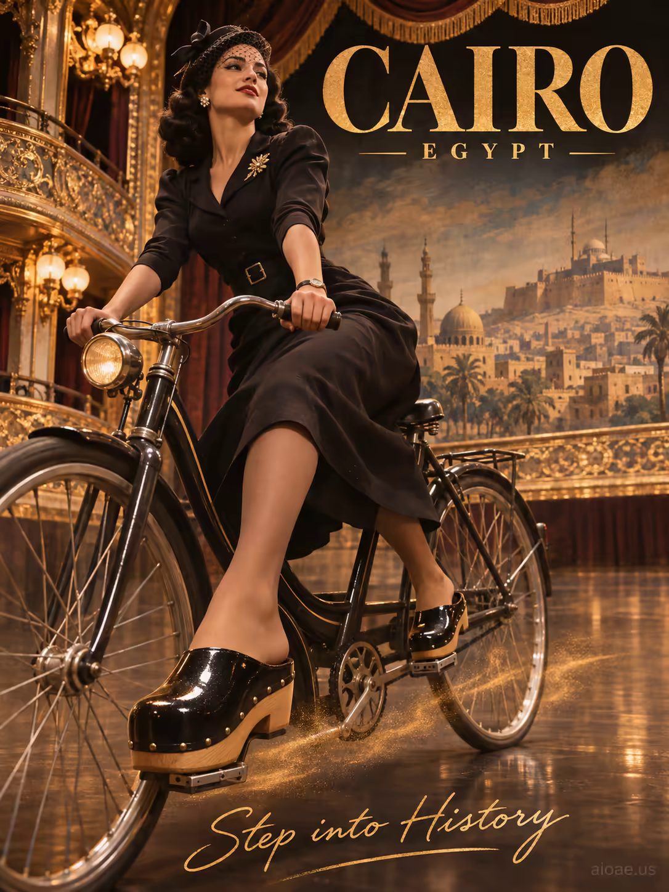

# 案例 146：開羅單車上的經典木屐鞋 | Case 146: Classic Clog Shoes on a Bicycle in Cairo



黑色復古風模特兒踩著亮面木屐騎過開羅劇院包廂，琥珀色舞台燈與金色塵霧交織，1940 年代好萊塢黑白片質感，鞋履佔據畫面下三分之一，絕對主角。

A noir-styled model in glossy wooden clogs rides a classic black step-through bicycle across a Cairo-theater balcony, warm amber stage lamps and golden dust evoking 1940s Old Hollywood; the clogs dominate the lower third.

## 完整提示詞 / Full Prompt

```
SUBJECT: Classic Clog Shoes on a model riding a black step‑through bicycle

SCENE: In an ornate Cairo‑theater balcony, a sleek noir‑styled adult model leans on the handlebars of a classic black step‑through bicycle, her feet firmly planted in glossy wooden classic clogs that dominate the lower third. Warm amber stage lamps illuminate the clogs, casting a golden glow onto the polished floor, while a swirl of golden dust rises from the shoes as she pedals leisurely. Behind her, a painted city backdrop of Cairo stretches upward, topped by a large serif "CAIRO" and small‑caps "EGYPT" with a handwritten "Step into History" tagline at the bottom.

STYLE & LIGHT: Old Hollywood studio lighting with warm amber key light, high‑contrast noir shadows, rich gold tones, and a subtle film‑grain texture evoke 1940s noir within an Egyptian golden‑age theater setting.

CAMERA: Medium‑format full‑body portrait with shallow depth of field, focus on the clogs in the foreground, captured from a slightly low angle to emphasize the shoes and bicycle wheels.

WATERMARK: Add the exact text "aioae.us" in the bottom-right corner at 90% transparency (10% opacity), with enough contrast to remain visible.
```

## 適用模型 / Recommended Models

擅長寫實人像、復古光影與圖中文字渲染的模型：GPT Image（Image2）、Flux Pro、Ideogram（圖中 "CAIRO" 文字須逐字渲染）。

Models strong at realistic portraits, vintage lighting and in-image text: GPT Image (Image2), Flux Pro, Ideogram (the "CAIRO" text must render verbatim).

## 修改說明 / How to Adapt

- 換城市：開羅換成巴黎或威尼斯，背景城景與 "CAIRO" / "EGYPT" 字樣整組換。
- 換鞋款：木屐換成高跟鞋或馬靴，SUBJECT 與 CAMERA 的焦點描述跟著改。
- 換年代氛圍：1940 年代黑白片風改成現代街頭風，STYLE & LIGHT 整段換，舞台燈描述同步改。

- Change the city: swap Cairo for Paris or Venice; rewrite the painted backdrop and the "CAIRO" / "EGYPT" lettering as a set.
- Change the shoes: swap clogs for heels or riding boots, and update SUBJECT and the focus description in CAMERA.
- Change the era: swap 1940s noir for a modern street style; rewrite STYLE & LIGHT as a set and update the stage-lamp description.

---
直達本案例 / Direct link: https://aioae.us/prompt?title=Classic%20Clog%20Shoes%20on%20a%20Bicycle%20in%20Cairo
更多同類提示詞 / More prompts like this: [AIOAE 免費 AI 圖片提示詞庫](https://aioae.us/prompts)
