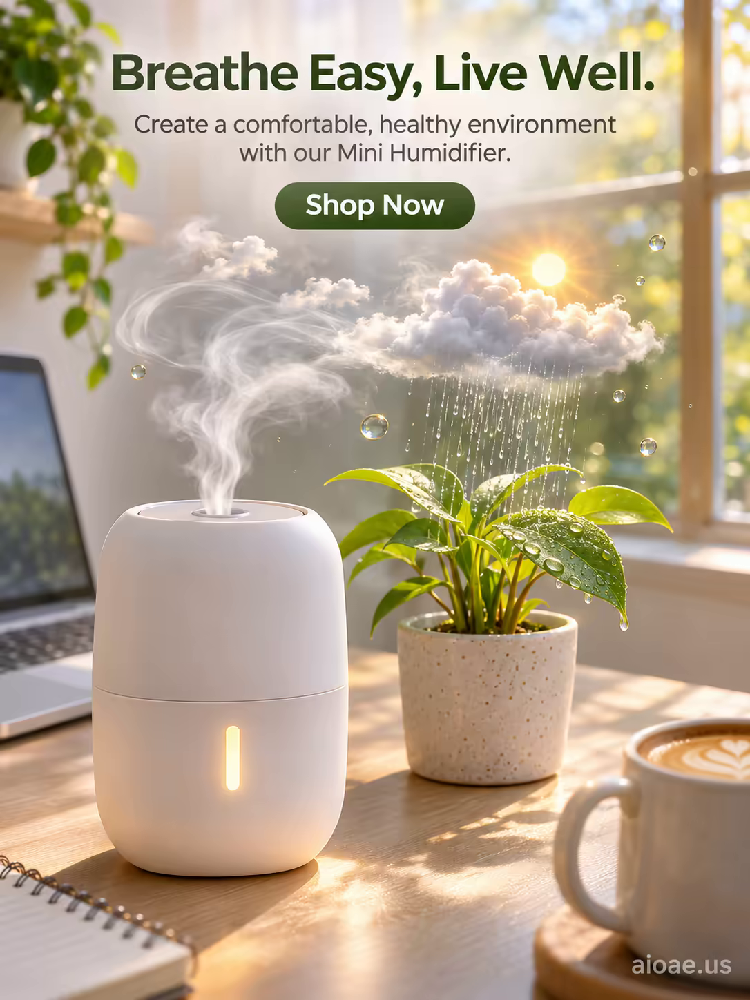

# 案例 147：迷你加濕器：輕鬆呼吸，健康生活 | Case 147: Mini Humidifier Breathe Easy Live Well



陽光書桌上的白色迷你加濕器噴出小小天氣系統：微型雲朵、發光小太陽、輕柔細雨灑在盆栽上，夢幻又療癒的居家辦公小品，產品海報感十足。

A compact white mini humidifier on a sunlit desk releases a miniature weather system — tiny clouds, a glowing sun, gentle misty rain falling on a potted plant — fresh, serene and slightly whimsical.

## 完整提示詞 / Full Prompt

```
SUBJECT: Mini Humidifier with a compact, white design and a soft, glowing light

SCENE: On a bright, sunlit desk, the Mini Humidifier stands next to a small potted plant, its compact, white design blending seamlessly with the minimalist workspace. From its top, a delicate, swirling cloud rises upward, forming a miniature, intricate weather system complete with tiny, wispy clouds, a small, glowing sun, and a gentle, misty rain that falls softly onto the plant's leaves below. The cloud's edges are illuminated by the soft, golden morning light streaming through a nearby window, creating a magical, ethereal glow. Around the humidifier, small, floating water droplets catch the light, sparkling like tiny diamonds in the air. In the background, a blurred, cozy home office is visible, with a laptop, a notebook, and a cup of coffee on the desk, adding a sense of warmth and productivity to the scene. The overall atmosphere is fresh, serene, and slightly whimsical, with a focus on the humidifier's ability to create a comfortable, healthy environment.

STYLE & LIGHT: Bright, airy realism with soft, golden morning light and delicate, misty accents, creating a fresh, serene atmosphere.

CAMERA: Macro lens, close-up, capturing the humidifier and the miniature weather system in exquisite detail with a shallow depth of field that keeps the cloud and the plant sharply in focus while softly blurring the home office in the background.

ON-IMAGE TEXT: headline "Breathe Easy, Live Well."; subheadline "Create a comfortable, healthy environment with our Mini Humidifier."; CTA "Shop Now".

WATERMARK: Add the exact text "aioae.us" in the bottom-right corner at 70% transparency (30% opacity), with enough contrast to remain readable.
```

## 適用模型 / Recommended Models

擅長產品海報、微距細節與圖中文字渲染的模型：GPT Image（Image2）、Flux Pro、Ideogram（標語須逐字渲染）。

Models strong at product posters, macro detail and in-image text: GPT Image (Image2), Flux Pro, Ideogram (the headline must render verbatim).

## 修改說明 / How to Adapt

- 換產品：迷你加濕器換成香薰機或空氣淨化器，SUBJECT 與 SCENE 首句一起換，微型天氣系統意象保留。
- 換場景：書桌換成床頭櫃或窗台，背景的居家辦公物件跟著換。
- 換文案：主標語 "Breathe Easy, Live Well." 換成其他賣點，副標題與 CTA 同步改。

- Change the product: swap the mini humidifier for a diffuser or air purifier; rewrite SUBJECT and the first sentence of SCENE together, keep the miniature weather system.
- Change the setting: swap the desk for a nightstand or windowsill, and update the home-office props in the background.
- Change the copy: swap the "Breathe Easy, Live Well." headline for another selling point, and update the subheadline and CTA to match.

---
直達本案例 / Direct link: https://aioae.us/prompt?title=Mini%20Humidifier%20Breathe%20Easy%20Live%20Well
更多同類提示詞 / More prompts like this: [AIOAE 免費 AI 圖片提示詞庫](https://aioae.us/prompts)
