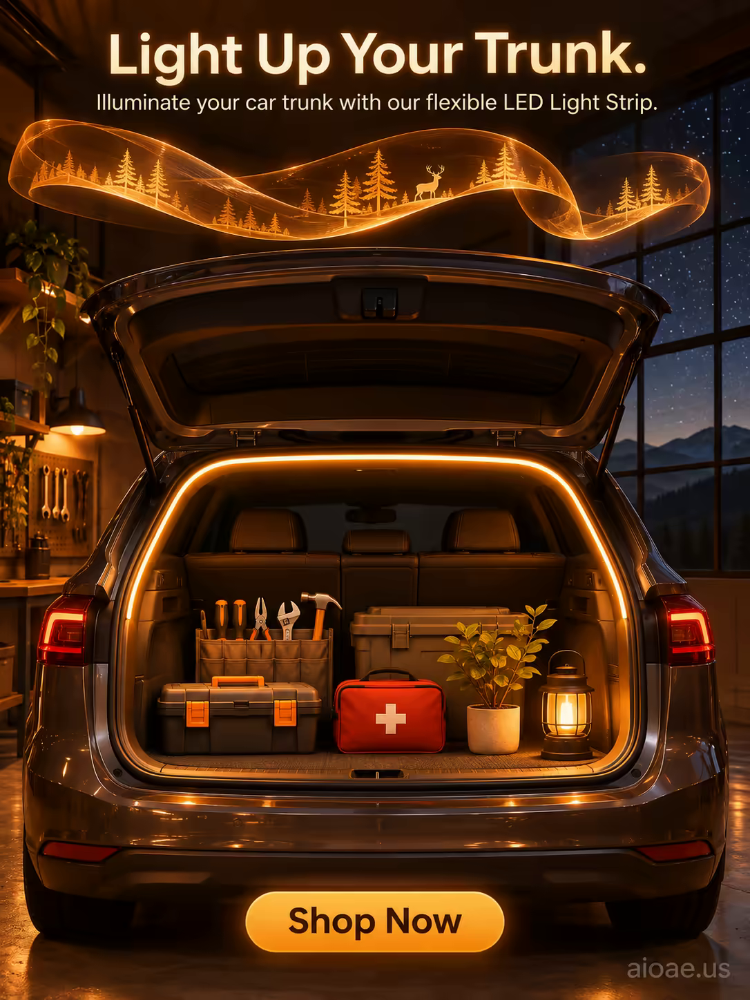

# 案例 148：車尾箱 LED 燈條：點亮你的車尾箱 | Case 148: Car Trunk LED Light Strip Light Up Your Trunk



深夜車庫裡，暖琥珀色 LED 燈條照亮整齊的車尾箱，上方一條發光緞帶如光之河流蜿蜒，緞帶表面是微型森林圖案，溫馨、安全又帶一點魔幻的汽車用品海報。

A flexible LED light strip glows warm amber along an open car trunk in a dark garage, while a luminous ribbon floats above like a river of light; cozy, organized and slightly magical.

## 完整提示詞 / Full Prompt

```
SUBJECT: Car Trunk LED Light Strip with a flexible, adhesive design

SCENE: In a dark, atmospheric garage at night, the Car Trunk LED Light Strip is installed along the edge of an open car trunk, its flexible, adhesive design glowing with a warm, amber light. The light strip illuminates the interior of the trunk, revealing a meticulously organized space filled with neatly arranged tools, a first-aid kit, and a small, potted plant. Above the trunk, a large, glowing, amber-colored ribbon floats in the air, twisting and turning like a river of light, its surface covered in intricate, glowing patterns that resemble a miniature forest. The ribbon's light casts a warm, inviting glow onto the car and the surrounding garage, creating a sense of warmth and security. In the background, a large window reveals a starry night sky, with the faint outline of a distant mountain range visible on the horizon. The overall scene is cozy, organized, and slightly magical, with a sense of adventure and preparedness.

STYLE & LIGHT: Atmospheric realism with warm, amber lighting and glowing, magical accents, creating a cozy, inviting atmosphere.

CAMERA: Wide-angle lens, eye-level, capturing the full car trunk and the glowing amber ribbon with a shallow depth of field that keeps the light strip and the trunk's interior sharply in focus while softly blurring the garage and night sky in the background.

ON-IMAGE TEXT: headline "Light Up Your Trunk."; subheadline "Illuminate your car trunk with our flexible LED Light Strip."; CTA "Shop Now".

WATERMARK: Add the exact text "aioae.us" in the bottom-right corner at 70% transparency (30% opacity), with enough contrast to remain readable.
```

## 適用模型 / Recommended Models

擅長產品海報、夜景氛圍與圖中文字渲染的模型：GPT Image（Image2）、Flux Pro、Ideogram（標語須逐字渲染）。

Models strong at product posters, night atmosphere and in-image text: GPT Image (Image2), Flux Pro, Ideogram (the headline must render verbatim).

## 修改說明 / How to Adapt

- 換產品：車尾箱燈條換成車內氛圍燈或露營燈帶，SUBJECT 與 SCENE 首句一起換，發光緞帶意象保留。
- 換緞帶圖案：微型森林換成星空或海洋圖案，緞帶表面的描寫整組換。
- 換文案：主標語 "Light Up Your Trunk." 換成其他賣點，副標題與 CTA 同步改。

- Change the product: swap the trunk light strip for interior ambient lighting or a camping light strip; rewrite SUBJECT and the first sentence of SCENE together, keep the glowing ribbon.
- Change the ribbon pattern: swap the miniature forest for a starry sky or ocean motif, rewriting the ribbon-surface description as a set.
- Change the copy: swap the "Light Up Your Trunk." headline for another selling point, and update the subheadline and CTA to match.

---
直達本案例 / Direct link: https://aioae.us/prompt?title=Car%20Trunk%20LED%20Light%20Strip%20Light%20Up%20Your%20Trunk
更多同類提示詞 / More prompts like this: [AIOAE 免費 AI 圖片提示詞庫](https://aioae.us/prompts)
