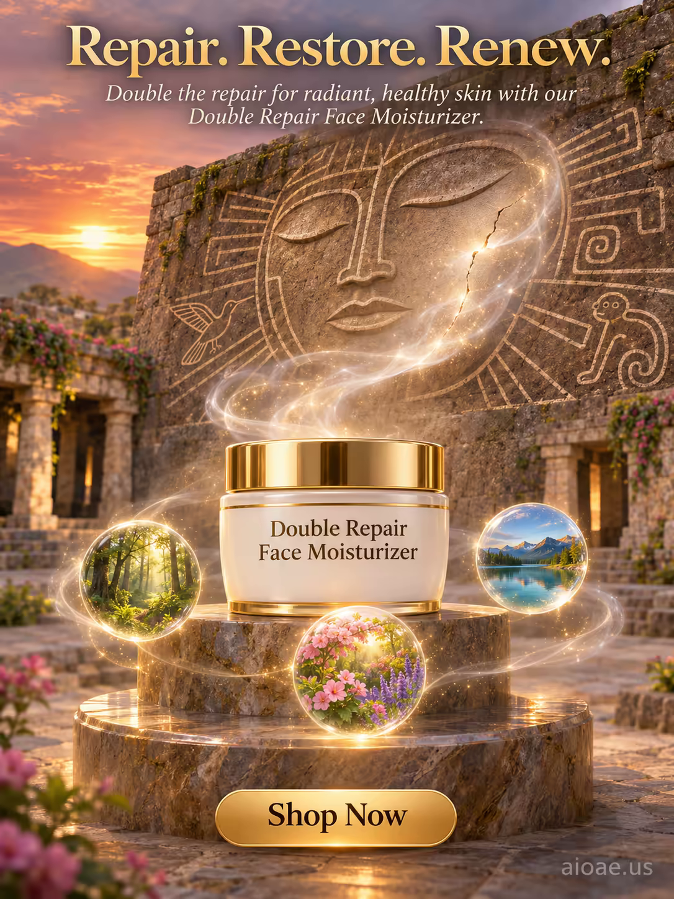

# 案例 149：雙重修護面霜：修護、恢復、煥新 | Case 149: Double Repair Face Moisturizer Repair Restore Renew



古寺庭院裡，白金配色的面霜罐立於石台座，背後是刻著納斯卡線條巨臉的石牆，面霜升起的微光薄霧輕撫石臉，彷彿在修護古老石頭；寧靜、神秘又充滿療癒感。

A white-and-gold moisturizer jar stands on a stone pedestal in an ancient temple courtyard, a glowing Nazca geoglyph face carved behind it, its shimmering mist veiling the stone face as if repairing it; calm, mystical and deeply restorative.

## 完整提示詞 / Full Prompt

```
SUBJECT: Double Repair Face Moisturizer jar with a white and gold design

SCENE: In a serene, ancient temple courtyard, the Double Repair Face Moisturizer jar stands on a polished stone pedestal, its white and gold design catching the soft, golden light of the setting sun. Behind it, a large, intricately carved stone wall depicts the Nazca Lines, with a giant, glowing geoglyph of a face etched into the stone, its eyes closed in peaceful contemplation. From the jar, a gentle, shimmering mist rises upward, forming a delicate, translucent veil that envelops the geoglyph's face, as if the moisturizer is repairing and rejuvenating the ancient stone. Around the pedestal, small, glowing orbs of light float gently in the air, each one containing a tiny, miniature landscape—a lush forest, a tranquil lake, a blooming garden—symbolizing the dual repair and nourishment the moisturizer provides. The overall scene is calm, mystical, and deeply restorative, with a sense of timeless beauty and healing.

STYLE & LIGHT: Mystical realism with soft, golden lighting and glowing, ethereal accents, creating a serene, healing atmosphere.

CAMERA: Wide-angle lens, slightly elevated, capturing the full moisturizer jar and the Nazca geoglyph with a shallow depth of field that keeps the jar and the mist sharply in focus while softly blurring the temple courtyard in the background.

ON-IMAGE TEXT: headline "Repair. Restore. Renew."; subheadline "Double the repair for radiant, healthy skin with our Double Repair Face Moisturizer."; CTA "Shop Now".

WATERMARK: Add the exact text "aioae.us" in the bottom-right corner at 70% transparency (30% opacity), with enough contrast to remain readable.
```

## 適用模型 / Recommended Models

擅長產品海報、神秘氛圍與圖中文字渲染的模型：GPT Image（Image2）、Flux Pro、Ideogram（標語須逐字渲染）。

Models strong at product posters, mystical atmosphere and in-image text: GPT Image (Image2), Flux Pro, Ideogram (the headline must render verbatim).

## 修改說明 / How to Adapt

- 換產品：面霜換成精華液或面膜，SUBJECT 與 SCENE 首句一起換，修護石臉的意象保留。
- 換古蹟：納斯卡線條換成金字塔或吳哥浮雕，背景石牆的描寫整組換。
- 換文案：主標語 "Repair. Restore. Renew." 換成其他賣點，副標題與 CTA 同步改。

- Change the product: swap the moisturizer for a serum or face mask; rewrite SUBJECT and the first sentence of SCENE together, keep the repairing-the-stone-face idea.
- Change the monument: swap the Nazca Lines for pyramids or Angkor reliefs, rewriting the carved stone-wall description as a set.
- Change the copy: swap the "Repair. Restore. Renew." headline for another selling point, and update the subheadline and CTA to match.

---
直達本案例 / Direct link: https://aioae.us/prompt?title=Double%20Repair%20Face%20Moisturizer%20Repair%20Restore%20Renew
更多同類提示詞 / More prompts like this: [AIOAE 免費 AI 圖片提示詞庫](https://aioae.us/prompts)
