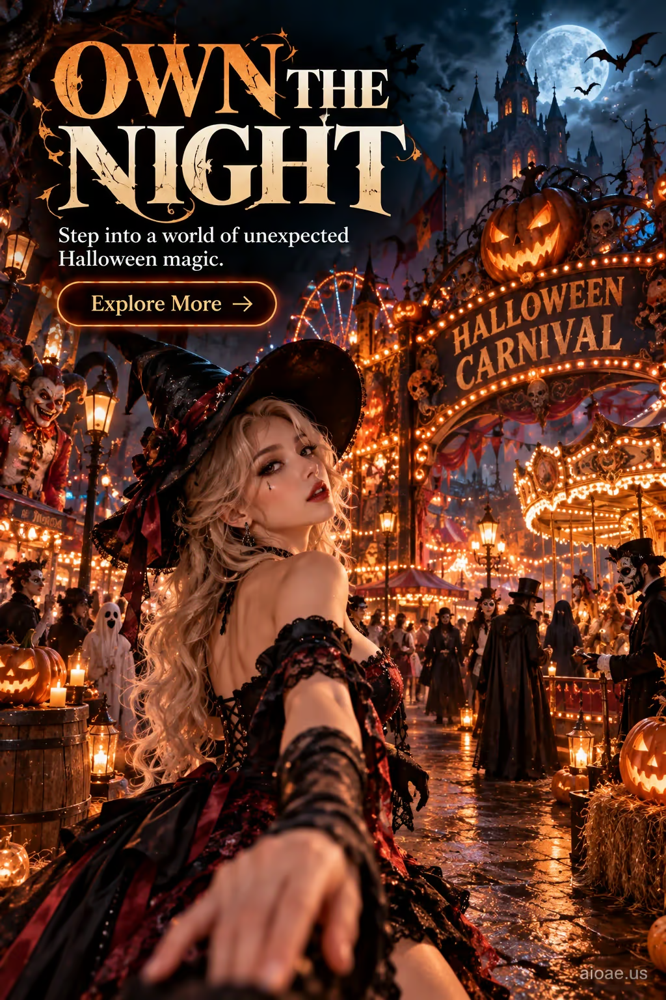

# 案例 15：萬聖節鬼屋嘉年華海報 | Case 15: Halloween Haunted Carnival Poster



萬聖節嘉年華夜遊：女巫回眸、旋轉木馬、南瓜燈與哥特城堡在滿月下燃起燈海，商業級海報構圖。

A Halloween carnival night: a witch glances back over her shoulder, a carousel, jack-o'-lanterns and a gothic castle blaze in a sea of lights under a full moon — commercial-poster composition.

## 完整提示詞 / Full Prompt

```
SUBJECT & IDEA: Halloween Haunted Carnival Poster. Preserve named subject, requested relationships, main action and format.

SCENE: one continuous believable setting suited to the subject and brief. Maintain clear foreground, midground and background with a single coherent physical logic.

MUTATION RULES: Subject-grounded visual evolution. MAIN SUBJECT LOCK: Halloween Haunted Carnival Poster. SINGLE DATABASE-GROUNDED CREATIVE MUTATION: Make one concrete subject-related visual change using the existing light, material response and surroundings; the change must directly reinforce advertising_poster through a subject-relevant supporting detail. Mutate a supporting element within the original composition only. Evidence: One coherent visible before/after material cue, contact, shadows or directional light explains the change. Staging: Preserve the original scene and the exact hero/action; no unrelated background or new main subject. Purpose: The existing subject and its meaning remain primary; reinforce advertising_poster through a subject-relevant supporting detail. One transformation, one consistent physical logic; subject, format, original relationships, named products, setting and main action unchanged. No unsolicited portals, robots, random second worlds or subject replacement. No unrelated portal, no arbitrary second world and no subject replacement unless expressly requested.

ON-IMAGE AD COPY: Exact headline "OWN THE NIGHT"; exact subheadline "Step into a world of unexpected Halloween magic."; exact CTA "Explore More". Keep the lettering legible and organized in negative space. Distinct typographic scale and hierarchy; no other invented brand, prices or specifications.

STYLE: coherent premium visual storytelling with readable subject geometry and motivated light. Lighting and color should respond to the actual setting rather than unrelated stock effects.

CAMERA: subject-first coherent perspective. Preserve perspective and realistic scale.

WATERMARK: Add a small, subtle and readable "aioae.us" in the bottom-right corner.

AVOID: generic random genre backgrounds, contradictory lighting, product identity substitution, extra fingers, duplicate characters, disjointed composition, unintended copy and unsupported factual claims.
```

## 適用模型 / Recommended Models

適合需要精準渲染圖上英文文案的模型：GPT Image（Image2，本案例原生成模型）、Flux 1.1 Pro、Ideogram（海報文字專長）。

Works best on models that render on-image English copy accurately: GPT Image (Image2 — the original model used for this case), Flux 1.1 Pro, Ideogram (poster-text specialist).

## 修改說明 / How to Adapt

- 換文案：把 ON-IMAGE AD COPY 的 headline / subheadline / CTA 三行換成自己的品牌口號，其它段落不動。
- 換主題：把 SUBJECT & IDEA 與 MAIN SUBJECT LOCK 換成自己的主題（如聖誕市集），保留 SCENE / STYLE / CAMERA 的約束結構。
- 去水印：刪掉 WATERMARK 段落，或把 "aioae.us" 換成自己的網域。

- Swap the copy: replace the headline / subheadline / CTA lines in ON-IMAGE AD COPY with your own brand slogans; leave everything else untouched.
- Swap the subject: change SUBJECT & IDEA and MAIN SUBJECT LOCK to your own theme (e.g. a Christmas market) while keeping the SCENE / STYLE / CAMERA constraint structure.
- Remove the watermark: delete the WATERMARK paragraph, or replace "aioae.us" with your own domain.

---
直達本案例 / This case on AIOAE: https://aioae.us/prompt?title=Halloween%20Haunted%20Carnival%20Poster
更多同類提示詞 / More prompts like this: https://aioae.us/prompts
