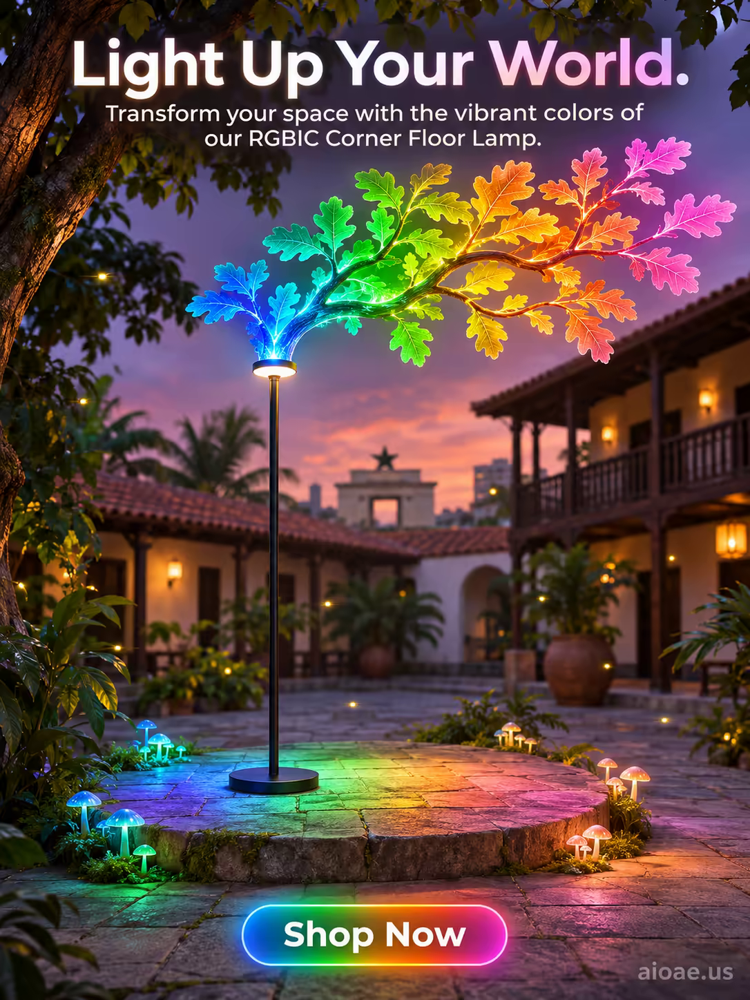

# 案例 150：RGBIC 角落落地燈：點亮你的世界 | Case 150: RGBIC Corner Floor Lamp Light Up Your World



黃昏魔法森林庭院中央，細長落地燈如活樹般伸展，燈頭長出發光的橡樹枝，葉片從深藍漸變到綠、琥珀、粉紅，螢火蟲與發光蘑菇環繞，奇幻沉浸的燈具海報。

An RGBIC corner floor lamp stands like a living tree in a magical forest courtyard at dusk, a luminous oak branch growing from its light head, leaves glowing in a gradient from deep blue to green, amber and soft pink; fantastical and immersive.

## 完整提示詞 / Full Prompt

```
SUBJECT: RGBIC Corner Floor Lamp with a tall, slender pole and a soft, diffused light head

SCENE: In a magical forest courtyard at dusk, the RGBIC Corner Floor Lamp stands at the center of a circular stone platform, its tall, slender pole reaching upward like a living tree. From its light head, a luminous, bioluminescent oak branch grows outward, its leaves glowing in a gradient of RGB colors—deep blue at the base, transitioning to vibrant green, warm amber, and finally soft pink at the tips. The glowing leaves cast a warm, colorful light onto the surrounding stone tiles, creating a mesmerizing, otherworldly atmosphere. Around the platform, small, glowing mushrooms and fireflies float gently in the air, adding to the enchanted ambiance. In the background, the silhouette of a traditional Accra courtyard with wooden balconies and terracotta roofs is visible, softly illuminated by the lamp's colorful glow.

STYLE & LIGHT: Fantastical realism with vibrant RGB colors and soft, diffused lighting, creating a magical, immersive atmosphere.

CAMERA: Wide-angle lens, slightly elevated, capturing the full lamp and the glowing oak branch with a shallow depth of field that keeps the lamp and its luminous leaves sharply in focus while softly blurring the background courtyard.

ON-IMAGE TEXT: headline "Light Up Your World."; subheadline "Transform your space with the vibrant colors of our RGBIC Corner Floor Lamp."; CTA "Shop Now".

WATERMARK: Add the exact text "aioae.us" in the bottom-right corner at 70% transparency (30% opacity), with enough contrast to remain readable.
```

## 適用模型 / Recommended Models

擅長產品海報、奇幻光效與圖中文字渲染的模型：GPT Image（Image2）、Flux Pro、Ideogram（標語須逐字渲染）。

Models strong at product posters, fantasy lighting and in-image text: GPT Image (Image2), Flux Pro, Ideogram (the headline must render verbatim).

## 修改說明 / How to Adapt

- 換產品：落地燈換成檯燈或吊燈，SUBJECT 與 SCENE 首句一起換，發光樹枝意象保留。
- 換色階：藍綠琥珀粉的漸變換成紫藍銀或暖金紅，SCENE 的葉片漸變描寫整組換。
- 換文案：主標語 "Light Up Your World." 換成其他賣點，副標題與 CTA 同步改。

- Change the product: swap the floor lamp for a table lamp or pendant light; rewrite SUBJECT and the first sentence of SCENE together, keep the glowing-branch idea.
- Change the colour gradient: swap the blue-green-amber-pink gradient for purple-blue-silver or warm gold-red, rewriting the leaf-gradient passage in SCENE as a set.
- Change the copy: swap the "Light Up Your World." headline for another selling point, and update the subheadline and CTA to match.

---
直達本案例 / Direct link: https://aioae.us/prompt?title=RGBIC%20Corner%20Floor%20Lamp%20Light%20Up%20Your%20World
更多同類提示詞 / More prompts like this: [AIOAE 免費 AI 圖片提示詞庫](https://aioae.us/prompts)
