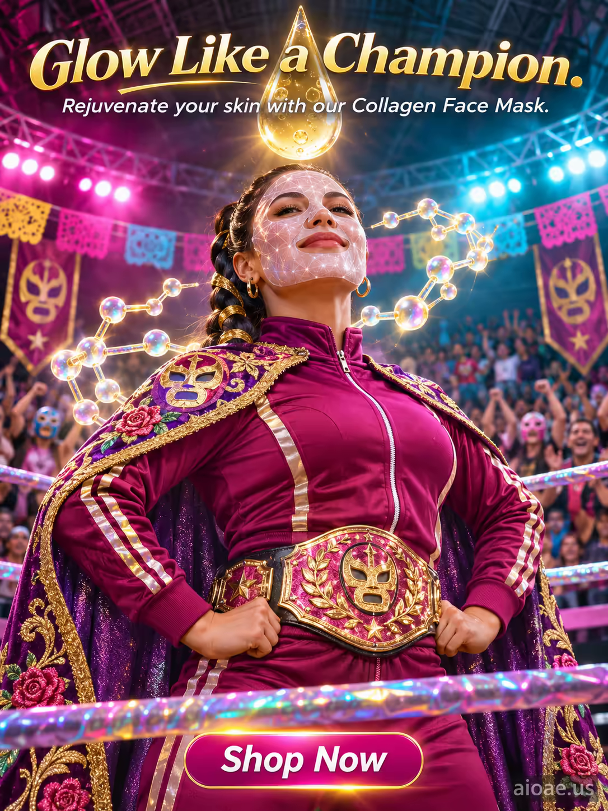

# 案例 151：膠原蛋白面膜：像冠軍一樣發光 | Case 151: Collagen Face Mask Glow Like a Champion



墨西哥摔角擂台中央，戴著晶格紋面膜的女子面龐水光發亮，漂浮的膠原分子形成光暈，頭頂一顆巨大半透明膠原水滴灑下金光，披風飛揚，力量與優雅並存的超現實產品海報。

A woman wearing a collagen face mask stands at the center of a vibrant Lucha Libre wrestling ring, her face glowing dewy, floating collagen molecules swirling around her, a giant translucent droplet hovering above; powerful and elegant.

## 完整提示詞 / Full Prompt

```
SUBJECT: Collagen Face Mask with a white sheet mask featuring a crystalline lattice pattern

SCENE: On a vibrant Lucha Libre wrestling ring, a woman wearing the Collagen Face Mask stands at the center, her face glowing with a radiant, dewy finish. The mask's crystalline lattice pattern shimmers under the bright arena lights, reflecting the colorful banners and cheering crowd in the background. Around her, floating collagen molecules form a luminous, swirling aura, while a large, translucent collagen droplet hovers above her head, casting a soft, golden light onto her skin. The wrestler's cape, adorned with intricate, glowing patterns, billows dramatically behind her, adding a sense of power and elegance to the scene. The ring's ropes are wrapped in shimmering, iridescent fabric that catches the light, creating a dynamic, energetic atmosphere.

STYLE & LIGHT: Hyper-realistic with vibrant, saturated colors and dramatic arena lighting, emphasizing the glowing, dewy texture of the mask and the wrestler's powerful presence.

CAMERA: Wide-angle lens, low angle, capturing the full scene of the wrestling ring and the woman at its center with a shallow depth of field that keeps the mask and her face sharply in focus while softly blurring the cheering crowd in the background.

ON-IMAGE TEXT: headline "Glow Like a Champion."; subheadline "Rejuvenate your skin with our Collagen Face Mask."; CTA "Shop Now".

WATERMARK: Add the exact text "aioae.us" in the bottom-right corner at 70% transparency (30% opacity), with enough contrast to remain readable.
```

## 適用模型 / Recommended Models

擅長產品海報、超寫實人像與圖中文字渲染的模型：GPT Image（Image2）、Flux Pro、Ideogram（標語須逐字渲染）。

Models strong at product posters, hyper-realistic portraits and in-image text: GPT Image (Image2), Flux Pro, Ideogram (the headline must render verbatim).

## 修改說明 / How to Adapt

- 換場景：摔角擂台換成伸展台或健身房，SCENE 的場地與人群描寫整組換，面膜光暈意象保留。
- 換產品：膠原面膜換成精華液或防曬乳，SUBJECT 與膠原分子的描寫一起換。
- 換文案：主標語 "Glow Like a Champion." 換成其他賣點，副標題與 CTA 同步改。

- Change the setting: swap the wrestling ring for a runway or gym, rewriting the venue and crowd description in SCENE as a set, keep the glowing-mask aura.
- Change the product: swap the collagen mask for a serum or sunscreen; rewrite SUBJECT and the collagen-molecule description together.
- Change the copy: swap the "Glow Like a Champion." headline for another selling point, and update the subheadline and CTA to match.

---
直達本案例 / Direct link: https://aioae.us/prompt?title=Collagen%20Face%20Mask%20Glow%20Like%20a%20Champion
更多同類提示詞 / More prompts like this: [AIOAE 免費 AI 圖片提示詞庫](https://aioae.us/prompts)
