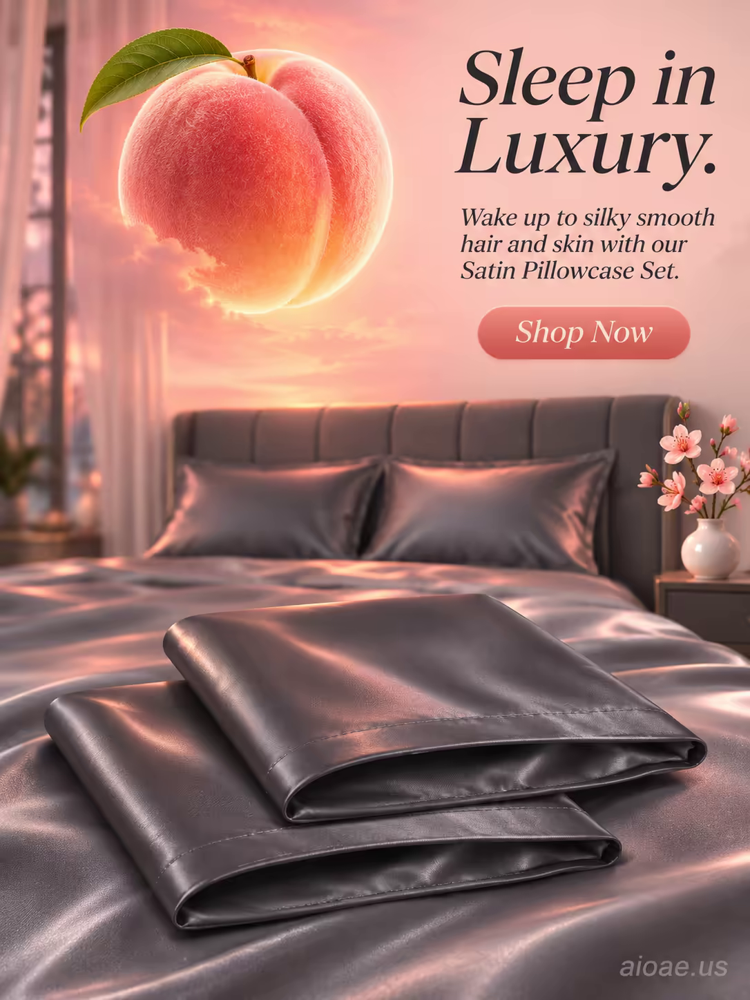

# 案例 152：緞面枕套套裝：奢華入眠 | Case 152: Satin Pillowcase Set Sleep in Luxury



寧靜臥室裡，石墨灰緞面枕套躺在絲綢床鋪上，床頭上方漂浮一顆發光的蜜桃，如暖陽般灑下粉橘光暈，床頭小花瓶點綴桃花，夢幻、舒適又奢華。

A satin pillowcase set lies on a silk-covered bed in a serene bedroom, a large glowing peach floating above like a warm sunset, its peach-pink light casting a gentle halo on the satin; dreamy, cozy and luxurious.

## 完整提示詞 / Full Prompt

```
SUBJECT: Satin Pillowcase Set with two graphite grey pillowcases folded in the foreground

SCENE: In a serene bedroom, the satin pillowcase set lies on a silk-covered bed with an illuminated graphite-grey headboard in the background, where a large glowing peach-pink peach floats gently above the bed like a warm sunset. The pillowcases shimmer softly under the light, their silk fabric reflecting the peach glow, creating a dreamy, cozy atmosphere. A small white porcelain vase with peach blossoms sits on the bedside table to the right, adding a touch of natural elegance. The peach's warm light casts a gentle halo on the pillowcases and the surrounding bedding, emphasizing the luxurious, smooth texture of the satin.

STYLE & LIGHT: Soft, warm, dreamy realism with a peach-pink glow and silky highlights on the satin fabric, creating a cozy and inviting atmosphere.

CAMERA: Wide-angle lens, eye-level, capturing the full bed and the glowing peach above it with a shallow depth of field that keeps the pillowcases and peach sharply in focus while softly blurring the background.

ON-IMAGE TEXT: headline "Sleep in Luxury."; subheadline "Wake up to silky smooth hair and skin with our Satin Pillowcase Set."; CTA "Shop Now".

WATERMARK: Add the exact text "aioae.us" in the bottom-right corner at 70% transparency (30% opacity), with enough contrast to remain readable.
```

## 適用模型 / Recommended Models

擅長產品海報、柔光質感與圖中文字渲染的模型：GPT Image（Image2）、Flux Pro、Ideogram（標語須逐字渲染）。

Models strong at product posters, soft-light texture and in-image text: GPT Image (Image2), Flux Pro, Ideogram (the headline must render verbatim).

## 修改說明 / How to Adapt

- 換顏色：石墨灰換成香檳金或霧藍，SUBJECT 與床頭板的顏色描寫一起換。
- 換漂浮物：發光蜜桃換成發光月亮或水晶球，SCENE 的漂浮物與光暈描寫整組換。
- 換文案：主標語 "Sleep in Luxury." 換成其他賣點，副標題與 CTA 同步改。

- Change the colour: swap graphite grey for champagne gold or misty blue, and update the colour description in SUBJECT and the headboard together.
- Change the floating object: swap the glowing peach for a glowing moon or crystal orb, rewriting the floating-object and halo description in SCENE as a set.
- Change the copy: swap the "Sleep in Luxury." headline for another selling point, and update the subheadline and CTA to match.

---
直達本案例 / Direct link: https://aioae.us/prompt?title=Satin%20Pillowcase%20Set%20Sleep%20in%20Luxury
更多同類提示詞 / More prompts like this: [AIOAE 免費 AI 圖片提示詞庫](https://aioae.us/prompts)
