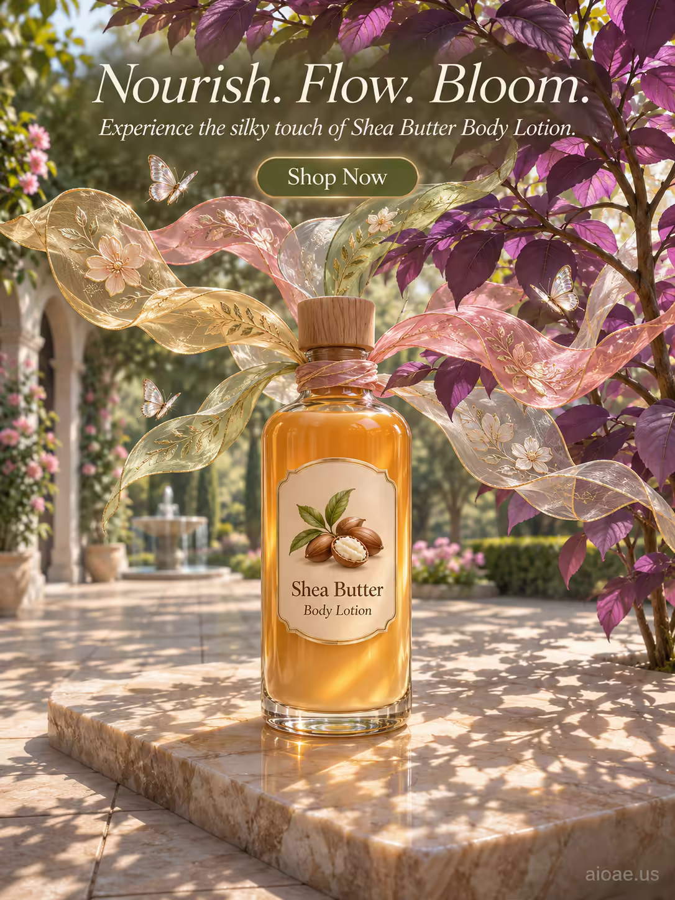

# 案例 153：乳木果身體乳：滋養、流動、綻放 | Case 153: Shea Butter Body Lotion Nourish Flow Bloom



陽光石板庭院裡，透明玻璃乳液瓶立於拋光石板中央，瓶頸綻出絲綢刺繡花瓣，織成透光花棚，半透明蝴蝶輕舞其間，寫實與超現實交融的柔美產品海報。

A clear-glass shea butter lotion bottle stands on a polished stone slab in a sunlit courtyard, silk-embroidered petals unfurling from its neck into a translucent canopy, tiny butterflies hovering; a realistic-surreal blend with soft daylight.

## 完整提示詞 / Full Prompt

```
SUBJECT: Shea Butter Body Lotion bottle with clear glass and wooden cork cap

SCENE: In a sunlit courtyard of stone tiles, the lotion bottle stands centered on a polished stone slab. From its neck, silk-embroidered petals in muted gold, willow green, blush pink and pearl grey unfurl upward, weaving through a tall violet-leafed plant on the right and forming a translucent canopy that filters dappled daylight onto the stone. Tiny translucent butterflies hover around the floating petals, adding gentle motion. The filtered light creates a soft glow on the bottle's amber lotion and casts delicate shadows on the surrounding tiles, emphasizing the silky texture.

STYLE & LIGHT: A realistic-surreal blend with soft natural daylight, muted luxury colors, and fine silk texture that catches subtle highlights.

CAMERA: Wide-angle lens, slightly elevated, capturing the full bottle and petal canopy with shallow depth of field that blurs the distant garden while keeping the bottle and petals sharply in focus.

ON-IMAGE TEXT: headline "Nourish. Flow. Bloom."; subheadline "Experience the silky touch of Shea Butter Body Lotion."; CTA "Shop Now".

WATERMARK: Add the exact text "aioae.us" in the bottom-right corner at 70% transparency (30% opacity), with enough contrast to remain readable.
```

## 適用模型 / Recommended Models

擅長產品海報、細膩質感與圖中文字渲染的模型：GPT Image（Image2）、Flux Pro、Ideogram（標語須逐字渲染）。

Models strong at product posters, fine textures and in-image text: GPT Image (Image2), Flux Pro, Ideogram (the headline must render verbatim).

## 修改說明 / How to Adapt

- 換產品：身體乳換成香水或護手霜，SUBJECT 與瓶身描寫一起換，花瓣棚意象保留。
- 換花瓣配色：金、柳綠、粉、珍珠灰換成薰衣草紫或海洋藍，SCENE 的花瓣顏色整組換。
- 換文案：主標語 "Nourish. Flow. Bloom." 換成其他賣點，副標題與 CTA 同步改。

- Change the product: swap the body lotion for a perfume or hand cream; rewrite SUBJECT and the bottle description together, keep the petal canopy.
- Change the petal palette: swap muted gold, willow green, blush pink and pearl grey for lavender purple or ocean blue, rewriting the petal colours in SCENE as a set.
- Change the copy: swap the "Nourish. Flow. Bloom." headline for another selling point, and update the subheadline and CTA to match.

---
直達本案例 / Direct link: https://aioae.us/prompt?title=Shea%20Butter%20Body%20Lotion%20Nourish%20Flow%20Bloom
更多同類提示詞 / More prompts like this: [AIOAE 免費 AI 圖片提示詞庫](https://aioae.us/prompts)
