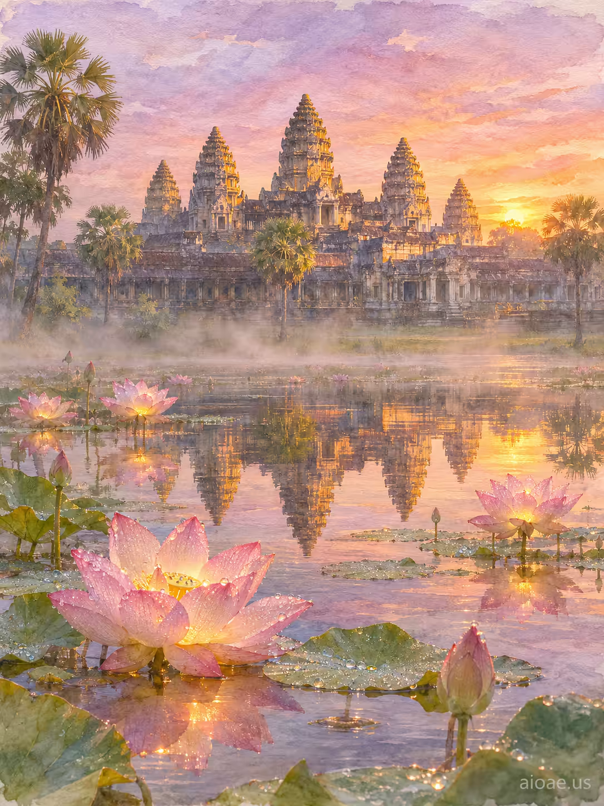

# 案例 154：吳哥窟日出蓮花池 | Case 154: Angkor Wat Sunrise Lotus Pond



黎明第一道光灑落吳哥窟，五座塔尖燃起琥珀色，薄霧自蓮花池升起，熱氣把水汽化作露珠落在蓮瓣上，花朵綻放出金色微光，倒映水面如一面燦爛鏡子；超寫實水彩、粉彩色調。

At dawn, first light spills over Angkor Wat, its five towers catching fire in amber, mist lifting from the lotus pond, lotus flowers unfurling with a soft golden glow that mirrors on the water; hyperrealistic watercolor with delicate pastel tones.

## 完整提示詞 / Full Prompt

```
SUBJECT: Angkor Wat sunrise, lotus pond, five towers, mist

SCENE: At dawn, the first light of sunrise spills over Angkor Wat, its five towers catching fire in amber, while a veil of mist lifts from the lotus pond; the heat transforms the lingering vapor into shimmering droplets that settle on each lotus petal, causing the flowers to unfurl and emit a soft, golden glow that reflects on the water's surface, turning the pond into a radiant mirror of the temple's silhouette.

STYLE & LIGHT: Rendered in hyperrealistic watercolor style with delicate pastel tones.

CAMERA: Captured with a full‑frame camera using a 35mm lens at f/2.0, ISO 100, and a slow shutter to capture the gentle glow.

WATERMARK: Add the exact text "aioae.us" in the bottom-right corner at 70% transparency (30% opacity), with enough contrast to remain readable.
```

## 適用模型 / Recommended Models

擅長寫實風景、水彩質感與晨光氛圍的模型：GPT Image（Image2）、Flux Pro、Midjourney（建議加 `--ar 3:4`）。

Models strong at realistic landscapes, watercolor texture and dawn light: GPT Image (Image2), Flux Pro, Midjourney (add `--ar 3:4`).

## 修改說明 / How to Adapt

- 換時段：日出換成黃昏或月夜，SCENE 的光線與 STYLE & LIGHT 的色調整組換。
- 換主體：蓮花池換成荷花或睡蓮，SCENE 的花朵描寫跟著換，倒影意象保留。
- 換畫風：超寫實水彩換成油畫或攝影寫實，STYLE & LIGHT 整段換。

- Change the time of day: swap sunrise for dusk or moonlight, rewriting the light in SCENE and the tones in STYLE & LIGHT as a set.
- Change the flowers: swap lotus for water lilies, updating the flower description in SCENE while keeping the mirror-reflection idea.
- Change the art style: swap hyperrealistic watercolor for oil painting or photographic realism; rewrite STYLE & LIGHT as a set.

---
直達本案例 / Direct link: https://aioae.us/prompt?title=Angkor%20Wat%20Sunrise%20Lotus%20Pond
更多同類提示詞 / More prompts like this: [AIOAE 免費 AI 圖片提示詞庫](https://aioae.us/prompts)
