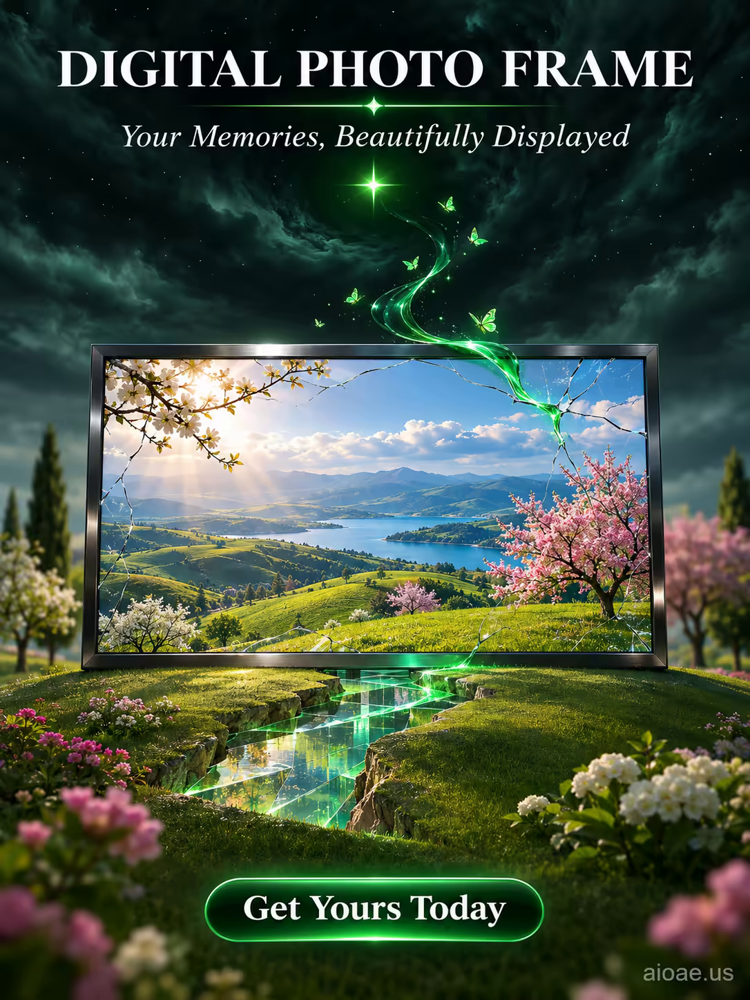

# 案例 155：數位相框：美好回憶美麗呈現 | Case 155: Digital Photo Frame Your Memories Beautifully Displayed



超現實夢境風：數位相框立於開裂的山丘頂端，裂縫中湧出翠綠液態光，螢光蝴蝶飛舞，暗夜裡一顆綠星如眼注視；照片中的陽光山水與現實世界交融。

Surreal dreamscape: a digital photo frame crowns a cracked hilltop, emerald liquid light pouring from the cracks in its screen, glowing butterflies drifting up, a single green star watching like an eye; the sunlit landscape inside the photograph spills into the real world.

## 完整提示詞 / Full Prompt

```
SCENE: A vast, rolling garden with a central hill that seems to have cracked open, revealing a vibrant, gleaming glass surface. The digital photo frame — a sleek, large-format screen made of polished dark steel — is placed on the very top of the hill, its back barely visible, its front displaying a cracked photograph. A swirling, bright-green liquid light rises slowly from the cracks in the image's surface, like a slow-moving river, and curls up toward the dark sky. The liquid glints with an emerald light, and tiny, glowing green butterflies flutter around it. The dark, curling sky above carries dozens of dead stars and one bright green star that glows brightly, like a single eye above the frame, watching the light. The photograph itself is a rich, sun-drenched landscape — rolling olive-green hills, a distant lake, and a few trees in full bloom — but it has been cracked at its edges, like glass, allowing the luminous green liquid glow to leak out and into the real world. The frame's display is larger than life, taller than the trees, and the digital screen pulses with an eerie, beautiful light.

SUBJECT: Digital Photo Frame — a large, sleek screen made of polished dark steel — on the top of a rolling hill, displaying a cracked, sun-drenched landscape photograph with bright-green liquid light rising from its cracks.

STYLE & LIGHT: A vast, rolling garden in luminous green and dark, curling skies. A dreamlike, surreal digital-natural hybrid — dead stars and a single bright green star in a dark sky, and a photo frame with cracked glass that glows emerald-green. Mood is serene, contemplative and slightly mysterious.

CAMERA: Straight-on shot at eye level, 50mm lens; focus is sharp on the photo frame and the cracked photograph, while the rolling green garden blurs softly into the background, the frame's screen dominating the frame like a doorway into a digital landscape.

ON-IMAGE TEXT: headline "DIGITAL PHOTO FRAME"; subheadline "Your Memories, Beautifully Displayed"; CTA "Get Yours Today"

WATERMARK: Add the exact text "aioae.us" in the bottom-right corner at 70% transparency (30% opacity), with enough contrast to remain readable.
```

## 適用模型 / Recommended Models

擅長超現實場景、產品主體與夢境光影的模型：GPT Image（Image2）、Flux Pro、Midjourney（建議加 `--ar 3:4`）。

Models strong at surreal scenes, hero products and dreamlike light: GPT Image (Image2), Flux Pro, Midjourney (add `--ar 3:4`).

## 修改說明 / How to Adapt

- 換照片內容：把 SCENE 裡的照片風景換成海邊或城市夜景，裂縫與液態光的設定不用動。
- 換光色：翠綠液態光換成金色或冰藍，STYLE & LIGHT 的綠色描寫跟著整組換。
- 換畫面比例：直式海報改橫式時，把 CAMERA 的 50mm 平視改成廣角，山丘與相框的比例跟著調。

- Change the photo content: swap the landscape in SCENE for a seaside or city nightscape; keep the cracked-glass and liquid-light setup.
- Change the light colour: swap the emerald liquid light for gold or ice blue, rewriting the green descriptions in STYLE & LIGHT as a set.
- Change the aspect ratio: for a landscape poster, swap the 50mm eye-level CAMERA for a wide angle and adjust the hill-to-frame proportions.

---
直達本案例 / Direct link: https://aioae.us/prompt?title=Digital%20Photo%20Frame%20Your%20Memories%20Beautifully%20Displayed
更多同類提示詞 / More prompts like this: [AIOAE 免費 AI 圖片提示詞庫](https://aioae.us/prompts)
