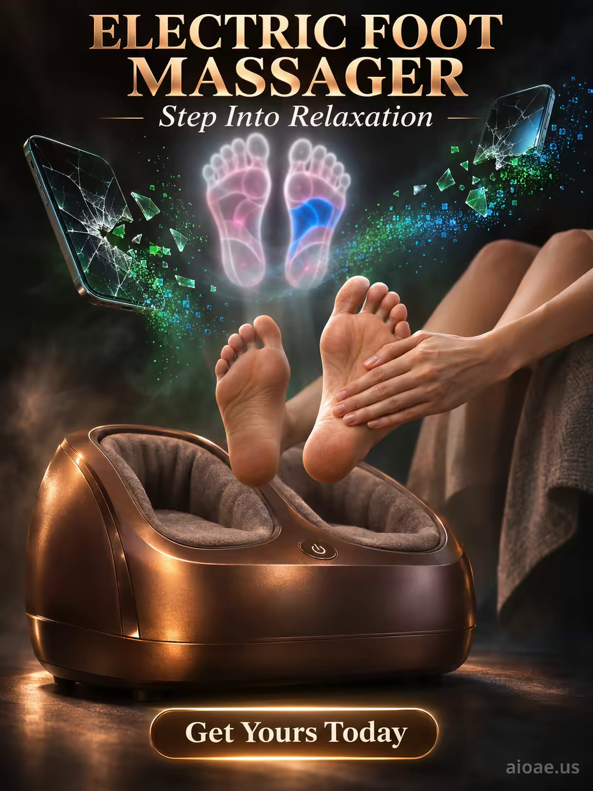

# 案例 156：電動足部按摩器：踏入放鬆 | Case 156: Electric Foot Massager Step Into Relaxation



明暗對比的超現實電商海報：古銅色足部按摩器浮於深黑虛空，碎裂的手機螢幕化作綠藍光粒，半透明的足部線路圖在頭頂發光，溫暖的手掌揉按雙足，數位崩解中透出身體的暖意。

A chiaroscuro surreal e-commerce poster: a bronze foot massager floats in a dark void, shattered smartphone screens dissolving into green-blue particles, a ghostly foot schematic glowing overhead, warm hands massaging bare feet — physical comfort rising out of digital decay.

## 完整提示詞 / Full Prompt

```
SUBJECT: A large, cushioned electric foot massager near the center-left of the frame — a deep bronze device glowing with a faint warm light — around and above it, a dense, textured cloud of small, shattered smartphone screens is floating, each one breaking apart into clean, sharp, green-tinted fragments. The massager, as the main subject, stands against a background of deep, cavernous darkness, its cushions coated in a layer of fine, ash-grey dust. Hovering in the blackness around the device is a luminous, ghostly pattern — white-and-pink technical lines forming a schematic of a human foot, each line pulsing with light, and a single, distinct patch of saturated, intense blue. Human hand, with long fingers, rubs and massages the soles of bare feet, glowing with soft, warm light.

SCENE: In a dark, digital void, the electric foot massager sits at the center-left, surrounded by floating fragments of shattered smartphone screens that dissolve into glowing green and blue particles — digital decay, splitting and reforming like data flowing across the void. Above the device, the ghostly technical schematic of a human foot is the only source of light, its white and pink lines pulsing and the single patch of brilliant blue drawing the eye. The hand, glowing with warm light, massages a pair of bare feet in the foreground, the feet rising from the massager as if carried upward by the flow of particles — physical comfort emerging from digital dissolution. The scene is lit by chiaroscuro — deep, cavernous darkness against the glow of the device, the schematic, and the hand.

STYLE & LIGHT: Chiaroscuro — the deep, velvety black of the void against the warm bronze of the device and the cold glow of the digital fragments. Texture is dusty ash-grey and shattered-glass fragments, light is soft and hazy, and the style is surreal, intimate and dreamlike, with the contrast between analog warmth and digital decay creating a strange, captivating tension.

CAMERA: Straight-on shot at eye level, 35mm lens; focus is sharp on the foot massager, the human hand and the bare feet, while the floating smartphone fragments and the schematic of the foot blur into a luminous, indistinct glow.

ON-IMAGE TEXT: headline "ELECTRIC FOOT MASSAGER"; subheadline "Step Into Relaxation"; CTA "Get Yours Today"

WATERMARK: Add the exact text "aioae.us" in the bottom-right corner at 70% transparency (30% opacity), with enough contrast to remain readable.
```

## 適用模型 / Recommended Models

擅長明暗對比、產品特寫與超現實氛圍的模型：GPT Image（Image2）、Flux Pro、Midjourney（建議加 `--ar 3:4`）。

Models strong at chiaroscuro, product close-ups and surreal mood: GPT Image (Image2), Flux Pro, Midjourney (add `--ar 3:4`).

## 修改說明 / How to Adapt

- 換產品：足部按摩器換成肩頸按摩儀，SUBJECT 的足部線路圖改成對應部位的示意圖。
- 換背景氛圍：深黑虛空換成暖色家居，STYLE & LIGHT 的明暗對比改成柔光。
- 換碎裂元素：碎手機螢幕換成碎時鐘或碎鏡面，SCENE 的光粒顏色跟著換。

- Change the product: swap the foot massager for a neck-and-shoulder massager, replacing the foot schematic in SUBJECT with the matching body-part diagram.
- Change the backdrop: swap the dark void for a warm home interior, softening the chiaroscuro in STYLE & LIGHT into gentle light.
- Change the shattering element: swap the broken phone screens for a shattered clock or mirror, updating the particle colours in SCENE.

---
直達本案例 / Direct link: https://aioae.us/prompt?title=Electric%20Foot%20Massager%20Step%20Into%20Relaxation
更多同類提示詞 / More prompts like this: [AIOAE 免費 AI 圖片提示詞庫](https://aioae.us/prompts)
