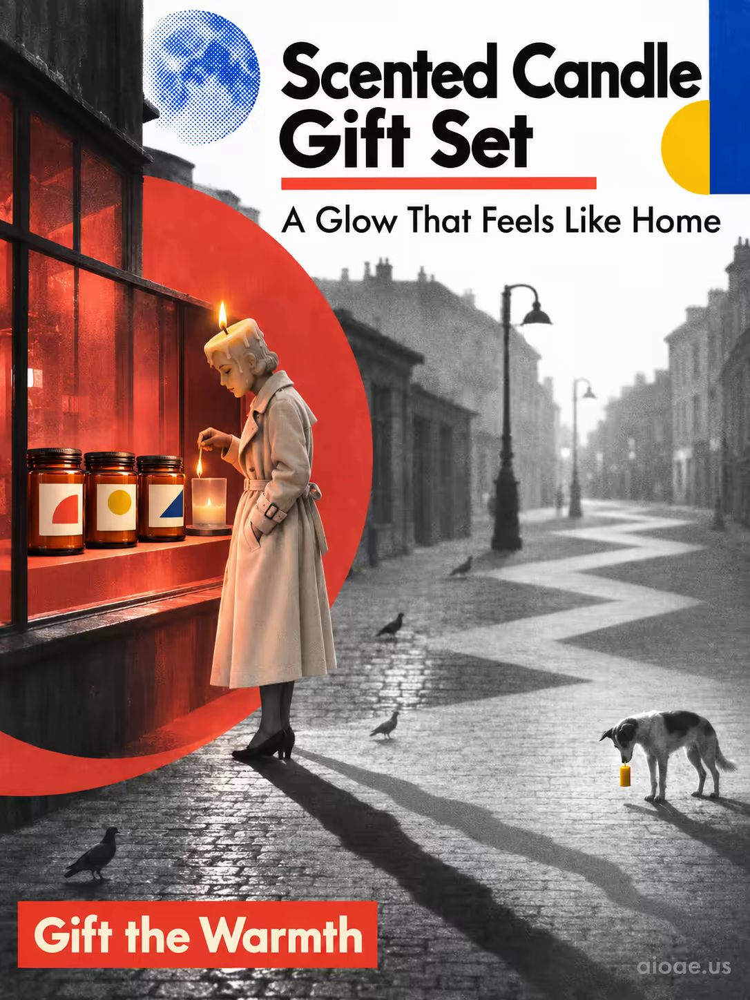

# 案例 158：香薰蠟燭禮盒：家的溫暖微光 | Case 158: Scented Candle Gift Set A Glow That Feels Like Home



包浩斯拼貼風：黑白街景中一輪藍色半調月亮、珊瑚紅建築與金黃燭光並置，燭形小販在櫥窗前點亮一支蠟燭，三隻琥珀玻璃燭罐坐在窗台上，長長的影子在之字形街道上奔跑。

Bauhaus collage: a black-and-white street under a blue halftone moon, coral-red architecture and golden candlelight, a candle-shaped vendor lighting a single flame by a shop window, three amber jars on the sill, long shadows racing down a zigzag street.

## 完整提示詞 / Full Prompt

```
SCENE: Bauhaus — a Brassaï-inspired black-and-white city portrait in sharp, geometric light. A deep primary-blue halftone moon in the upper left glows against the true white sky, shining cold light on a coral-red Bauhaus building. A candle-shaped street vendor, draped in a cream-colored trench coat, stands by a shop window at dawn, lighting a single candle in a small glass jar. Its flame, a small point of golden-yellow light, splits her shadow into two: a deep charcoal-black silhouette and a faint grey one, the long shadows racing down the zigzagging street toward the bottom-right corner, where a dog holds a golden-yellow candle in its mouth, staring at the second shadow. The candle's jar is frosted glass with a warm, amber glow, its flame half-drawn, the wax half-melted, the scent of rose and musk hanging in the air. A red circle in the lower left frames the vendor — "directly in front of a Scented Candle Gift Set" — and the set, three amber-glass jars with cream labels, sits on the windowsill behind her, lit by the same golden flame. The moon above casts no light on the jars — red lights and the warm glow of the candle's flame illuminate the scene. Pigeons dot the shadow on the street, where their silhouettes dance.

SUBJECT: Scented Candle Gift Set (three amber-glass jars with cream labels) perched on a Bauhaus windowsill at dawn, lit by a single small golden-yellow flame.

STYLE & LIGHT: High-contrast Bauhaus halftone — primary blue, coral red, deep charcoal-black, true white, cream and golden-yellow, with the warm amber glow of the candle contrasting the cold moonlight. Geometric composition, sharp edges, and dramatic split shadows define the style.

CAMERA: Full-frame Bauhaus layout — three amber-glass jars on a windowsill, a candle-shaped vendor, and a distant dog with a candle — all arranged in a vertical composition. Wide-angle 35mm lens, sharp focus on the flame and the jars, with the street softly blurred into a geometric pattern of shadows.

TEXT: HEADLINE: "Scented Candle Gift Set"; SUBHEADLINE: "A Glow That Feels Like Home"; CTA: "Gift the Warmth"

WATERMARK: Add the exact text "aioae.us" in the bottom-right corner at 70% transparency (30% opacity), with enough contrast to remain readable.
```

## 適用模型 / Recommended Models

擅長包浩斯拼貼、高對比配色與街景的模型：GPT Image（Image2）、Flux Pro、Midjourney（建議加 `--ar 3:4`）。

Models strong at Bauhaus collage, high-contrast palettes and street scenes: GPT Image (Image2), Flux Pro, Midjourney (add `--ar 3:4`).

## 修改說明 / How to Adapt

- 換主色：珊瑚紅＋寶藍換成墨綠＋米白，STYLE & LIGHT 的包浩斯配色整組換。
- 換小販造型：燭形小販換成提燈人或花店老闆，SCENE 的角色與火焰描寫跟著換。
- 換動物：街角叼蠟燭的狗換成貓或鴿子，影子與構圖不用動。

- Change the palette: swap coral red and primary blue for deep green and cream, replacing the Bauhaus colours in STYLE & LIGHT as a set.
- Change the vendor: swap the candle-shaped vendor for a lantern bearer or florist, updating the character and flame in SCENE.
- Change the animal: swap the dog carrying a candle for a cat or pigeon; keep the shadows and composition.

---
直達本案例 / Direct link: https://aioae.us/prompt?title=Scented%20Candle%20Gift%20Set%20A%20Glow%20That%20Feels%20Like%20Home
更多同類提示詞 / More prompts like this: [AIOAE 免費 AI 圖片提示詞庫](https://aioae.us/prompts)
