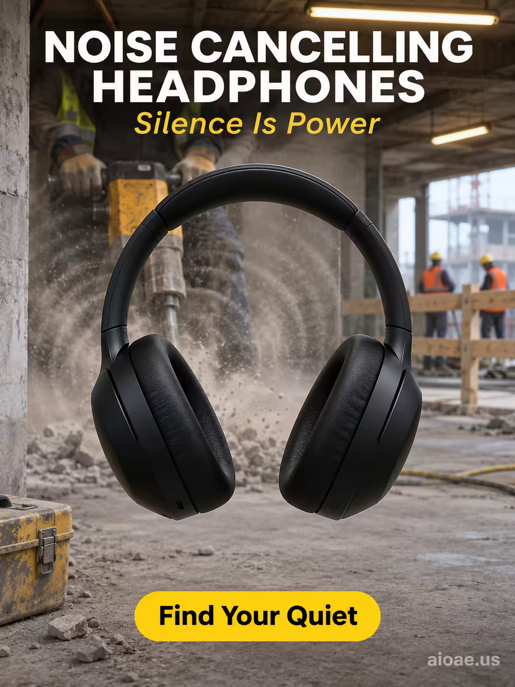

# 案例 160：降噪耳機：靜默即力量 | Case 160: Noise Cancelling Headphones Silence Is Power



工地現場的真實粗糲感：啞光黑降噪耳機懸於電鎬與塵霧之前，像一道「靜音牆」把喧囂擋在身後，暖黃日光燈與冷色天光交錯，唯有耳機處是一片安靜。

Raw, unfiltered construction-site realism: matte-black noise cancelling headphones hover before a jackhammer like a "silence wall", warm fluorescent light against cold daylight, the headphones the only pocket of quiet in the chaos.

## 完整提示詞 / Full Prompt

```
SUBJECT: Over-ear wireless noise cancelling headphones floating at the center of a raw construction site, positioned before a huge jackhammer.

SCENE: The headphones are positioned directly between the viewer and the jackhammer, creating a "silence wall" that separates the viewer's quiet perspective from the noisy chaotic environment beyond — the jackhammer is visible but appears powerless, its sound waves absorbed before reaching the headphones. Behind a wooden barrier, workers continue their noisy tasks in a dusty industrial haze, but their movement and clamor are silenced by the deep matte-black sound-absorbing headphones. Warm fluorescent light from overhead and cold daylight filtering through the construction-site opening highlight the headphones as the sole source of silence and calm in an otherwise chaotic environment.

STYLE & LIGHT: RAW, UNFILTERED — a candid, imperfect, real-world aesthetic; natural grain replaces polish, color palette is dirty industrial greys and yellows, broken by the deep matte-black of the headphones; warm fluorescent light from overhead and cold daylight through the site opening; lighting emphasizes quiet calm amid industrial chaos.

CAMERA: Straight-on shot at eye level; 50mm lens, f/1.8; focus is sharp on the headphones while the construction site beyond is softly blurred — the headphones are the sole source of silence.

ON-IMAGE TEXT: headline "NOISE CANCELLING HEADPHONES"; subheadline "Silence Is Power"; CTA "Find Your Quiet".

WATERMARK: Add the exact text "aioae.us" in the bottom-right corner at 70% transparency (30% opacity), with enough contrast to remain readable.
```

## 適用模型 / Recommended Models

擅長寫實攝影、工業場景與產品特寫的模型：GPT Image（Image2）、Flux Pro、Midjourney（建議加 `--ar 3:4`）。

Models strong at realistic photography, industrial scenes and product close-ups: GPT Image (Image2), Flux Pro, Midjourney (add `--ar 3:4`).

## 修改說明 / How to Adapt

- 換噪音源：電鎬工地換成機場跑道或搖滾舞台，SCENE 的背景噪音描寫跟著換。
- 換耳機顏色：啞光黑換成米白或亮銀，STYLE & LIGHT 的黑白對比跟著調。
- 換畫面比例：直式改橫式時，把 CAMERA 的 50mm 平視改成 35mm，工地縱深跟著拉開。

- Change the noise source: swap the jackhammer site for an airport runway or rock stage, updating the background noise in SCENE.
- Change the headphone colour: swap matte black for cream or bright silver, adjusting the contrast in STYLE & LIGHT.
- Change the aspect ratio: for a landscape frame, swap the 50mm eye-level CAMERA for 35mm and open up the site depth.

---
直達本案例 / Direct link: https://aioae.us/prompt?title=Noise%20Cancelling%20Headphones%20Silence%20Is%20Power
更多同類提示詞 / More prompts like this: [AIOAE 免費 AI 圖片提示詞庫](https://aioae.us/prompts)
