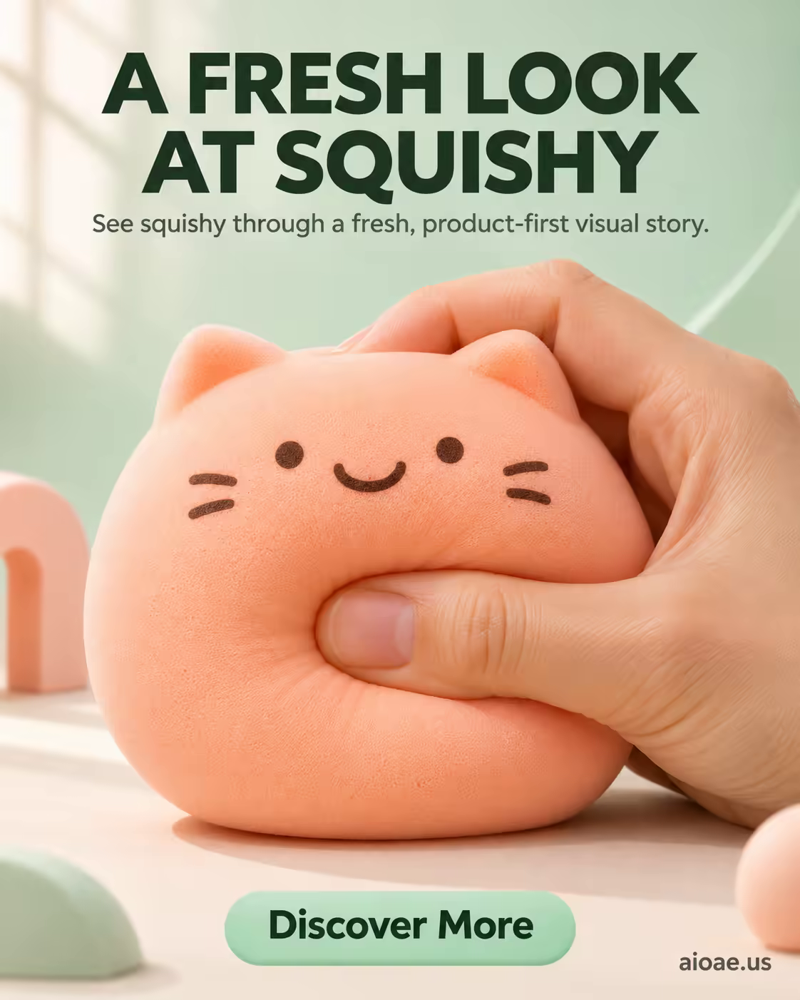

# 案例 162：蜜桃貓捏捏樂玩具海報新視角 | Case 162: A Fresh Look at Squishy Peach Cat Toy Poster



產品優先的電商海報模板：蜜桃色貓咪捏捏樂佔滿畫面中心，清新薄荷綠背景、柔光與留白讓產品觸感一目了然，標題、副標與 CTA 層次分明。

A product-first e-commerce poster template: a peach squishy cat toy dominates the frame, fresh mint-green background and soft light making its squeezable texture instantly readable, headline, subheadline and CTA in clear hierarchy.

## 完整提示詞 / Full Prompt

```
SUBJECT & IDEA: Squishy Toy Poster. Preserve named subject, requested relationships, main action and format.

HERO PRODUCT VISIBILITY: Keep squishy unambiguously dominant, large and readable. Preserve the actual form factor, function, silhouette, product identity and stated materials. Do not replace the product with a generic futuristic object or shrink it behind scenery.

PRODUCT VALUE STRATEGY: Distinctive product value — Make the product benefit visually understandable before decorative spectacle. Visible proof: clear product-function relationship; one visible cause-and-effect cue. Do not invent measurements or factual specifications.

PRODUCT ATMOSPHERE: visually clear, emotionally appropriate and benefit-led. Make the product benefit tangible through its real use context.. Use coherent lighting, materials and color that support this product.

SCENE: a coherent commercial setting grounded in the named product and its intended use. Maintain clear foreground, midground and background with a single coherent physical logic.

ON-IMAGE AD COPY: Exact headline "A FRESH LOOK AT SQUISHY"; exact subheadline "See squishy through a fresh, product-first visual story."; exact CTA "Discover More". Keep the lettering legible and organized in negative space. Distinct typographic scale and hierarchy; no other invented brand, prices or specifications. CAMPAIGN ATMOSPHERE & ART DIRECTION: Product-poster visual language: squishy. Preserve the exact hero product.

STYLE: coherent premium visual storytelling with readable subject geometry and motivated light. Lighting and color should respond to the actual setting rather than unrelated stock effects.

CAMERA: hero product dominates the frame, with legible details and controlled reflections. Preserve perspective and realistic scale.

WATERMARK: Add a small, subtle and readable "aioae.us" in the bottom-right corner.

AVOID: generic random genre backgrounds, contradictory lighting, product identity substitution, extra fingers, duplicate characters, disjointed composition, unintended copy and unsupported factual claims.
```

## 適用模型 / Recommended Models

擅長電商海報、產品主體與圖文排版的模型：GPT Image（Image2）、Flux Pro、Midjourney（建議加 `--ar 3:4`）。

Models strong at e-commerce posters, hero products and on-image copy layout: GPT Image (Image2), Flux Pro, Midjourney (add `--ar 3:4`).

## 修改說明 / How to Adapt

- 換產品：蜜桃貓捏捏樂換成其他造型捏捏樂（如兔子、熊掌），SUBJECT & IDEA 的產品描寫跟著換，構圖不用動。
- 換背景色：薄荷綠換成奶油黃或霧粉，STYLE 的配色跟著整組換。
- 換文案：標題、副標與 CTA 照 ON-IMAGE AD COPY 的格式換成自己的賣點，字級層次保留。

- Change the product: swap the peach cat squishy for another squishy shape (rabbit, bear paw), updating the product description in SUBJECT & IDEA; keep the composition.
- Change the background colour: swap mint green for cream yellow or misty pink, replacing the palette in STYLE as a set.
- Change the copy: swap the headline, subheadline and CTA in ON-IMAGE AD COPY for your own selling points, keeping the type hierarchy.

---
直達本案例 / Direct link: https://aioae.us/prompt?title=A%20Fresh%20Look%20at%20Squishy%20Peach%20Cat%20Toy%20Poster
更多同類提示詞 / More prompts like this: [AIOAE 免費 AI 圖片提示詞庫](https://aioae.us/prompts)
