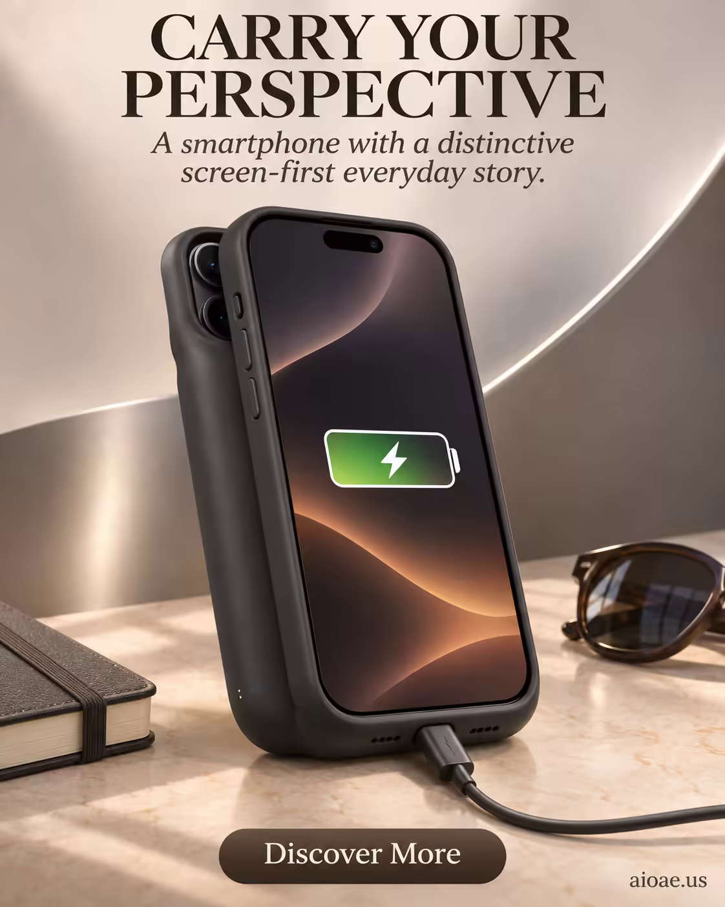

# 案例 163：隨身視角：充電手機殼海報 | Case 163: Carry Your Perspective Charging Phone Case Poster



產品優先的電商海報模板：黑色充電手機殼與亮起充電圖示的手機立於大理石桌面，暖棕光影與墨鏡、筆記本構成日常場景，強調隨身、耐用的生活感。

A product-first e-commerce poster template: a black charging phone case and a phone showing its charging icon stand on a marble desktop, warm brown light with sunglasses and a notebook staging an everyday scene of portable, durable use.

## 完整提示詞 / Full Prompt

```
SUBJECT & IDEA: Charging Phone Case Poster. Preserve named subject, requested relationships, main action and format.

HERO PRODUCT VISIBILITY: Keep smartphone unambiguously dominant, large and readable. Preserve the actual form factor, function, silhouette, product identity and stated materials. Do not replace the product with a generic futuristic object or shrink it behind scenery.

PRODUCT VALUE STRATEGY: Everyday versatility — Make the device feel capable across many daily contexts without inventing specifications. Visible proof: clear hero silhouette; multiple functional cues condensed into one coherent composition. Do not invent measurements or factual specifications.

PRODUCT ATMOSPHERE: visually clear, emotionally appropriate and benefit-led. Make the product benefit tangible through its real use context.. Use coherent lighting, materials and color that support this product.

SCENE: a coherent commercial setting grounded in the named product and its intended use. Maintain clear foreground, midground and background with a single coherent physical logic.

ON-IMAGE AD COPY: Exact headline "CARRY YOUR PERSPECTIVE"; exact subheadline "A smartphone with a distinctive screen-first everyday story."; exact CTA "Discover More". Keep the lettering legible and organized in negative space. Distinct typographic scale and hierarchy; no other invented brand, prices or specifications. CAMPAIGN ATMOSPHERE & ART DIRECTION: Product-poster visual language: smartphone. Preserve the exact hero product.

STYLE: coherent premium visual storytelling with readable subject geometry and motivated light. Lighting and color should respond to the actual setting rather than unrelated stock effects.

CAMERA: hero product dominates the frame, with legible details and controlled reflections. Preserve perspective and realistic scale.

WATERMARK: Add a small, subtle and readable "aioae.us" in the bottom-right corner.

AVOID: generic random genre backgrounds, contradictory lighting, product identity substitution, extra fingers, duplicate characters, disjointed composition, unintended copy and unsupported factual claims.
```

## 適用模型 / Recommended Models

擅長電商海報、產品主體與圖文排版的模型：GPT Image（Image2）、Flux Pro、Midjourney（建議加 `--ar 3:4`）。

Models strong at e-commerce posters, hero products and on-image copy layout: GPT Image (Image2), Flux Pro, Midjourney (add `--ar 3:4`).

## 修改說明 / How to Adapt

- 換產品：充電手機殼換成磁吸錢包或支架殼，HERO PRODUCT VISIBILITY 的產品描寫跟著換。
- 換場景：大理石桌面換成咖啡廳木桌或戶外野餐墊，SCENE 的日常物件跟著換。
- 換文案：標題、副標與 CTA 照 ON-IMAGE AD COPY 的格式換成自己的賣點，字級層次保留。

- Change the product: swap the charging phone case for a magnetic wallet or kickstand case, updating HERO PRODUCT VISIBILITY.
- Change the setting: swap the marble desktop for a cafe wooden table or picnic blanket, updating the everyday props in SCENE.
- Change the copy: swap the headline, subheadline and CTA in ON-IMAGE AD COPY for your own selling points, keeping the type hierarchy.

---
直達本案例 / Direct link: https://aioae.us/prompt?title=Carry%20Your%20Perspective%20Charging%20Phone%20Case%20Poster
更多同類提示詞 / More prompts like this: [AIOAE 免費 AI 圖片提示詞庫](https://aioae.us/prompts)
