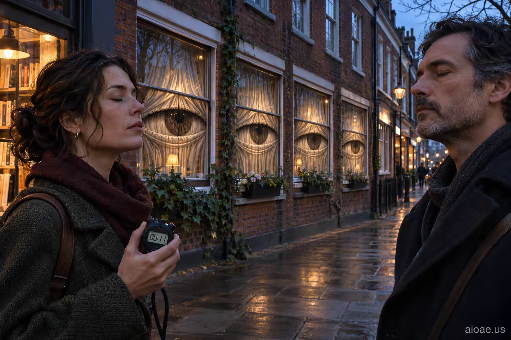

# 案例 164：當窗戶回望 | Case 164: When the Windows Watched Back



超現實電影感街景：黃昏磚牆老街上，每扇窗戶的窗簾後都睜著一隻巨眼，街角一男一女閉目而立，女子手握碼表，彷彿整條街都在注視他們的一次眨眼。

Surreal cinematic street scene: on a brick street at dusk, a giant eye opens behind every curtained window, while a man and a woman stand at the corner with eyes closed, the woman holding a stopwatch — as if the whole street is watching them blink.

## 完整提示詞 / Full Prompt

```
SUBJECT & IDEA: He blinks every eleven seconds, I counted; I blinked with him once and felt the whole street notice.. Preserve named subject, requested relationships, main action and format. Visual idea: Reimagine He blinks every eleven seconds, I counted; I blinked with him once and felt the whole street notice. through Background reveal: let an environmental element interrupt or comment on the subject's action through an impossible but physically readable transformation. Make the change prominent in the most visually prominent unlocked layer: subject-to-environment relationship, background behavior, scale, material or spatial structure; preserve explicit subject and action locks, and show how it affects the stated action rather than adding a separate visual idea. SCENE: one continuous believable setting suited to the subject and brief. Maintain clear foreground, midground and background with a single coherent physical logic. keep the core subject immediately readable before the surprise is decoded. Visible evidence: deliver one clear visual reveal that can be understood without explanatory clutter. STYLE: coherent premium visual storytelling with readable subject geometry and motivated light. Lighting and color should respond to the actual setting rather than unrelated stock effects. CAMERA: subject-first coherent perspective. Preserve the user-requested camera and crop; allow the selected mutation to alter apparent scale or perspective when that is its actual mechanism, and make the change physically legible. WATERMARK: Add a small, subtle and readable "aioae.us" in the bottom-right corner. AVOID: generic random genre backgrounds, contradictory lighting, product identity substitution, extra fingers, duplicate characters, disjointed composition, unintended copy and unsupported factual claims.
```

## 適用模型 / Recommended Models

擅長電影感街景、超現實氛圍與寫實人像的模型：GPT Image（Image2）、Flux Pro、Midjourney（建議加 `--ar 3:2`）。

Models strong at cinematic street scenes, surreal mood and realistic portraits: GPT Image (Image2), Flux Pro, Midjourney (add `--ar 3:2`).

## 修改說明 / How to Adapt

- 換地點：磚牆老街換成地鐵站或公寓走廊，SCENE 的窗戶改成對應的「眼睛」載體（如車窗、門縫）。
- 換計時道具：碼表換成懷錶或手機計時，女子手中的物件描寫跟著換。
- 換眨眼節奏：十一秒換成其他間隔，SUBJECT & IDEA 的第一句跟著改，街景的注視感保留。

- Change the location: swap the brick street for a subway station or apartment hallway, turning the windows in SCENE into matching "eye" carriers (train windows, door gaps).
- Change the timing prop: swap the stopwatch for a pocket watch or phone timer, updating the object in the woman's hand.
- Change the blink rhythm: swap eleven seconds for another interval, updating the first line of SUBJECT & IDEA; keep the street's watching gaze.

---
直達本案例 / Direct link: https://aioae.us/prompt?title=When%20the%20Windows%20Watched%20Back
更多同類提示詞 / More prompts like this: [AIOAE 免費 AI 圖片提示詞庫](https://aioae.us/prompts)
