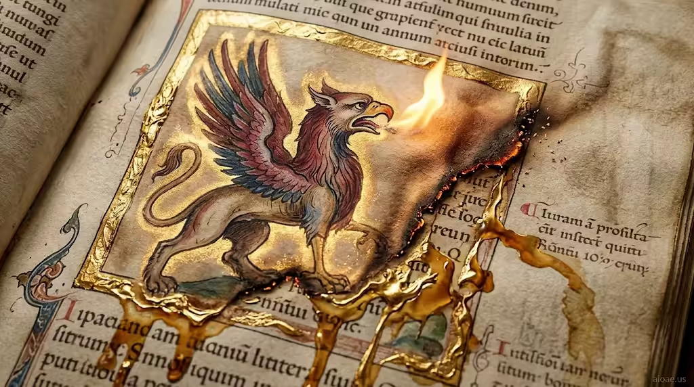

# 案例 166：中世紀動物誌：獅鷲手稿頁 | Case 166: Medieval Bestiary Creature Page



中世紀動物誌手稿風：獅鷲張口吐出火焰，灼燒羊皮紙邊緣，金箔邊框熔成液態金帶，整頁彷彿活了過來。

Medieval bestiary manuscript style: a griffin opens its beak and breathes flame, scorching the vellum margin while gold-leaf borders melt into liquid ribbons — the page feels alive.

## 完整提示詞 / Full Prompt

```
SUBJECT: Medieval Bestiary Creature Page

SCENE: The illuminated page shows a snarling griffin rendered in ink and watercolor; as its beak opens, the tip morphs into a flickering flame that sears the surrounding vellum, turning the nearby margin into a glowing ember trail. The heat causes the gold leaf borders to melt into liquid ribbons that cascade down the page, staining the parchment with molten amber and giving the creature a luminous aura that seems to breathe life into the manuscript.

STYLE & LIGHT: Rendered in illuminated manuscript style with gold leaf accents and muted earth tones.

CAMERA: A close-up, slightly angled view that captures the parchment texture and the creature’s transformation.

WATERMARK: Add the exact text "aioae.us" in the bottom-right corner at 90% transparency (10% opacity), with enough contrast to remain visible.
```

## 適用模型 / Recommended Models

擅長手稿插畫、金箔質感與奇幻生物的模型：GPT Image（Image2）、Flux Pro、Midjourney（建議加 `--ar 3:2`）。

Models strong at manuscript illustration, gold-leaf texture and fantasy creatures: GPT Image (Image2), Flux Pro, Midjourney (add `--ar 3:2`).

## 修改說明 / How to Adapt

- 換生物：獅鷲換成龍或獨角獸，SCENE 的火焰改成對應的吐息（冰霧、星光）。
- 換手稿年代：中世紀換成文藝復興或維京符文風，STYLE & LIGHT 的顏料與金箔描寫跟著換。
- 換火焰去向：火焰灼燒邊緣改成結冰或開花，羊皮紙的反應描寫跟著改。

- Swap the creature: replace the griffin with a dragon or unicorn, and change the flame in SCENE to a matching breath (frost mist, starlight).
- Change the manuscript era: swap medieval for Renaissance or Viking-rune style, updating the pigments and gold leaf in STYLE & LIGHT.
- Change what the breath does: swap the scorching flame for frost or blooming, updating how the parchment reacts.

---
直達本案例 / Direct link: https://aioae.us/prompt?title=Medieval%20Bestiary%20Creature%20Page
更多同類提示詞 / More prompts like this: [AIOAE 免費 AI 圖片提示詞庫](https://aioae.us/prompts)
