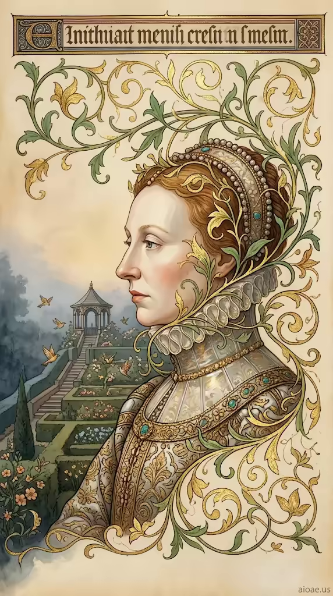

# 案例 167：伊莉莎白一世泥金手稿肖像 | Case 167: Queen Elizabeth I Illuminated Manuscript Portrait



都鐸王朝泥金手稿風：伊莉莎白一世側面肖像立於手稿頁上，金色藤蔓邊框環繞頭頸，身後梯田花園與飛鳥在暖金顏料光中若隱若現。

Tudor illuminated-manuscript style: Queen Elizabeth I in profile on a manuscript page, a gilded vine border crowning her head and neck, terraced gardens and birds glowing behind her in warm pigment light.

## 完整提示詞 / Full Prompt

```
SUBJECT: Queen Elizabeth I, adult, seated in profile on an illuminated manuscript page, her face framed by a gilded vine border that crowns her head and neck

SCENE: She sits solemnly as the green botanical crown’s tendrils gently brush the parchment, leaving a faint, translucent reflection of surrounding foliage on her polished collar; behind her, terraced gardens rise toward a distant pavilion where birds flutter among blossoms, their wings catching the warm amber glow of the manuscript’s pigments while a cool mist clings to the garden’s edge, creating a dual atmosphere of regal illumination and twilight. The gilded vines curl into delicate petals that seem to breathe with the page’s golden light.

STYLE & LIGHT: Rendered in opaque watercolor and fine gold line on smooth burnished paper, the palette of mineral turquoise, coral, ivory and leaf gold gives the scene an even, luminous manuscript light that highlights faces and intricate gold details.

CAMERA: Tight vertical bust portrait filling most of a 9:16 frame, with the queen’s face positioned in the upper‑middle third beneath a heavy title band.

WATERMARK: Add the exact text "aioae.us" in the bottom-right corner at 90% transparency (10% opacity), with enough contrast to remain visible.
```

## 適用模型 / Recommended Models

擅長手稿肖像、金箔細節與古典服飾的模型：GPT Image（Image2）、Flux Pro、Midjourney（建議加 `--ar 9:16`）。

Models strong at manuscript portraiture, gold-leaf detail and period costume: GPT Image (Image2), Flux Pro, Midjourney (add `--ar 9:16`).

## 修改說明 / How to Adapt

- 換人物：女王換成其他歷史人物（如亨利八世、瑪麗一世），服飾與藤蔓邊框的配色跟著換。
- 換背景花園：梯田花園換成宮殿內景或海岸，SCENE 的遠景描寫跟著改。
- 換顏料調色：礦物土耳其藍與珊瑚色換成深紅與墨綠，STYLE & LIGHT 的礦物顏料描寫跟著換。

- Swap the sitter: replace the queen with another historical figure (Henry VIII, Mary I), updating the costume and vine-border palette.
- Change the background garden: swap the terraced garden for a palace interior or coastline, updating the distant view in SCENE.
- Change the pigment palette: swap mineral turquoise and coral for deep crimson and dark green, updating the pigment description in STYLE & LIGHT.

---
直達本案例 / Direct link: https://aioae.us/prompt?title=Queen%20Elizabeth%20I%20Illuminated%20Manuscript%20Portrait
更多同類提示詞 / More prompts like this: [AIOAE 免費 AI 圖片提示詞庫](https://aioae.us/prompts)
