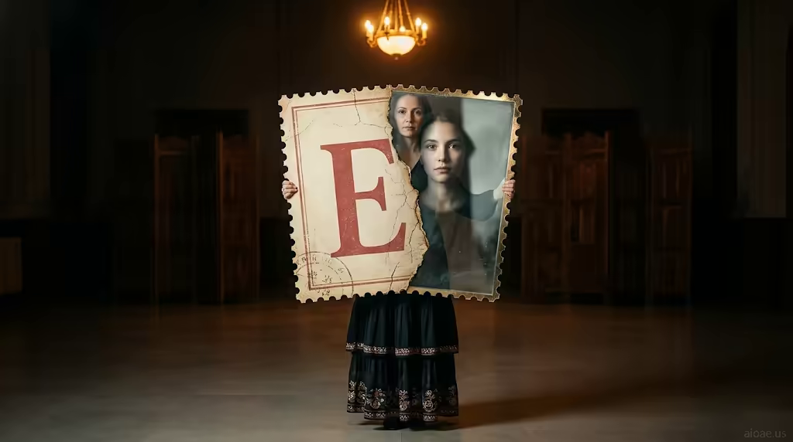

# 案例 168：艾蓮娜手持復古郵票海報 | Case 168: Elena Holding a Vintage Postage Stamp Poster



寫實肖像＋復古郵票元素：艾蓮娜在昏暗禮堂舉起巨型郵票海報，破裂邊緣化作透明玻璃，映出二十年前的自己，古董質感與透亮變形形成強烈對比。

Photorealistic portrait with vintage stamp elements: Elena lifts a giant postage-stamp poster in a dim ceremonial hall; its cracked edge turns to glass, reflecting her face from twenty years ago — antique texture against luminous transformation.

## 完整提示詞 / Full Prompt

```
SUBJECT: 38‑year‑old woman Elena holding a vintage engraved postage stamp poster

SCENE: In a dimly lit ceremonial hall, Elena stands on a polished, level floor surrounded by tall, dark‑wood screens. She wears a long, layered gown with embroidered hems that catch the amber glow of a single overhead chandelier. Holding a giant vertical poster—an antique postage stamp with a perforated cream edge and a huge red serif name—she lifts it. The cracked edge transforms into a shimmering, translucent glass pane that reflects Elena’s youthful face from twenty years ago, producing a visible mirrored double. The glass casts a crisp, cool shadow across her face while the chandelier illuminates the poster’s gilded edges, creating a striking contrast between antique texture and luminous transformation. The poster’s watermark “aioae.us” appears in the bottom‑right corner at 70% transparency.

STYLE & LIGHT: Photorealistic portrait with vintage stamp elements, soft amber illumination, and a dramatic interplay of shadow and gilded light.

CAMERA: Frontal, medium‑distance shot capturing Elena’s composed posture and the mirrored double on the glass pane.

WATERMARK: Add the exact text "aioae.us" in the bottom-right corner at 90% transparency (10% opacity), with enough contrast to remain visible.
```

## 適用模型 / Recommended Models

擅長寫實人像、復古質感與鏡像效果的模型：GPT Image（Image2）、Flux Pro、Midjourney（建議加 `--ar 3:2`）。

Models strong at realistic portraits, vintage texture and mirror effects: GPT Image (Image2), Flux Pro, Midjourney (add `--ar 3:2`).

## 修改說明 / How to Adapt

- 換海報圖案：郵票換成舊明信片或黑膠唱片封面，SUBJECT 的海報描寫跟著換。
- 換時間跨度：二十年前換成童年或老年，玻璃中的倒影年齡跟著改。
- 換場地：禮堂換成圖書館或車站大廳，SCENE 的木屏風與吊燈描寫跟著換。

- Swap the poster: replace the stamp with an old postcard or vinyl sleeve, updating the poster description in SUBJECT.
- Change the time gap: swap twenty years ago for childhood or old age, updating the reflected age in the glass.
- Change the venue: swap the ceremonial hall for a library or station hall, updating the wood screens and chandelier in SCENE.

---
直達本案例 / Direct link: https://aioae.us/prompt?title=Elena%20Holding%20a%20Vintage%20Postage%20Stamp%20Poster
更多同類提示詞 / More prompts like this: [AIOAE 免費 AI 圖片提示詞庫](https://aioae.us/prompts)
