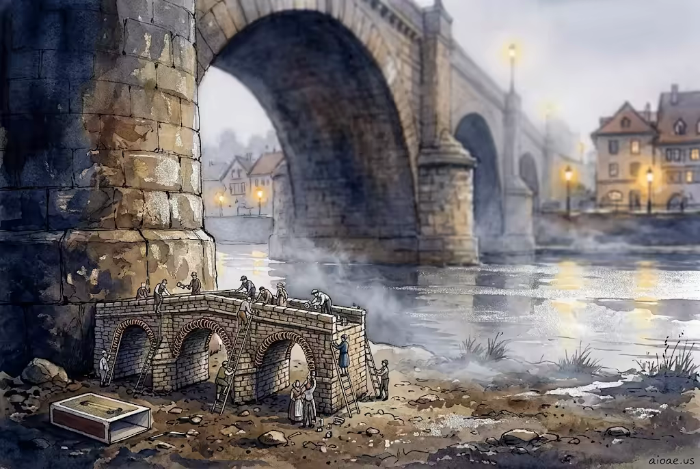

# 案例 169：微縮世界：真實之地的迷你橋 | Case 169: Miniature World From a Real Place



微縮模型＋真實場景：歐洲古鎮的石橋縮成火柴盒大小的銅線模型，河水化作銀色鏡面，迷你工人在梯子上擰緊螺栓，尺度錯置帶來童話感。

Miniature model meets real place: a European town's stone bridge shrinks to a matchbox-sized copper-wire model, the river turns to a silver mirror, and tiny workers tighten bolts on ladders — a fairy-tale scale trick.

## 完整提示詞 / Full Prompt

```
SUBJECT: Miniature World From a Real Place

SCENE: At the foot of a historic stone bridge in a bustling European town, the bridge itself has been transformed into a delicate, hand‑crafted model the size of a matchbox, its arches now tiny arches of copper wire; as the miniature bridge settles, a gentle ripple spreads across the river, turning the water into a glossy silver sheet that reflects the surrounding lanterns, while dozens of minuscule workers in period clothing climb ladders to tighten the model’s bolts, causing a faint mist to rise from the riverbank.

STYLE & LIGHT: The scene is rendered in crisp, high‑contrast watercolor with fine line detailing that emphasizes the miniature scale against the real environment.

CAMERA: Captured with a 35mm lens at f/2.0, ISO 100, from a low ground angle to emphasize the tiny bridge against the towering stone arches.

WATERMARK: Add the exact text "aioae.us" in the bottom-right corner at 90% transparency (10% opacity), with enough contrast to remain visible.
```

## 適用模型 / Recommended Models

擅長微縮模型、建築細節與水彩質感的模型：GPT Image（Image2）、Flux Pro、Midjourney（建議加 `--ar 3:2`）。

Models strong at miniature models, architectural detail and watercolour texture: GPT Image (Image2), Flux Pro, Midjourney (add `--ar 3:2`).

## 修改說明 / How to Adapt

- 換地標：石橋換成鐘樓或風車，SUBJECT 與 SCENE 的模型描寫跟著換。
- 換工人服裝：時代服裝換成現代工裝或宇航服，梯子上的迷你工人描寫跟著改。
- 換河面效果：銀色鏡面換成結冰或霧氣，SCENE 的河水反應描寫跟著換。

- Swap the landmark: replace the stone bridge with a clock tower or windmill, updating the model description in SUBJECT and SCENE.
- Change the workers' outfits: swap period clothing for modern workwear or spacesuits, updating the tiny workers on the ladders.
- Change the river effect: swap the silver mirror for ice or mist, updating how the river reacts in SCENE.

---
直達本案例 / Direct link: https://aioae.us/prompt?title=Miniature%20World%20From%20a%20Real%20Place
更多同類提示詞 / More prompts like this: [AIOAE 免費 AI 圖片提示詞庫](https://aioae.us/prompts)
