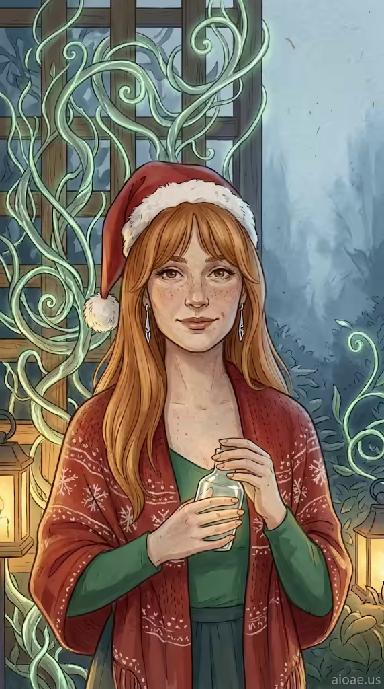

# 案例 170：聖誕帽艾蓮娜與發光花園 | Case 170: Elena in a Santa Hat in a Luminous Garden



聖誕花園肖像風：戴著傾斜聖誕帽的艾蓮娜站在和紙質感的花園裡，身後木格架化作發光藤蔓雕塑，暖金燈光與冷藍薄霧交織，節日氣氛溫柔而夢幻。

Christmas garden portrait: Elena in a tilted Santa hat stands in a washi-textured garden, a wooden trellis transformed into glowing bioluminescent vines, warm lantern light against cool blue haze — festive, gentle and dreamlike.

## 完整提示詞 / Full Prompt

```
SUBJECT: Elena, a 28‑year‑old freckled woman with long ginger hair and curtain bangs, wearing a tilted Santa hat, red snowflake knit shawl, green top, and silver earrings, holding a small clear glass bottle

SCENE: Elena stands in a tranquil layered garden on a softly textured washi background. A wooden trellis behind her has been transformed into a luminous sculpture of bioluminescent vines that coil around the frame, casting a gentle greenish glow. The bottle in her hand reflects this glow, its surface rippling with shimmering light. Warm golden lantern light bathes the foreground, while a cool misty blue haze lingers in the distant background, creating a contrast of illumination across the scene.

STYLE & LIGHT: The image uses muted malachite, ochre, indigo, and soft chalk white pigments on handmade paper, giving the portrait an even, gentle light that highlights delicate garment folds and the glowing vines.

CAMERA: A tight vertical bust portrait fills a 9:16 frame, with Elena's face positioned in the upper‑middle third under a subtle title band.

WATERMARK: Add the exact text "aioae.us" in the bottom-right corner at 90% transparency (10% opacity), with enough contrast to remain visible.
```

## 適用模型 / Recommended Models

擅長寫實人像、聖誕氛圍與發光植物的模型：GPT Image（Image2）、Flux Pro、Midjourney（建議加 `--ar 9:16`）。

Models strong at realistic portraits, Christmas mood and glowing plants: GPT Image (Image2), Flux Pro, Midjourney (add `--ar 9:16`).

## 修改說明 / How to Adapt

- 換節日裝飾：聖誕帽換成新年頭飾或萬聖節南瓜帽，SUBJECT 的服裝描寫跟著換。
- 換發光植物：藤蔓換成發光蘑菇或螢火蟲群，SCENE 的光源描寫跟著改。
- 換手中道具：玻璃瓶換成燭燈或禮物盒，瓶身反光的描寫跟著換。

- Swap the festive accessory: replace the Santa hat with a New Year headpiece or Halloween pumpkin hat, updating the outfit in SUBJECT.
- Change the glowing plants: swap the vines for glowing mushrooms or a firefly swarm, updating the light source in SCENE.
- Swap the hand prop: replace the glass bottle with a candle lantern or gift box, updating the reflection description.

---
直達本案例 / Direct link: https://aioae.us/prompt?title=Elena%20in%20a%20Santa%20Hat%20in%20a%20Luminous%20Garden
更多同類提示詞 / More prompts like this: [AIOAE 免費 AI 圖片提示詞庫](https://aioae.us/prompts)
