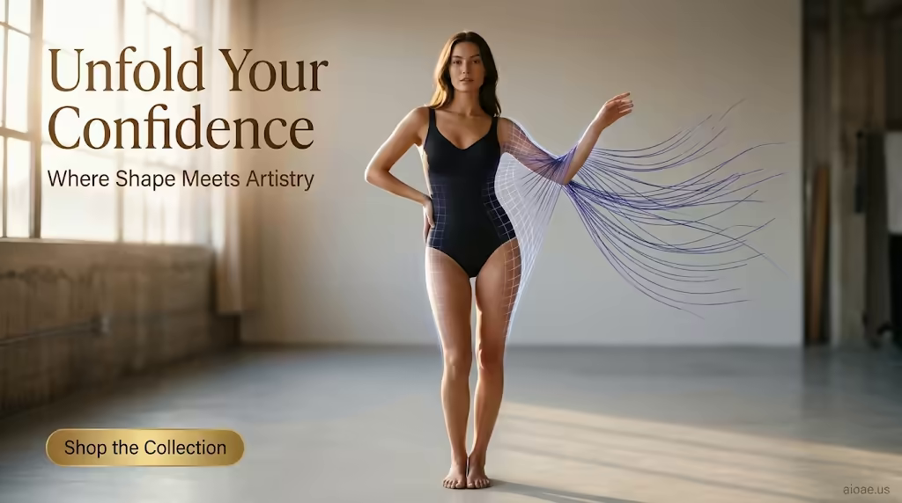

# 案例 171：黑色塑身衣：展開你的自信 | Case 171: Black Shapewear Bodysuit Unfold Your Confidence



電商時尚海報風：啞黑塑身衣模特站在淺灰攝影棚，暖陽從左窗灑入，右臂展開的靛藍絲線與半透明幾何網格勾勒出衣身輪廓，自信而有藝術感。

E-commerce fashion poster: a model in a matte black shapewear bodysuit stands in a light-gray studio, warm afternoon sun from the left window, indigo threads unspooling from her arm into a translucent geometric grid — confident and artistic.

## 完整提示詞 / Full Prompt

```
SUBJECT: Slender female model in matte black shapewear bodysuit
SCENE: The model stands centered on a light-gray studio floor, wearing a seamless matte black bodysuit that contours her silhouette. Warm late-afternoon natural light pours from a large left-hand window, casting a soft halo and rim light on the right. From her right arm, unspooled indigo threads fan outward, intertwining with a translucent geometric grid that traces the bodysuit's edges. The model's relaxed posture, one hand on her hip, the other gesturing toward the unfolding pattern, conveys confidence. The studio's minimal backdrop is softly blurred, keeping focus on the garment and its animated threads.
STYLE & LIGHT: Warm natural light, film-like grain, indigo-accented threads, gold CTA button, "aioae.us" watermark at 70% opacity
CAMERA: 35mm equivalent wide-angle lens, shallow depth of field, sharp focus on central bodysuit and threads, background gently softened
ON-IMAGE TEXT: headline "Unfold Your Confidence"; subheadline "Where Shape Meets Artistry"; CTA "Shop the Collection".
WATERMARK: Add the exact text "aioae.us" in the bottom-right corner at 90% transparency (10% opacity), with enough contrast to remain visible.
```

## 適用模型 / Recommended Models

擅長時尚電商海報、服裝質感與棚拍光線的模型：GPT Image（Image2）、Flux Pro、Midjourney（建議加 `--ar 3:2`）。

Models strong at fashion e-commerce posters, garment texture and studio light: GPT Image (Image2), Flux Pro, Midjourney (add `--ar 3:2`).

## 修改說明 / How to Adapt

- 換服裝：塑身衣換成運動內衣或連身泳裝，SUBJECT 的服裝描寫跟著換。
- 換絲線顏色：靛藍換成金色或玫紅，STYLE & LIGHT 的絲線配色跟著改。
- 換圖上文案：標題與副標題換成自家品牌口號，ON-IMAGE TEXT 的三行跟著改。

- Swap the garment: replace the bodysuit with a sports bra or swimsuit, updating the outfit in SUBJECT.
- Change the thread colour: swap indigo for gold or magenta, updating the thread palette in STYLE & LIGHT.
- Swap the on-image copy: replace the headline, subheadline and CTA with your own brand lines, updating all three in ON-IMAGE TEXT.

---
直達本案例 / Direct link: https://aioae.us/prompt?title=Black%20Shapewear%20Bodysuit%20Unfold%20Your%20Confidence
更多同類提示詞 / More prompts like this: [AIOAE 免費 AI 圖片提示詞庫](https://aioae.us/prompts)
