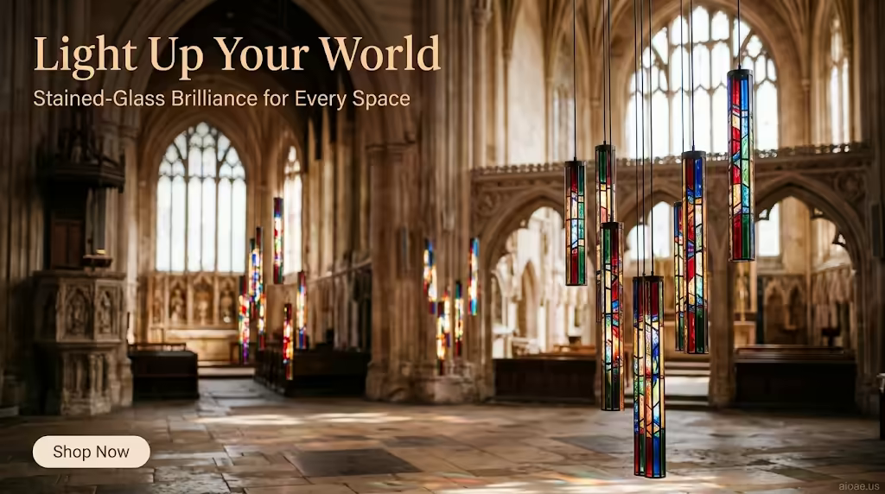

# 案例 172：LED 瀑布燈管：點亮你的世界 | Case 172: LED Cascade Light Tubes Light Up Your World



電商燈飾海報風：彩色玻璃效果的 LED 瀑布燈管懸於古老教堂，稜鏡光灑在石地板上，現代燈具與歷史建築形成迷人對比。

E-commerce lighting poster: stained-glass-effect LED cascade tubes hang in an ornate chapel, prismatic light spilling onto the stone floor — sleek modern lighting against historic architecture.

## 完整提示詞 / Full Prompt

```
SUBJECT: A set of LED cascade light tubes with a stained-glass effect, hanging from the ceiling of a grand, ornate chapel
SCENE: The light tubes hang in a cascading arrangement, their stained-glass panels casting colorful, prismatic light onto the chapel's stone floor. The tubes' vibrant colors—reds, blues, greens, and golds—create a mesmerizing display, while their sleek, modern design contrasts with the chapel's historic architecture. Behind the tubes, the chapel's tall, arched windows and intricate carvings provide a stunning backdrop, their details highlighted by the soft, diffused light. The background is a warm, earthy palette of browns and creams, with soft, diffused light creating a sense of depth and reverence.
STYLE & LIGHT: Warm, diffused light, earthy palette, stained-glass effect, "aioae.us" watermark at 70% opacity
CAMERA: 35mm equivalent wide-angle lens, shallow depth of field, focus on the light tubes, background softly blurred
ON-IMAGE TEXT: headline "Light Up Your World"; subheadline "Stained-Glass Brilliance for Every Space"; CTA "Shop Now".
WATERMARK: Add the exact text "aioae.us" in the bottom-right corner at 90% transparency (10% opacity), with enough contrast to remain visible.
```

## 適用模型 / Recommended Models

擅長電商產品海報、燈光效果與建築內景的模型：GPT Image（Image2）、Flux Pro、Midjourney（建議加 `--ar 3:2`）。

Models strong at e-commerce product posters, lighting effects and architectural interiors: GPT Image (Image2), Flux Pro, Midjourney (add `--ar 3:2`).

## 修改說明 / How to Adapt

- 換場地：教堂換成現代客廳或酒店大堂，SCENE 的拱窗與雕刻描寫跟著換。
- 換燈管配色：紅藍綠金換成暖白與琥珀，STYLE & LIGHT 的色彩描寫跟著改。
- 換圖上文案：標題與副標題換成自家品牌口號，ON-IMAGE TEXT 的三行跟著改。

- Change the venue: swap the chapel for a modern living room or hotel lobby, updating the arched windows and carvings in SCENE.
- Change the tube colours: swap red, blue, green and gold for warm white and amber, updating the palette in STYLE & LIGHT.
- Swap the on-image copy: replace the headline, subheadline and CTA with your own brand lines, updating all three in ON-IMAGE TEXT.

---
直達本案例 / Direct link: https://aioae.us/prompt?title=LED%20Cascade%20Light%20Tubes%20Light%20Up%20Your%20World
更多同類提示詞 / More prompts like this: [AIOAE 免費 AI 圖片提示詞庫](https://aioae.us/prompts)
