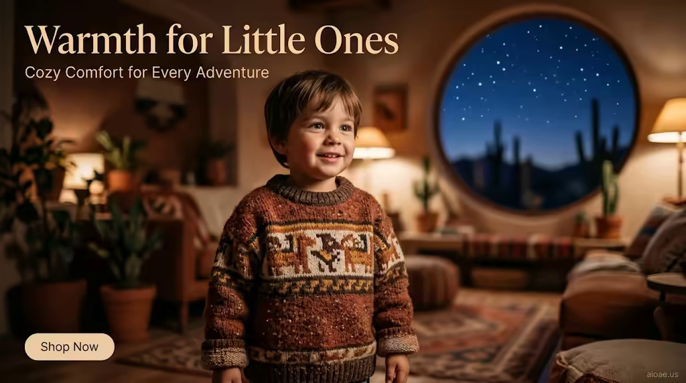

# 案例 173：兒童毛衣：給小寶貝的溫暖 | Case 173: Kids Sweater Warmth for Little Ones



電商童裝海報風：孩子穿著莫切浮雕紋的保暖毛衣站在溫暖客廳，針織表面如陶瓷釉面，圓窗外是沙漠夜空的星光，溫馨又舒適。

E-commerce kids' wear poster: a child in a thermal-lined sweater with a Moche frieze pattern stands in a warm living room, the knit like ceramic glaze, a desert-night sky through the round window — cosy and inviting.

## 完整提示詞 / Full Prompt

```
SUBJECT: A child in a cozy thermal-lined kids sweater, its knitted surface mimicking the textured glaze of a ceramic vessel, standing in a warm, inviting living room
SCENE: The child stands in the center of a warm, inviting living room, wearing a thermal-lined sweater that features a Moche frieze pattern, its knitted surface mimicking the textured glaze of a ceramic vessel. The sweater's rich, earthy tones contrast with the child's bright, cheerful expression, creating a sense of warmth and comfort. Behind the child, a large, circular window frames a view of a desert-night sky, its stars twinkling in the soft, diffused light. The background is a warm, earthy palette of browns and creams, with soft, diffused light creating a cozy, inviting atmosphere.
STYLE & LIGHT: Warm, diffused light, earthy palette, Moche frieze pattern, "aioae.us" watermark at 70% opacity
CAMERA: 35mm equivalent wide-angle lens, shallow depth of field, focus on the child and sweater, background softly blurred
ON-IMAGE TEXT: headline "Warmth for Little Ones"; subheadline "Cozy Comfort for Every Adventure"; CTA "Shop Now".
WATERMARK: Add the exact text "aioae.us" in the bottom-right corner at 90% transparency (10% opacity), with enough contrast to remain visible.
```

## 適用模型 / Recommended Models

擅長電商童裝海報、針織質感與暖調室內的模型：GPT Image（Image2）、Flux Pro、Midjourney（建議加 `--ar 3:2`）。

Models strong at e-commerce kids' wear posters, knit texture and warm interiors: GPT Image (Image2), Flux Pro, Midjourney (add `--ar 3:2`).

## 修改說明 / How to Adapt

- 換毛衣圖案：莫切浮雕換成北歐雪花或恐龍圖案，SCENE 的紋樣描寫跟著換。
- 換窗外景色：沙漠夜空換成雪景或海邊，圓窗外的描寫跟著改。
- 換圖上文案：標題與副標題換成自家品牌口號，ON-IMAGE TEXT 的三行跟著改。

- Swap the sweater pattern: replace the Moche frieze with Nordic snowflakes or dinosaurs, updating the pattern in SCENE.
- Change the window view: swap the desert-night sky for snow or seaside, updating the round-window description.
- Swap the on-image copy: replace the headline, subheadline and CTA with your own brand lines, updating all three in ON-IMAGE TEXT.

---
直達本案例 / Direct link: https://aioae.us/prompt?title=Kids%20Sweater%20Warmth%20for%20Little%20Ones
更多同類提示詞 / More prompts like this: [AIOAE 免費 AI 圖片提示詞庫](https://aioae.us/prompts)
