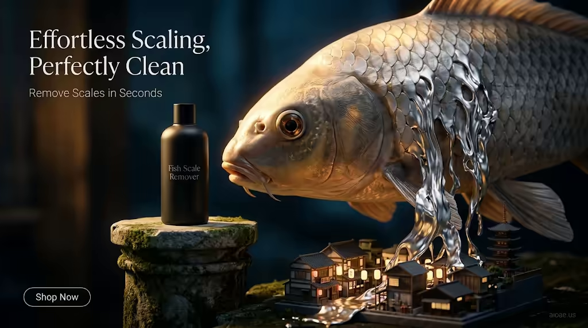

# 案例 174：魚鱗去除器：輕鬆去鱗，潔淨無暇 | Case 174: Fish Scale Remover Effortless Scaling Perfectly Clean



電商產品海報風：啞黑去鱗器立於石座上，與巨型錦鯉平視，銀鱗化作液態絲帶傾瀉到下方的迷你日本街區，深藍背景襯出暖金光澤，氣勢十足。

E-commerce product poster: a matte-black fish scale remover stands on a stone pedestal eye-to-eye with a colossal koi, silver scales melting into liquid ribbons over a miniature Japanese city block — warm gold against deep blue.

## 完整提示詞 / Full Prompt

```
SUBJECT: A sleek matte-black Fish Scale Remover bottle rests on a stone pedestal at the eye level of a colossal koi, its silver scales melting into liquid ribbons that cascade down the fish's flank and spill onto a miniature Japanese city block belo
SCENE: The koi dominates the frame, its scales gleaming in warm golden light as it curves around the pedestal, while below the bottle, a tiny Japanese city block unfolds—tiny houses, lanterns, and a pagoda, all bathed in soft, warm light. The bottle stands on a stone pedestal, its sleek black surface reflecting the koi's scales, while the city below glows with a soft, golden hue. The background is a deep, rich blue, with soft, diffused light creating a sense of depth and mystery.
STYLE & LIGHT: Warm golden light, deep blue background, soft diffused light, "aioae.us" watermark at 70% opacity
CAMERA: 35mm equivalent wide-angle lens, shallow depth of field, focus on the bottle and koi, background softly blurred
ON-IMAGE TEXT: headline "Effortless Scaling, Perfectly Clean"; subheadline "Remove Scales in Seconds"; CTA "Shop Now".
WATERMARK: Add the exact text "aioae.us" in the bottom-right corner at 90% transparency (10% opacity), with enough contrast to remain visible.
```

## 適用模型 / Recommended Models

擅長電商產品海報、巨物對比與水下光感的模型：GPT Image（Image2）、Flux Pro、Midjourney（建議加 `--ar 3:2`）。

Models strong at e-commerce product posters, giant-scale contrast and underwater light: GPT Image (Image2), Flux Pro, Midjourney (add `--ar 3:2`).

## 修改說明 / How to Adapt

- 換主角魚種：錦鯉換成金魚或鯨魚，SUBJECT 的魚鱗描寫跟著換。
- 換下方街區：日本街區換成威尼斯水城或海底城市，SCENE 的迷你建築描寫跟著改。
- 換圖上文案：標題與副標題換成自家品牌口號，ON-IMAGE TEXT 的三行跟著改。

- Swap the fish: replace the koi with a goldfish or whale, updating the scale description in SUBJECT.
- Change the city below: swap the Japanese block for a Venetian water town or underwater city, updating the miniature buildings in SCENE.
- Swap the on-image copy: replace the headline, subheadline and CTA with your own brand lines, updating all three in ON-IMAGE TEXT.

---
直達本案例 / Direct link: https://aioae.us/prompt?title=Fish%20Scale%20Remover%20Effortless%20Scaling%20Perfectly%20Clean
更多同類提示詞 / More prompts like this: [AIOAE 免費 AI 圖片提示詞庫](https://aioae.us/prompts)
