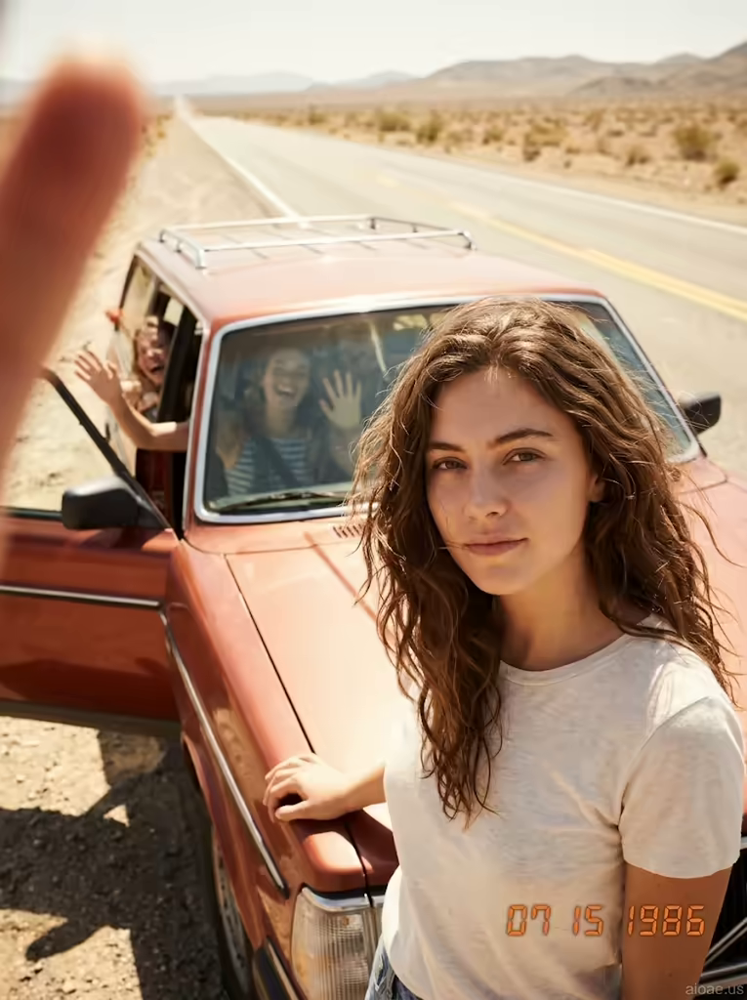

# 案例 175：沙漠公路旁的 1980 年代旅行車與米婭 | Case 175: Mia by a 1980s Station Wagon on a Desert Road Trip



復古公路旅行風：米婭倚在 1980 年代鐵鏽紅旅行車旁，拇指半遮鏡頭、右下角「07 15 1986」日期戳，陽光曬褪的色彩裡滿是無憂無慮的青春氣息。

Retro road-trip nostalgia: Mia leans on a rust-red 1980s station wagon, a thumb half-covering the lens and an orange "07 15 1986" date stamp in the corner — sun-bleached colours full of carefree youth.

## 完整提示詞 / Full Prompt

```
SUBJECT: Mia, a young woman in her early twenties with wavy brown hair flowing in the wind, stands beside a 1980s rust-red station wagon, her hands on the hood as she gazes into the camera.
SCENE: She stands beside the open door of the 1980s station wagon, the desert highway stretching out behind her, its white lines fading into the distance. Her fingers are curled around the edge of the car door, and a thumb partially covers the lens, creating a 1980s Polaroid charm. Behind her, her friends are visible through the car windows, laughing and waving, their faces bright with joy. The sun has bleached the colors of the scene, giving it a faded, nostalgic look. The thumb on the camera lens adds an authentic touch, as if the photo was taken by a friend in the moment, capturing the carefree spirit of a road trip. The orange date stamp "07 15 1986" in the bottom right corner adds to the vintage vibe.
STYLE & LIGHT: The image has a bright, sunlit feel with warm tones and soft focus that enhances the nostalgic charm of the road trip.
CAMERA: Medium close-up, capturing Mia's face and upper body, with the rust-red station wagon and the desert highway in the background.
WATERMARK: Add the exact text "aioae.us" in the bottom-right corner at 70% transparency (30% opacity), with enough contrast to remain visible.
```

## 適用模型 / Recommended Models

擅長復古寫實人像、懷舊膠片質感的模型：GPT Image（Image2）、Flux Pro、Midjourney（建議加 `--ar 3:4`）。

Models strong at retro photorealistic portraits and nostalgic film texture: GPT Image (Image2), Flux Pro, Midjourney (add `--ar 3:4`).

## 修改說明 / How to Adapt

- 換年代車款：把 1980 年代旅行車換成 1960 年代甲殼蟲或皮卡，SCENE 的車門與公路描寫跟著改。
- 換日期戳：把 "07 15 1986" 換成其他年份，懷舊氛圍跟著變。
- 換背景人物：車窗裡的朋友換成一隻狗或空無一人，SCENE 的歡笑描寫跟著刪。

- Swap the car: replace the 1980s station wagon with a 1960s Beetle or pickup, updating the door and highway details in SCENE.
- Change the date stamp: swap "07 15 1986" for another year to shift the nostalgic era.
- Change the background figures: replace the friends in the windows with a dog — or no one — and drop the laughing lines in SCENE.

---
直達本案例 / Direct link: https://aioae.us/prompt?title=Mia%20by%20a%201980s%20Station%20Wagon%20on%20a%20Desert%20Road%20Trip
更多同類提示詞 / More prompts like this: [AIOAE 免費 AI 圖片提示詞庫](https://aioae.us/prompts)
