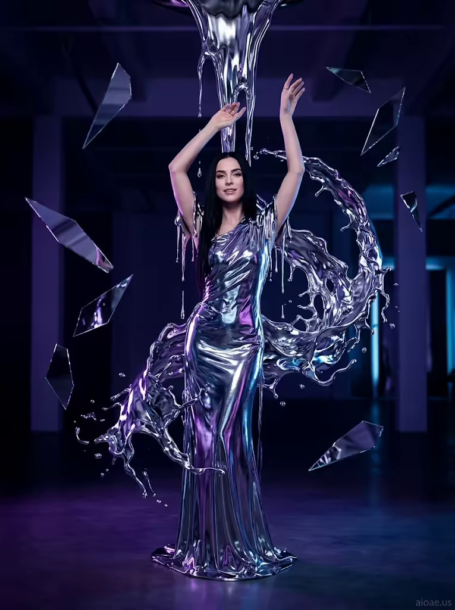

# 案例 176：液態金屬禮服中的莉娜 | Case 176: Lena in a Liquid Metal Gown



未來高級時尚風：液態金屬自天花板傾瀉、凝成定格的水花弧線，紫外光與鏡面碎片環繞著銀光中的莉娜，優雅又充滿未來感。

Futuristic high fashion: liquid metal pours from the ceiling and freezes into a glistening splash, ultraviolet glow and mirror shards circling Lena in silver light — elegant and futuristic.

## 完整提示詞 / Full Prompt

```
SUBJECT: Lena, a striking woman with long black hair, stands tall in a sculpted gown that flows like liquid metal, her arms lifted in a graceful arc that frames her body in silver light.
SCENE: Liquid metal pours from the ceiling and drips onto her gown, forming a frozen splash that catches the light in an elegant arc, as if time itself has been suspended. She stands in a studio filled with ultraviolet glow, mirror shards floating in the air around her, her face turned slightly toward the camera, a soft smile playing on her lips. The chrome liquid metal flows like a wave over her gown, freezing into a glistening cascade of high-fashion elegance.
STYLE & LIGHT: The scene has a high-fashion, futuristic glam feel with dramatic lighting, ultraviolet glow and chrome reflections, emphasizing the fluidity of the liquid metal and the elegance of the model's pose.
CAMERA: Full-body shot from a front-facing angle, capturing Lena's dynamic pose and the flowing liquid metal in sharp focus, with the sleek studio background providing a striking contrast.
WATERMARK: Add the exact text "aioae.us" in the bottom-right corner at 70% transparency (30% opacity), with enough contrast to remain visible.
```

## 適用模型 / Recommended Models

擅長時尚攝影、金屬流體質感的模型：GPT Image（Image2）、Flux Pro、Midjourney（建議加 `--ar 3:4`）。

Models strong at fashion photography and liquid-metal textures: GPT Image (Image2), Flux Pro, Midjourney (add `--ar 3:4`).

## 修改說明 / How to Adapt

- 換金屬顏色：把銀色液態金屬換成金色或玫瑰金，STYLE & LIGHT 的鉻面反光描寫跟著改。
- 換姿勢：把雙臂優雅弧線換成單手叉腰或回眸，SUBJECT 的姿態描寫跟著改。
- 換背景光：把紫外光換成暖金攝影棚光，SCENE 的鏡面碎片描寫可保留或刪掉。

- Change the metal colour: swap silver liquid metal for gold or rose gold, updating the chrome-reflection lines in STYLE & LIGHT.
- Change the pose: swap the graceful arm arc for a hand on the hip or a look back over the shoulder, updating SUBJECT.
- Change the background light: swap the ultraviolet glow for warm golden studio light, keeping or dropping the mirror shards in SCENE.

---
直達本案例 / Direct link: https://aioae.us/prompt?title=Lena%20in%20a%20Liquid%20Metal%20Gown
更多同類提示詞 / More prompts like this: [AIOAE 免費 AI 圖片提示詞庫](https://aioae.us/prompts)
