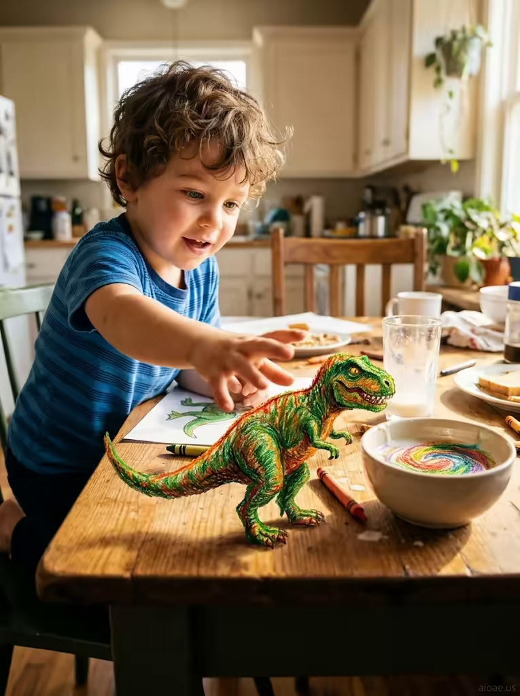

# 案例 177：陽光廚房裡的里奧與蠟筆恐龍 | Case 177: Leo and the Crayon Dinosaur in a Sunlit Kitchen



童畫成真風：蠟筆暴龍從紙上走下來，踩得麥片碗輕晃、金色牛奶化作蠟筆塗鴉，晨光裡的廚房充滿童趣與魔法。

Kids-drawing-comes-to-life: a crayon T-Rex steps off the paper, the cereal bowl trembles and golden milk swirls into crayon scribbles — a sunlit kitchen full of childlike magic.

## 完整提示詞 / Full Prompt

```
SUBJECT: Leo, a young boy with curly hair and bright eyes, sits at a sunlit kitchen table, wearing a blue striped t‑shirt, his hand reaching toward a crayon dinosaur.
SCENE: A crayon-drawn T-Rex steps off the paper onto the kitchen table, its crayon body still glowing with vibrant colors. As it takes its first real step, the table trembles, causing the cereal bowl to shake and the milk inside to slosh. The dinosaur's yellow eyes scan the room in search of its next adventure, the morning light streaming through the window casting a golden glow on the scene. The child's hand reaches toward the dinosaur, fingers outstretched, as if to catch the creature mid-step. The dinosaur's tail sweeps across the table, knocking over a crayon, and the golden milk inside the cereal bowl transforms into a swirl of crayon scribbles, bringing the drawing to life.
STYLE & LIGHT: The image has a warm, playful atmosphere with soft morning light and vibrant crayon colors.
CAMERA: Capture the scene from a low angle, focusing on the child's hand and the crayon dinosaur, with the sunlit kitchen in the background.
WATERMARK: Add the exact text "aioae.us" in the bottom-right corner at 70% transparency (30% opacity), with enough contrast to remain visible.
```

## 適用模型 / Recommended Models

擅長兒童題材、童畫質感與暖色晨光的模型：GPT Image（Image2）、Flux Pro、Midjourney（建議加 `--ar 3:4`）。

Models strong at children's subjects, crayon textures and warm morning light: GPT Image (Image2), Flux Pro, Midjourney (add `--ar 3:4`).

## 修改說明 / How to Adapt

- 換恐龍種類：把暴龍換成三角龍或翼龍，SCENE 的尾巴掃落蠟筆描寫跟著改。
- 換場景：把廚房餐桌換成臥室書桌或教室，SCENE 的麥片碗描寫跟著換。
- 換畫具：把蠟筆換成水彩或粉筆，STYLE & LIGHT 的鮮豔蠟筆色描寫跟著改。

- Swap the dinosaur: replace the T-Rex with a Triceratops or Pterodactyl, updating the tail-sweeps-a-crayon line in SCENE.
- Change the setting: swap the kitchen table for a bedroom desk or classroom, replacing the cereal-bowl details in SCENE.
- Change the medium: swap crayons for watercolour or chalk, updating the vibrant crayon colours in STYLE & LIGHT.

---
直達本案例 / Direct link: https://aioae.us/prompt?title=Leo%20and%20the%20Crayon%20Dinosaur%20in%20a%20Sunlit%20Kitchen
更多同類提示詞 / More prompts like this: [AIOAE 免費 AI 圖片提示詞庫](https://aioae.us/prompts)
