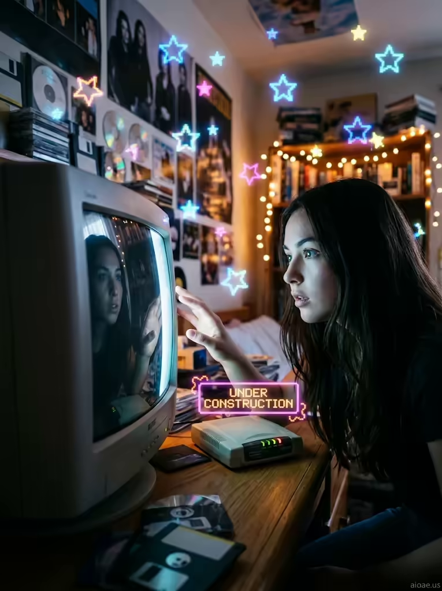

# 案例 178：1998 年臥室裡的米婭與 CRT 螢幕傳送門 | Case 178: Mia in a 1998 Bedroom with a CRT Monitor Portal



九零年代復古網絡風：CRT 螢幕化作液態鏡面傳送門，像素星星在牆上閃爍，撥接數據機與霓虹「施工中」橫幅把人拉回 1998 年的臥室。

1990s retro-web aesthetic: a CRT screen melts into a liquid-mirror portal, pixelated stars twinkle on the walls, and a dial-up modem with a neon under-construction banner pulls you back to a 1998 bedroom.

## 完整提示詞 / Full Prompt

```
SUBJECT: Mia, a young woman with long dark hair, sits at a cluttered wooden desk in a 1998 bedroom, leaning forward toward a chunky CRT monitor that fills the foreground with a glowing, curved screen.
SCENE: The CRT monitor's screen is a liquid mirror slipping into a glowing portal, its glass surface reflecting Mia's wide-eyed wonder as she stares into the glowing gateway. Pixelated star GIFs dance and twinkle across the walls and ceiling, their neon outlines casting a soft glow on the posters and clutter. On the desk, a dial-up modem hums softly with blinking lights, and next to it, a neon under-construction banner glows bright pink and orange, its pixelated text flickering. Mia reaches out her hand, her fingertips hovering near the CRT screen, feeling the pull of the portal as if it might draw her in, while the soft blinking glow of the modem and the pixelated stars surround her form in a surreal, retro web aesthetic.
STYLE & LIGHT: The scene has a vibrant 1990s bedroom feel, with neon colors and a mix of pixel art and real-life elements. The lighting is a blend of the CRT's cool glow and the warm tones of the fairy lights and posters.
CAMERA: Medium close-up at a slightly low angle, capturing Mia's face and the glowing CRT screen's reflections in sharp focus, with the pixelated stars and clutter softly blurred in the background.
WATERMARK: Add the exact text "aioae.us" in the bottom-right corner at 70% transparency (30% opacity), with enough contrast to remain visible.
```

## 適用模型 / Recommended Models

擅長復古科技、霓虹光影與寫實人像的模型：GPT Image（Image2）、Flux Pro、Midjourney（建議加 `--ar 3:4`）。

Models strong at retro tech, neon lighting and photorealistic portraits: GPT Image (Image2), Flux Pro, Midjourney (add `--ar 3:4`).

## 修改說明 / How to Adapt

- 換年代裝置：把 CRT 螢幕換成 2000 年代厚重筆電或遊戲機，SCENE 的撥接數據機描寫跟著改。
- 換傳送門去向：把發光入口換成星空或海洋，SCENE 的鏡面反射描寫跟著改。
- 換房間氛圍：把像素星星換成海報牆或樂隊貼紙，STYLE & LIGHT 的霓虹描寫跟著調。

- Swap the device: replace the CRT monitor with a 2000s chunky laptop or game console, updating the dial-up modem lines in SCENE.
- Change the portal's destination: swap the glowing gateway for a starfield or ocean, updating the mirror-reflection lines in SCENE.
- Change the room vibe: swap the pixel stars for a poster wall or band stickers, adjusting the neon lines in STYLE & LIGHT.

---
直達本案例 / Direct link: https://aioae.us/prompt?title=Mia%20in%20a%201998%20Bedroom%20with%20a%20CRT%20Monitor%20Portal
更多同類提示詞 / More prompts like this: [AIOAE 免費 AI 圖片提示詞庫](https://aioae.us/prompts)
