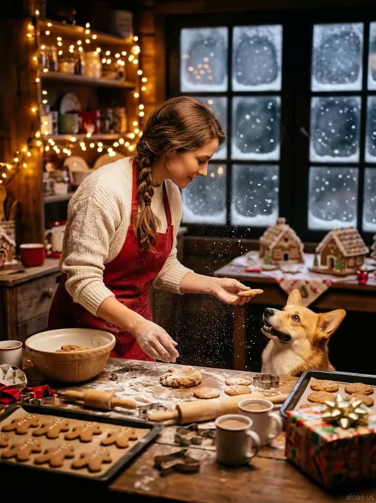

# 案例 179：小木屋廚房裡與柯基一起烤薑餅的艾瑪 | Case 179: Emma Baking Gingerbread with a Corgi in a Cabin Kitchen



冬日節慶暖心風：麵粉如雪花飄落，薑餅屋與熱可可冒著暖氣，柯基洛基仰頭等著剛出爐的餅乾，窗外雪花與屋內暖光形成最溫柔的對比。

Cozy winter-festive mood: flour drifts like snow, gingerbread houses and steaming cocoa glow under fairy lights, and corgi Rocky waits for a fresh cookie — snowfall outside, warm light within.

## 完整提示詞 / Full Prompt

```
SUBJECT: Emma, a woman in her late twenties with warm brown hair tied back in a loose braid, wearing a cream wool sweater and a red apron, stands at a wooden counter in a tiny snow‑covered cabin kitchen, baking gingerbread with a corgi named Rocky at her feet.
SCENE: She mixes cookie dough while flour drifts through the air like sparkling snow, her hands dusted with flour as she works above a wooden counter filled with gingerbread trays and freshly baked cookies. Warm fairy lights glow from the kitchen shelves behind her, illuminating a table with gingerbread houses, a rolling pin, a bowl of cookie dough and steaming mugs of hot cocoa. A brightly wrapped package rests on the counter, and a happy corgi watches her intently with honey‑gold eyes as she extends a hand holding a freshly baked cookie toward the dog's eager nose. The snow‑topped roof outside is covered in frost, and snowflakes gently dust the dark window panes behind her, adding to the warm, festive glow of the cabin kitchen.
STYLE & LIGHT: The image has a warm, festive atmosphere with soft, natural light and warm golden tones, enhancing the cozy, magical feel of the scene.
CAMERA: Medium close‑up from a three‑quarter angle, slightly elevated, capturing Emma's profile and the corgi's face in sharp focus.
WATERMARK: Add the exact text "aioae.us" in the bottom-right corner at 70% transparency (30% opacity), with enough contrast to remain visible.
```

## 適用模型 / Recommended Models

擅長節慶暖調、寫實人像與寵物互動的模型：GPT Image（Image2）、Flux Pro、Midjourney（建議加 `--ar 3:4`）。

Models strong at festive warm tones, photorealistic portraits and pet interaction: GPT Image (Image2), Flux Pro, Midjourney (add `--ar 3:4`).

## 修改說明 / How to Adapt

- 換烘焙主題：把薑餅換成聖誕蛋糕或肉桂捲，SCENE 的薑餅屋與餅乾描寫跟著改。
- 換狗狗品種：把柯基換成柴犬或金毛，SUBJECT 的狗名與 SCENE 的蜜金色眼睛描寫跟著改。
- 換季節氛圍：把冬日雪景換成秋日落葉，STYLE & LIGHT 的暖金色調可保留、雪花描寫刪掉。

- Swap the bake: replace gingerbread with a Christmas cake or cinnamon rolls, updating the gingerbread houses and cookies in SCENE.
- Swap the dog breed: replace the corgi with a Shiba Inu or Golden Retriever, updating the name in SUBJECT and the honey-gold eyes in SCENE.
- Change the season: swap the winter snow for autumn leaves, keeping the warm golden tones in STYLE & LIGHT and dropping the snowflakes.

---
直達本案例 / Direct link: https://aioae.us/prompt?title=Emma%20Baking%20Gingerbread%20with%20a%20Corgi%20in%20a%20Cabin%20Kitchen
更多同類提示詞 / More prompts like this: [AIOAE 免費 AI 圖片提示詞庫](https://aioae.us/prompts)
