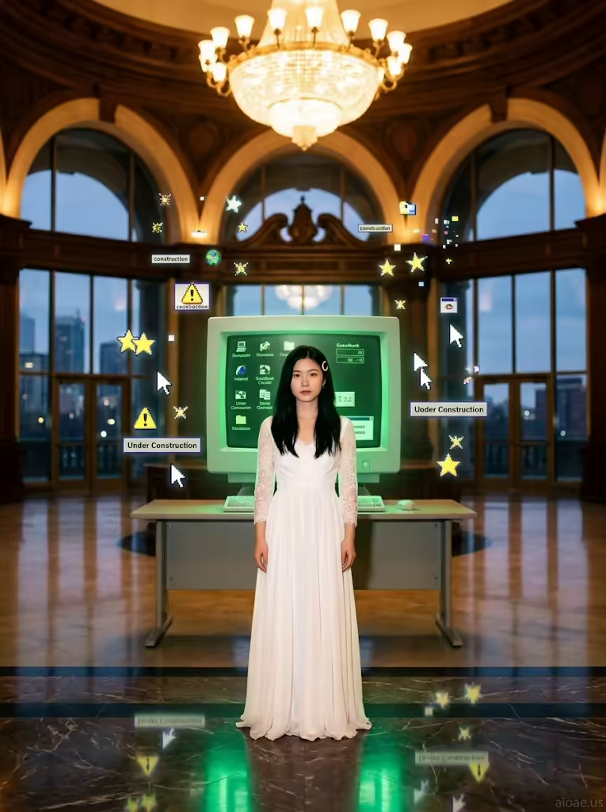

# 案例 180：復古電腦螢幕前的白衣女子 | Case 180: Woman in a White Gown Before a Retro Computer Screen



復古網絡 × 典禮大廳風：白衣女子如 1990 年代網站橫幅般端莊佇立，綠色螢光幕與像素圖標如數位彩紙般飄浮，吊燈暖光與螢幕冷光交織出跨越時代的畫面。

Retro-web meets ceremonial hall: a woman in a white gown stands iconic like an early-1990s website banner, a green-phosphor screen and pixelated icons drifting like digital confetti as warm chandelier light meets cool screen glow.

## 完整提示詞 / Full Prompt

```
SUBJECT: A young woman in her late 20s with glossy black hair, standing in the center of a grand ceremonial hall
SCENE: The woman stands frontally, wearing a flowing white gown with lace sleeves and a delicate gold c‑shaped hairpin, her posture calm and iconic like an early 1990s website banner. Behind her, the ceremonial hall unfolds with sweeping arches and tall glass windows, while a 1990s computer screen is set up on a desk in the middle of the hall, its green phosphor screen glowing with retro Geocities‑era icons and clipart. The woman is placed directly in front of the computer, surrounded by floating pixelated icons and early web design elements that drift upward around her like digital confetti, blending the physical hall with the digital past. Behind her, the polished marble floor reflects the glowing screen and chandelier, and the distant city skyline at dusk peeks through the tall windows, creating a bridge between eras.
STYLE & LIGHT: A striking contrast between the warm, golden chandelier glow and the cool green screen light, with the retro icons glowing in neon while her white gown catches the soft warm light. The composition is layered and detailed, designed to feel like a bashful portrait caught in a 1990s web browser.
CAMERA: Flat, open framing, straight‑on frontal flat view, centred on the woman and the computer screen, with a shallow depth of field that keeps her face sharp while the ornate hall and cityscape blur softly into the background.
WATERMARK: Add the exact text "aioae.us" in the bottom-right corner at 70% transparency (30% opacity), with enough contrast to remain visible.
```

## 適用模型 / Recommended Models

擅長復古網絡美學、寫實人像與雙色光對比的模型：GPT Image（Image2）、Flux Pro、Midjourney（建議加 `--ar 3:4`）。

Models strong at retro-web aesthetics, photorealistic portraits and dual-tone light contrast: GPT Image (Image2), Flux Pro, Midjourney (add `--ar 3:4`).

## 修改說明 / How to Adapt

- 換禮服顏色：把白色蕾絲長裙換成黑色或紅色，STYLE & LIGHT 的暖光描寫跟著調。
- 換螢幕年代：把 1990 年代綠色螢光幕換成 1980 年代街機或現代曲面螢幕，SCENE 的 Geocities 圖標描寫跟著改。
- 換場景建築：把典禮大廳換成圖書館或美術館，SCENE 的拱門與大理石地板描寫跟著改。

- Change the gown colour: swap the white lace gown for black or red, adjusting the warm-light lines in STYLE & LIGHT.
- Change the screen era: swap the 1990s green-phosphor screen for a 1980s arcade cabinet or a modern curved monitor, updating the Geocities icons in SCENE.
- Change the architecture: swap the ceremonial hall for a library or art gallery, updating the arches and marble floor in SCENE.

---
直達本案例 / Direct link: https://aioae.us/prompt?title=Woman%20in%20a%20White%20Gown%20Before%20a%20Retro%20Computer%20Screen
更多同類提示詞 / More prompts like this: [AIOAE 免費 AI 圖片提示詞庫](https://aioae.us/prompts)
