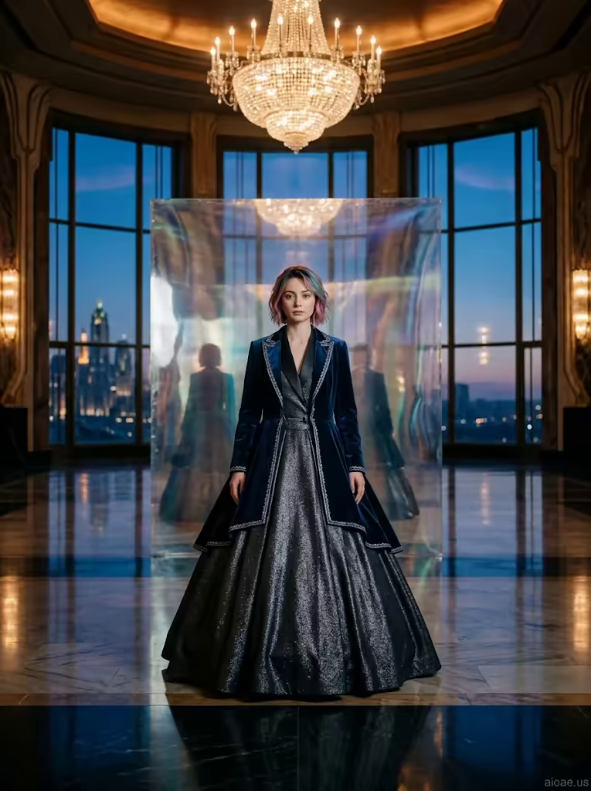

# 案例 181：宏偉大廳裡的炭灰燕尾禮服女子 | Case 181: Woman in a Charcoal Tuxedo Ballgown in a Grand Hall



電影感時尚肖像風：炭灰燕尾禮服在深藍絲絨斗篷下閃爍，鏡面牆把倒影扭曲成夢幻雙重曝光，吊燈暖光與遠方天際線冷光交鋒，氣場沉靜而強大。

Cinematic fashion portrait: a charcoal tuxedo ballgown shimmers under a deep-blue velvet cloak, a mirror wall warping her reflection into a dreamlike double exposure, warm chandelier light against a cool distant skyline.

## 完整提示詞 / Full Prompt

```
SUBJECT: A young woman in her late 20s with a delicate face, standing in a grand ceremonial hall
SCENE: The woman stands frontally center‑frame, wearing a shimmering charcoal tuxedo tailored like a ballgown, layered under a deep blue velvet jacket that flares like a cloak, with faint silver trim that catches the glow from the crystal chandelier overhead. Behind her, a vast art‑deco dance hall unfolds: floor‑to‑ceiling windows frame a distant mythical cityscape, while a polished marble floor reflects her figure and the surrounding ornate architecture. A holographic twist on the traditional backdrop — a shimmering, translucent mirror wall behind her bends reality, warping her reflection into a cinematic, dreamlike double‑exposure effect. Her short, colorful hairstyle is deliberately feminine, with soft strands framing her face, and her expression is calm, distant, and quietly commanding.
STYLE & LIGHT: A cinematic studio portrait with dramatic contrast — the chandelier’s warm amber light meets the cool blue glow of the distant skyline, defining her silhouette and the intricate texture of her jacket while creating a surreal, filmic atmosphere.
CAMERA: Straight frontal flat view, centered on the woman, with a shallow depth of field emphasizing sharp focus on her face and fabric details while softly blurring the grand hall and distant cityscape.
WATERMARK: Add the exact text "aioae.us" in the bottom-right corner at 70% transparency (30% opacity), with enough contrast to remain visible.
```

## 適用模型 / Recommended Models

擅長電影感肖像、時尚面料質感與雙重曝光的模型：GPT Image（Image2）、Flux Pro、Midjourney（建議加 `--ar 3:4`）。

Models strong at cinematic portraits, fashion fabric textures and double exposure: GPT Image (Image2), Flux Pro, Midjourney (add `--ar 3:4`).

## 修改說明 / How to Adapt

- 換禮服配色：把炭灰＋深藍換成酒紅＋墨綠，STYLE & LIGHT 的冷暖對比描寫跟著調。
- 換髮型：把繽紛短髮換成長捲髮或盤髮，SCENE 的髮絲描寫跟著改。
- 拿掉鏡面牆：刪掉半透明鏡面牆的雙重曝光，SCENE 換成普通落地窗，畫面更寫實。

- Change the palette: swap charcoal and deep blue for burgundy and dark green, adjusting the warm-cool contrast in STYLE & LIGHT.
- Change the hairstyle: swap the short colourful hair for long curls or an updo, updating the framing strands in SCENE.
- Drop the mirror wall: remove the translucent mirror wall and its double-exposure effect, leaving plain floor-to-ceiling windows for a more realistic frame.

---
直達本案例 / Direct link: https://aioae.us/prompt?title=Woman%20in%20a%20Charcoal%20Tuxedo%20Ballgown%20in%20a%20Grand%20Hall
更多同類提示詞 / More prompts like this: [AIOAE 免費 AI 圖片提示詞庫](https://aioae.us/prompts)
