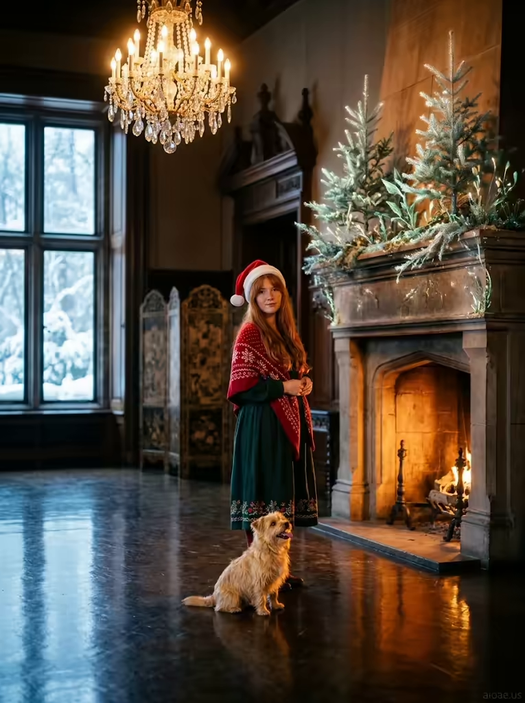

# 案例 182：壁爐旁正式大廳裡的安娜 | Case 182: Anna in a Formal Hall by the Fireplace



冬日奇幻寫實風：古董壁爐化作活生生的冬季森林，半透明冷杉枝在水晶吊燈下發光，金毛小梗犬仰頭望著閃爍樹皮，暖爐與冷窗的光影交織出聖誕氛圍。

Winter-fantasy realism: an antique fireplace turns into a living winter forest, translucent fir branches glowing under a crystal chandelier, a golden terrier gazing at the shimmering bark — hearth warmth against cold window light.

## 完整提示詞 / Full Prompt

```
SUBJECT: Anna, a 32‑year‑old woman with freckled cheeks, standing in a formal hall
SCENE: Anna stands frontally beside a large antique fireplace that has been transformed into a living winter forest: translucent fir branches sprout from the stone mantle, their tips glowing in soft golden light from a crystal chandelier overhead. She wears a long green blouse with embroidered hems, a red snowflake‑knit shawl, and a tilted Santa hat, her ginger hair falling in curtain bangs. A small, fluffy golden‑fur terrier sits at her feet, tongue lolling, watching the shimmering bark; its reflection shimmers on the polished floor, tying the foreground, midground, and distant snow‑covered windows together. The room is split between the warm amber glow of the chandelier and the cool, blue‑tinted light filtering through the glass windows, creating a dual atmosphere of cozy hearth and crisp winter air.
STYLE & LIGHT: A richly detailed, realistic portrait that balances warm and cool lighting to highlight Anna’s embroidered blouse, the glimmering fireplace, and the terrier’s golden fur, all rendered with precise texture and depth.
CAMERA: Straight frontal flat view, centered on Anna and the fireplace, with a shallow depth of field that keeps her face and the terrier’s reflection sharp while softly blurring the ornate screens and distant windows.
WATERMARK: Add the exact text "aioae.us" in the bottom-right corner at 70% transparency (30% opacity), with enough contrast to remain visible.
```

## 適用模型 / Recommended Models

擅長寫實人像、節慶氛圍與冷暖光對比的模型：GPT Image（Image2）、Flux Pro、Midjourney（建議加 `--ar 3:4`）。

Models strong at photorealistic portraits, festive atmosphere and warm-cool light contrast: GPT Image (Image2), Flux Pro, Midjourney (add `--ar 3:4`).

## 修改說明 / How to Adapt

- 換壁爐奇觀：把冬季森林換成開滿花的春日樹枝或飄雪的松枝，SCENE 的冷杉描寫跟著改。
- 換服裝配色：把綠上衣＋紅雪花披肩換成酒紅＋奶油白，STYLE & LIGHT 的刺繡描寫跟著調。
- 換狗狗：把金毛小梗犬換成柯基或貓咪，SCENE 的吐舌與倒影描寫跟著改。

- Swap the fireplace wonder: replace the winter forest with spring blossom branches or snow-dusted pine, updating the fir-branch lines in SCENE.
- Change the outfit palette: swap the green blouse and red snowflake shawl for burgundy and cream, adjusting the embroidery lines in STYLE & LIGHT.
- Swap the dog: replace the golden terrier with a corgi or a cat, updating the tongue-lolling and reflection lines in SCENE.

---
直達本案例 / Direct link: https://aioae.us/prompt?title=Anna%20in%20a%20Formal%20Hall%20by%20the%20Fireplace
更多同類提示詞 / More prompts like this: [AIOAE 免費 AI 圖片提示詞庫](https://aioae.us/prompts)
