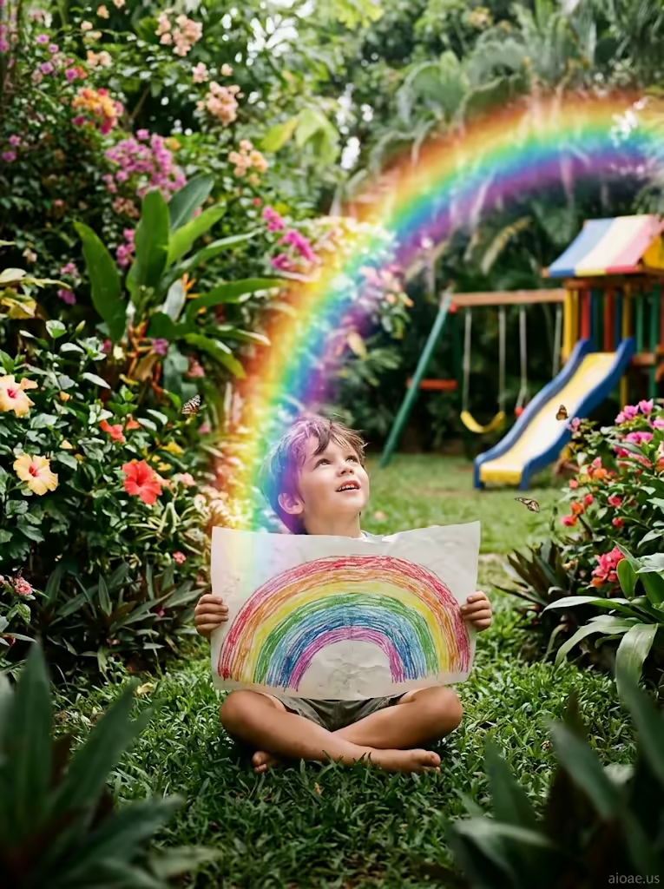

# 案例 183：熱帶花園裡拿著彩虹畫的男孩 | Case 183: Boy with Rainbow Drawing in a Tropical Garden



童畫成真風：男孩手中的蠟筆彩虹凝成真實的虹光，橫跨整座熱帶花園，鳥鳴葉響、遊樂場色彩鮮明，驚喜與魔法寫在孩子臉上。

Kids-drawing-comes-to-life: the crayon rainbow in the boy's hands solidifies into a real shimmering arc over a tropical garden — birdsong, rustling leaves and a bright playground framing his wonder.

## 完整提示詞 / Full Prompt

```
SUBJECT: A young boy sits in a lush, tropical garden, surrounded by vibrant flowers and butterflies, holding a large, detailed crayon drawing of a rainbow
SCENE: In a lush, tropical garden, a young boy sits on a soft, grassy patch, surrounded by vibrant flowers and fluttering butterflies. He holds a large, detailed crayon drawing of a rainbow, its colors vivid and bold, with each arc carefully drawn in a different hue. The drawing comes to life, its colors solidifying into a real, shimmering rainbow that arches over the garden, casting a soft, colorful glow on the boy's face. The garden is filled with the sounds of birds chirping and leaves rustling, creating a serene, magical atmosphere. In the background, a playground with a slide and swings is visible, its bright, primary colors contrasting with the lush, green surroundings. The boy's expression is one of wonder and delight, as he gazes up at the rainbow he has brought to life.
STYLE & LIGHT: Kids Drawing Brought to Life with a vibrant palette of rainbow colors, lush greens, and warm, sunny hues, soft film-like grain, and a bright, natural light that highlights the boy's wonder and the magic of the garden
CAMERA: Medium-range portrait shot, subject sharp, background softly blurred, capturing the boy's expression and the vibrant, magical garden
WATERMARK: Add the exact text "aioae.us" in the bottom-right corner at 70% transparency (30% opacity), with enough contrast to remain visible.
```

## 適用模型 / Recommended Models

擅長兒童題材、童畫質感與熱帶自然光的模型：GPT Image（Image2）、Flux Pro、Midjourney（建議加 `--ar 3:4`）。

Models strong at children's subjects, crayon textures and tropical natural light: GPT Image (Image2), Flux Pro, Midjourney (add `--ar 3:4`).

## 修改說明 / How to Adapt

- 換畫中內容：把彩虹換成火箭、城堡或鯨魚，SCENE 的虹光描寫跟著換成對應景象。
- 換花園場景：把熱帶花園換成海邊沙灘或秋日公園，SCENE 的蝴蝶與遊樂場描寫跟著改。
- 換光線氛圍：把明亮日光換成黃昏金光，STYLE & LIGHT 的暖陽色調描寫跟著調。

- Swap the drawing: replace the rainbow with a rocket, castle or whale, updating the shimmering-arc lines in SCENE.
- Change the garden: swap the tropical garden for a beach or an autumn park, updating the butterflies and playground in SCENE.
- Change the light: swap the bright daylight for golden-hour dusk, adjusting the warm sunny hues in STYLE & LIGHT.

---
直達本案例 / Direct link: https://aioae.us/prompt?title=Boy%20with%20Rainbow%20Drawing%20in%20a%20Tropical%20Garden
更多同類提示詞 / More prompts like this: [AIOAE 免費 AI 圖片提示詞庫](https://aioae.us/prompts)
