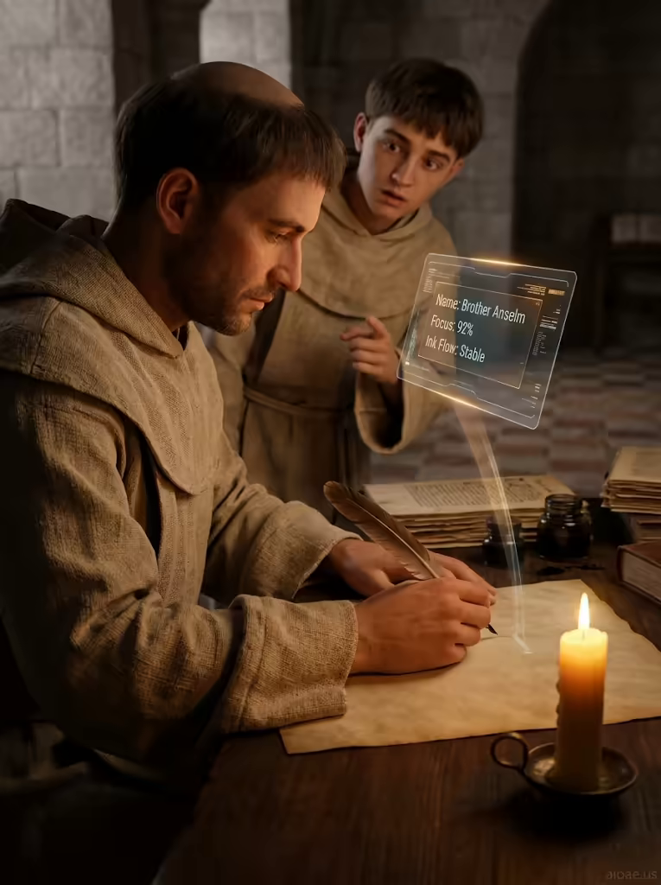

# 案例 184：燭光抄寫室裡的修道士抄寫員 | Case 184: Monk Scribe Scriptorium Candlelight



中世紀 × 未來混搭風：燭光抄寫室裡，修道士的羽毛筆懸在羊皮紙上，肩頭卻浮著一面顯示「Focus: 92%」的半透明終端螢幕，古老與數位在一燭光裡相遇。

Medieval meets future: in a candlelit scriptorium a monk's quill hovers over vellum while a translucent terminal screen floats above his shoulder reading "Focus: 92%" — ancient craft and digital readouts in one flame.

## 完整提示詞 / Full Prompt

```
SUBJECT: Monk Scribe Scriptorium Candlelight
SCENE: Under the warm glow of a single candle in a medieval scriptorium, a monk scribe leans over vellum, his quill poised to write. Hovering above his shoulder is a translucent terminal screen displaying scrolling status lines—‘Name: Brother Anselm’, ‘Focus: 92%’, ‘Ink Flow: Stable’. The candlelight reflects off the glass, and a thin ribbon of light from the screen brushes the parchment, leaving a faint pixel-etched trace. A novice assistant watches, eyebrows raised, pointing at the glowing readout.
STYLE & LIGHT: The image adopts a crisp, video-film aesthetic with visible tile flooring and cotton cloth textures, echoing Ghanaian street-video clarity.
CAMERA: A side-angled medium close-up captures the monk’s profile and the floating terminal, with the candle’s flame in sharp focus.
WATERMARK: Add the exact text "aioae.us" in the bottom-right corner at 90% transparency (10% opacity), with enough contrast to remain visible.
```

## 適用模型 / Recommended Models

擅長中世紀場景、燭光氛圍與寫實人像的模型：GPT Image（Image2）、Flux Pro、Midjourney（建議加 `--ar 3:4`）。

Models strong at medieval scenes, candlelight atmosphere and photorealistic portraits: GPT Image (Image2), Flux Pro, Midjourney (add `--ar 3:4`).

## 修改說明 / How to Adapt

- 換螢幕內容：把狀態行換成修道院菜單、經文進度或天氣預報，SCENE 的三行文字跟著改。
- 換人物組合：把新手助手換成一隻貓或另一位修道士，SCENE 的挑眉指螢幕描寫跟著改。
- 換光源：把單支蠟燭換成窗外月光或油燈，STYLE & LIGHT 的燭光描寫跟著調。

- Swap the screen content: replace the status lines with a monastery menu, scripture progress or a weather forecast, updating the three lines in SCENE.
- Change the second figure: swap the novice assistant for a cat or another monk, updating the raised-eyebrows-and-pointing line in SCENE.
- Change the light source: swap the single candle for moonlight through a window or an oil lamp, adjusting the candlelight lines in STYLE & LIGHT.

---
直達本案例 / Direct link: https://aioae.us/prompt?title=Monk%20Scribe%20Scriptorium%20Candlelight
更多同類提示詞 / More prompts like this: [AIOAE 免費 AI 圖片提示詞庫](https://aioae.us/prompts)
