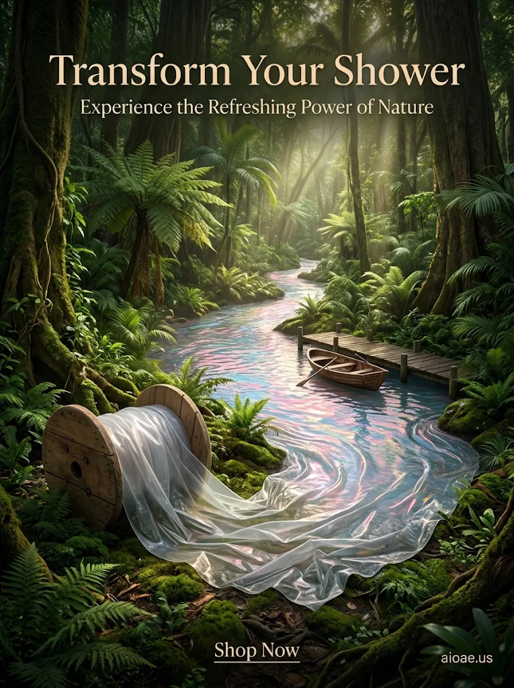

# 案例 185：熱帶雨林浴簾變身河 | Case 185: Shower Curtain Liner Transform Your Shower



熱帶雨林 × 浴簾變身河：木捲軸展開的半透明浴簾化作蜿蜒河流，虹彩水面映著穿透樹冠的金色陽光，超現實產品海報。

Tropical rainforest × shower curtain turned river: a translucent liner unrolls from a wooden spool into a winding river, its iridescent surface catching golden sunlight through the canopy — a surreal product poster.

## 完整提示詞 / Full Prompt

```
SCENE: In a sun-dappled, tropical rainforest, a shower curtain liner unrolls from a wooden spool, its translucent fabric morphing into a winding river that flows through the dense foliage. The river's surface shimmers with iridescent colors, reflecting the sunlight filtering through the canopy. The liner's edges ripple like water, blending seamlessly with the surrounding vegetation. A wooden dock extends into the river, where a small, wooden boat floats gently, its oars resting on the surface. The scene is alive with the sounds of nature, the rustling of leaves, and the gentle flow of water.

STYLE & LIGHT: The style is a blend of hyper-realistic and fantastical elements, with a focus on vibrant, saturated colors and soft, natural lighting. The sunlight creates a warm, golden glow, highlighting the iridescent sheen of the river and the lush greenery of the rainforest.

CAMERA: A wide-angle shot captures the entire scene, from the spool of the liner to the winding river and the wooden dock, with the rainforest stretching out into the distance. The camera is positioned at a slightly elevated angle, looking down at the river, emphasizing its meandering path and the scale of the transformation.

ON-IMAGE TEXT: headline "Transform Your Shower"; subheadline "Experience the Refreshing Power of Nature"; CTA "Shop Now".

WATERMARK: Add the exact text "aioae.us" in the bottom-right corner at 70% transparency, with enough contrast to remain visible.
```

## 適用模型 / Recommended Models

擅長產品海報、超現實場景與寫實產品圖的模型：GPT Image（Image2）、Flux Pro、Midjourney（建議加 `--ar 3:4`）。

Models strong at product posters, surreal scenes and photorealistic product shots: GPT Image (Image2), Flux Pro, Midjourney (add `--ar 3:4`).

## 修改說明 / How to Adapt

- 換場景：把熱帶雨林換成沙漠綠洲或北歐雪原，SCENE 的植被與光線描寫跟著改，河流的虹彩保留。
- 換產品：把浴簾換成浴袍或毛巾，SCENE 的木捲軸展開描寫改成對應的收納形態。
- 換文案：把 ON-IMAGE TEXT 的標題換成自家品牌口號，副標與 CTA 同步改，構圖不用動。

- Change the setting: swap the rainforest for a desert oasis or a Nordic snowfield, updating the foliage and light in SCENE while keeping the river's iridescence.
- Change the product: swap the liner for a bathrobe or towel, reworking the spool-unrolling line in SCENE into the matching form.
- Change the copy: replace the headline in ON-IMAGE TEXT with your own brand slogan, updating the subheadline and CTA to match — the composition stays intact.

---
直達本案例 / Direct link: https://aioae.us/prompt?title=Shower%20Curtain%20Liner%20Transform%20Your%20Shower
更多同類提示詞 / More prompts like this: [AIOAE 免費 AI 圖片提示詞庫](https://aioae.us/prompts)
