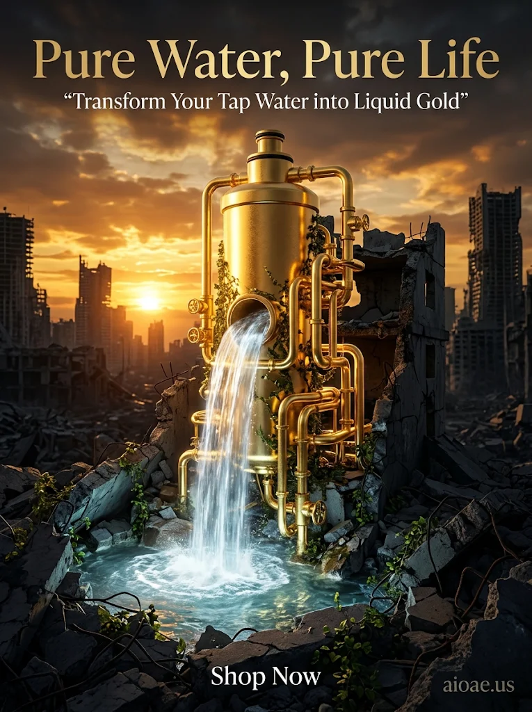

# 案例 186：末日廢墟中的黃金淨水器 | Case 186: Refrigerator Water Filter Pure Water Pure Life



末日廢墟 × 黃金淨水器：金色濾芯自殘垣中升起，化作發光純水瀑布，落日餘暉下的希望寓言。

Post-apocalyptic ruins × golden water filter: a golden filter rises from the rubble and turns into a luminous waterfall of pure water — a parable of hope under a fiery sunset.

## 完整提示詞 / Full Prompt

```
SCENE: In a dramatic, post-apocalyptic cityscape, a golden refrigerator water filter emerges from the ruins of a crumbling building, transforming into a glowing, intricate conduit of pure water. The filter, now a complex, swirling network of pipes and valves, rises from the rubble, its surface shimmering with a metallic sheen. The water flows through the conduit, forming a luminous, cascading waterfall that pours into a pool of crystal-clear water below. The surrounding landscape is a mix of broken concrete and twisted metal, with a few resilient plants growing through the cracks, symbolizing hope and renewal. The scene is set against a backdrop of a fiery sunset, casting long shadows and highlighting the contrast between the golden filter and the dark, ruined city.

STYLE & LIGHT: The style is a blend of dystopian realism and surrealism, with a focus on dramatic lighting and vivid colors. The golden filter is illuminated by the warm, golden light of the setting sun, creating a striking contrast with the cool, dark tones of the ruined city. The water's glow adds a magical, almost ethereal quality to the scene.

CAMERA: A wide-angle shot captures the entire scene, from the towering filter to the pool of water below, with the ruined cityscape stretching out into the distance. The camera is positioned at a low angle, looking up at the filter, emphasizing its grandeur and the scale of the transformation.

ON-IMAGE TEXT: headline "Pure Water, Pure Life"; subheadline "Transform Your Tap Water into Liquid Gold"; CTA "Shop Now".

WATERMARK: Add the exact text "aioae.us" in the bottom-right corner at 70% transparency, with enough contrast to remain visible.
```

## 適用模型 / Recommended Models

擅長產品海報、末日場景與戲劇光影的模型：GPT Image（Image2）、Flux Pro、Midjourney（建議加 `--ar 3:4`）。

Models strong at product posters, post-apocalyptic scenes and dramatic lighting: GPT Image (Image2), Flux Pro, Midjourney (add `--ar 3:4`).

## 修改說明 / How to Adapt

- 換場景：把末日城市換成乾淨現代廚房，SCENE 的殘垣與落日描寫改成明亮家居光線，濾芯的金色保留。
- 換產品：把冰箱濾芯換成淨水壺或濾水龍頭，SCENE 的管道網絡描寫改成對應的出水形態。
- 換文案：把 ON-IMAGE TEXT 的標題換成自家淨水品牌口號，副標與 CTA 同步改，構圖不用動。

- Change the setting: swap the ruined city for a clean modern kitchen, replacing the rubble and sunset lines in SCENE with bright home lighting while keeping the golden filter.
- Change the product: swap the refrigerator filter for a water pitcher or filter tap, reworking the pipe-network lines in SCENE into the matching water flow.
- Change the copy: replace the headline in ON-IMAGE TEXT with your own water brand slogan, updating the subheadline and CTA to match — the composition stays intact.

---
直達本案例 / Direct link: https://aioae.us/prompt?title=Refrigerator%20Water%20Filter%20Pure%20Water%20Pure%20Life
更多同類提示詞 / More prompts like this: [AIOAE 免費 AI 圖片提示詞庫](https://aioae.us/prompts)
