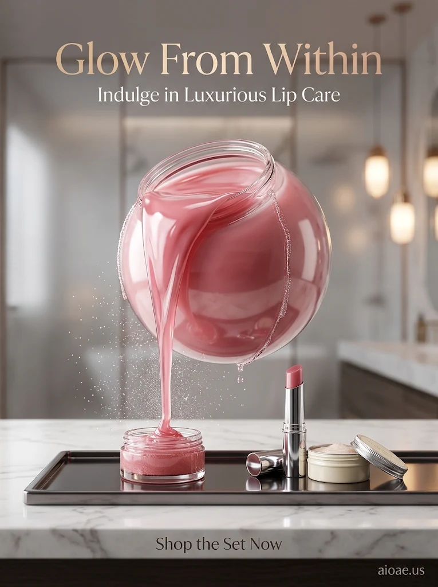

# 案例 187：玫瑰唇部護理禮盒 | Case 187: Lip Care Gift Set Glow From Within



極簡奢華浴室 × 玫瑰唇部護理：玻璃球中的粉色唇膏瀑布傾瀉而下，鉻金管身與大理石映襯水潤光澤。

Minimalist luxury bathroom × rose lip care: a pink lip-balm waterfall pours from a translucent glass globe, chrome tubes and marble reflecting its dewy sheen.

## 完整提示詞 / Full Prompt

```
SCENE: In a minimalist luxury bathroom, a lip care gift set with a large, translucent glass globe filled with rose-tinted lip balm waterfall sits on a polished marble vanity. The top of the globe forms a flowing waterfall of pink-colored lip balm, pouring into a smaller, open container of sugar scrub below, with droplets mid-air creating a fine mist. The globe is encircled by a metallic, chrome-finished tube of lip balm and a small, cream-colored tin of sugar scrub, all resting on a dark, reflective surface. A thin line of sparkling moisture runs down the surface of the glass globe, catching the light and enhancing the sense of hydration. The background features a soft-focus bathroom interior with frosted glass panels and hanging pendant lights.

STYLE & LIGHT: Clean, clinical yet luxurious aesthetic with a focus on high-gloss, reflective surfaces and soft, diffused lighting that accentuates the product's smooth, moisturizing texture. A palette of rose pink, white, and chrome.

CAMERA: A slightly elevated angle, looking down at the lip care gift set, with a shallow depth of field that keeps the product in sharp focus while blurring the background.

ON-IMAGE TEXT: headline "Glow From Within"; subheadline "Indulge in Luxurious Lip Care"; CTA "Shop the Set Now".

WATERMARK: Add the exact text "aioae.us" in the bottom-right corner at 70% transparency, with enough contrast to remain visible.
```

## 適用模型 / Recommended Models

擅長產品海報、美妝產品圖與高光反射質感的模型：GPT Image（Image2）、Flux Pro、Midjourney（建議加 `--ar 3:4`）。

Models strong at product posters, beauty product shots and glossy reflective textures: GPT Image (Image2), Flux Pro, Midjourney (add `--ar 3:4`).

## 修改說明 / How to Adapt

- 換色調：把玫瑰粉換成珊瑚橘或裸膚色，STYLE & LIGHT 的配色與唇膏瀑布描寫跟著改。
- 換產品：把唇部護理組換成香水或面霜禮盒，SCENE 的玻璃球瀑布改成對應的質地流動。
- 換文案：把 ON-IMAGE TEXT 的標題換成自家美妝品牌口號，副標與 CTA 同步改，構圖不用動。

- Change the palette: swap the rose pink for coral orange or nude tones, updating the palette and the lip-balm waterfall lines in STYLE & LIGHT.
- Change the product: swap the lip care set for a perfume or face-cream gift set, reworking the glass-globe waterfall in SCENE into the matching texture flow.
- Change the copy: replace the headline in ON-IMAGE TEXT with your own beauty brand slogan, updating the subheadline and CTA to match — the composition stays intact.

---
直達本案例 / Direct link: https://aioae.us/prompt?title=Lip%20Care%20Gift%20Set%20Glow%20From%20Within
更多同類提示詞 / More prompts like this: [AIOAE 免費 AI 圖片提示詞庫](https://aioae.us/prompts)
