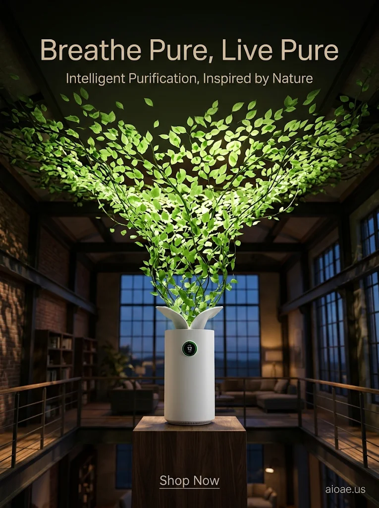

# 案例 188：綠葉穹頂空氣淨化器 | Case 188: Air Purifier Breathe Pure Live Pure



黃昏閣樓 × 綠葉穹頂：淨化器頂部展開成千片半透明綠葉，編織成發光天篷，極簡與親生物設計的融合。

Dusk loft × leaf canopy: the purifier's top unfolds into thousands of translucent green leaves forming a glowing canopy — modern minimalism fused with biophilic design.

## 完整提示詞 / Full Prompt

```
SCENE: In a dimly lit loft interior at dusk, the product stands on a raised dark walnut podium, centered at the edge of an upper balcony. Its crisp matte-white cylindrical body features a subtle digital screen displaying an air-quality reading. Suddenly the top of the unit unfolds, its panels splitting into thousands of translucent green leaves that rise and interlock overhead, forming a canopy that radiates soft light through its canopy of leaves. The canopy of leaves casts a dappled, natural light across the loft interior, while the rest of the room remains in soft focus with silhouetted furniture.

STYLE & LIGHT: A fusion of modern minimalism with biophilic design elements. The lighting is soft and diffused, using a warm glow to highlight the product's glossy finish and the vibrant green leaves. The palette is a clean, natural green-dominant scheme with warm earth tones from the walnut podium, emphasizing the product's eco-friendly technology and natural air-purification process.

CAMERA: A low angle with a slight tilt upward, framing the product and the leaf canopy in full view, creating a sense of grandeur and natural dominance.

ON-IMAGE TEXT: headline "Breathe Pure, Live Pure"; subheadline "Intelligent Purification, Inspired by Nature"; CTA "Shop Now".

WATERMARK: Add the exact text "aioae.us" in the bottom-right corner at 70% transparency, with enough contrast to remain visible.
```

## 適用模型 / Recommended Models

擅長產品海報、室內場景與柔和自然光的模型：GPT Image（Image2）、Flux Pro、Midjourney（建議加 `--ar 3:4`）。

Models strong at product posters, interior scenes and soft natural light: GPT Image (Image2), Flux Pro, Midjourney (add `--ar 3:4`).

## 修改說明 / How to Adapt

- 換葉色：把綠葉換成秋日金黃或櫻花粉，STYLE & LIGHT 的配色與淨化意象描寫跟著改。
- 換場景：把黃昏閣樓換成明亮客廳或辦公室，SCENE 的胡桃木講台與剪影家具描寫跟著改。
- 換文案：把 ON-IMAGE TEXT 的標題換成自家淨化器品牌口號，副標與 CTA 同步改，構圖不用動。

- Change the leaf colour: swap the green leaves for autumn gold or cherry-blossom pink, updating the palette and purification lines in STYLE & LIGHT.
- Change the setting: swap the dusk loft for a bright living room or office, updating the walnut podium and silhouetted furniture lines in SCENE.
- Change the copy: replace the headline in ON-IMAGE TEXT with your own purifier brand slogan, updating the subheadline and CTA to match — the composition stays intact.

---
直達本案例 / Direct link: https://aioae.us/prompt?title=Air%20Purifier%20Breathe%20Pure%20Live%20Pure
更多同類提示詞 / More prompts like this: [AIOAE 免費 AI 圖片提示詞庫](https://aioae.us/prompts)
