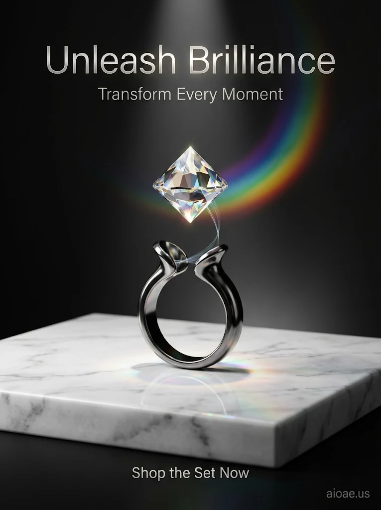

# 案例 189：黑曜戒指與彩虹稜鏡 | Case 189: Ring Unleash Brilliance



極簡工作室 × 黑曜戒指：戒圈彎折露出隱藏稜鏡，彩虹光沿黑牆蜿蜒，珠寶廣告的靜謐張力。

Minimalist studio × blackened-metal ring: the band bends open to reveal a hidden prism, its rainbow light curling along the black wall — quiet tension for a jewellery ad.

## 完整提示詞 / Full Prompt

```
SCENE: In a minimalistic studio, a polished blackened-metal ring sits on a glossy white marble slab against a matte black backdrop. The camera, positioned slightly above and angled 45°, captures the ring in sharp focus. Suddenly the ring's band bends inward, revealing a hidden prism that rises and rotates slowly, its facets scattering light into a rainbow that curls along the black wall. The prism hovers above the marble, tethered by a barely visible translucent thread of light, while the marble surface remains untouched, providing clean contrast.

STYLE & LIGHT: Soft diffused front lighting from the left, a narrow focused spotlight from above, and ambient backlight from the black wall create gentle highlights, depth, and accentuate the prism's refracted colors.

CAMERA: A 24mm prime lens at a 45° angle with shallow depth of field keeps the ring and prism crisp while slightly blurring the marble and background.

ON-IMAGE TEXT: headline "Unleash Brilliance"; subheadline "Transform Every Moment"; CTA "Shop the Set Now".

WATERMARK: Add the exact text "aioae.us" in the bottom-right corner at 70% transparency, with enough contrast to remain visible.
```

## 適用模型 / Recommended Models

擅長產品海報、珠寶特寫與光影折射的模型：GPT Image（Image2）、Flux Pro、Midjourney（建議加 `--ar 3:4`）。

Models strong at product posters, jewellery close-ups and light refraction: GPT Image (Image2), Flux Pro, Midjourney (add `--ar 3:4`).

## 修改說明 / How to Adapt

- 換珠寶：把戒指換成項鍊或耳環，SCENE 的戒圈彎折描寫改成對應的佩戴形態，稜鏡保留。
- 換色調：把黑曜金屬換成玫瑰金或鉑金，STYLE & LIGHT 的光影與大理石對比描寫跟著改。
- 換文案：把 ON-IMAGE TEXT 的標題換成自家珠寶品牌口號，副標與 CTA 同步改，構圖不用動。

- Change the jewellery: swap the ring for a necklace or earrings, reworking the band-bending line in SCENE into the matching form while keeping the prism.
- Change the metal: swap the blackened metal for rose gold or platinum, updating the lighting and marble-contrast lines in STYLE & LIGHT.
- Change the copy: replace the headline in ON-IMAGE TEXT with your own jewellery brand slogan, updating the subheadline and CTA to match — the composition stays intact.

---
直達本案例 / Direct link: https://aioae.us/prompt?title=Ring%20Unleash%20Brilliance
更多同類提示詞 / More prompts like this: [AIOAE 免費 AI 圖片提示詞庫](https://aioae.us/prompts)
