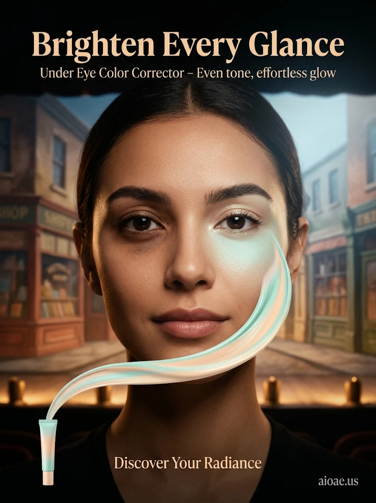

# 案例 190：眼下遮瑕提亮光采 | Case 190: Under Eye Color Corrector Brighten Every Glance



舞台燈光 × 眼下遮瑕：心形臉龐半明半暗，粉彩緞帶從管身劃向眼下，冷暖光對比凸顯提亮效果。

Stage footlights × under-eye corrector: a heart-shaped face half in shadow, a pastel ribbon arcing from the tube to the under-eye — warm and cool light contrasting the brightened side.

## 完整提示詞 / Full Prompt

```
SCENE: The woman's heart-shaped face occupies the upper two-thirds of a vertical canvas; her left eye shows a natural dark shadow while her right eye gleams after the pastel ribbon arcs from the tube at the lower left, passes behind her cheek, and lands on the right under-eye area, painting it a smooth, even glow. The ribbon glows, its tip barely touching skin, and the corrected side radiates a pastel teal that blends into a stylized Technicolor stage set of painted shopfronts and footlights in the background, which remains slightly blurred by shallow depth of field.

STYLE & LIGHT: Warm footlight from below casts soft shadows on the left, while cool diffused sky-light from above highlights the corrected side, emphasizing the pastel glow.

CAMERA: Medium close-up, slightly low angle, eye-level focus on the face; shallow depth of field keeps the background stage slightly blurred, drawing attention to the under-eye transformation.

ON-IMAGE TEXT: headline "Brighten Every Glance"; subheadline "Under Eye Color Corrector – Even tone, effortless glow"; CTA "Discover Your Radiance".

WATERMARK: Add the exact text "aioae.us" in the bottom-right corner at 70% transparency, with enough contrast to remain visible.
```

## 適用模型 / Recommended Models

擅長寫實人像、美妝產品圖與冷暖光對比的模型：GPT Image（Image2）、Flux Pro、Midjourney（建議加 `--ar 3:4`）。

Models strong at photorealistic portraits, beauty product shots and warm-cool light contrast: GPT Image (Image2), Flux Pro, Midjourney (add `--ar 3:4`).

## 修改說明 / How to Adapt

- 換色調：把粉彩青換成蜜桃粉或薰衣草紫，SCENE 的緞帶與提亮描寫跟著改。
- 換背景：把舞台佈景換成晨光浴室或化妝台，SCENE 的店面與腳燈描寫跟著改。
- 換文案：把 ON-IMAGE TEXT 的標題換成自家美妝品牌口號，副標與 CTA 同步改，構圖不用動。

- Change the tint: swap the pastel teal for peach pink or lavender, updating the ribbon and glow lines in SCENE.
- Change the backdrop: swap the stage set for a morning-lit bathroom or vanity, updating the shopfront and footlight lines in SCENE.
- Change the copy: replace the headline in ON-IMAGE TEXT with your own beauty brand slogan, updating the subheadline and CTA to match — the composition stays intact.

---
直達本案例 / Direct link: https://aioae.us/prompt?title=Under%20Eye%20Color%20Corrector%20Brighten%20Every%20Glance
更多同類提示詞 / More prompts like this: [AIOAE 免費 AI 圖片提示詞庫](https://aioae.us/prompts)
