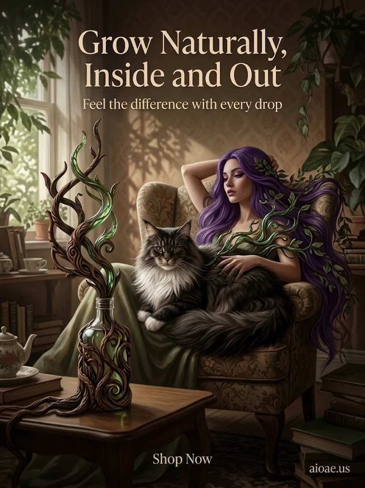

# 案例 191：自然生長：紫髮女子與緬因貓 | Case 191: Grow Naturally Inside and Out



黃昏茶室 × 藤蔓纏繞：紫髮女子與緬因貓依偎，玻璃瓶邊緣化作雕刻木藤蔓，溫暖泥土色調中的自然生長。

Tea-hour parlor × intertwining vines: a violet-haired woman reclines with a Maine Coon cat as a glass bottle melts into carved-wood vines — natural growth in warm earth tones.

## 完整提示詞 / Full Prompt

```
SCENE: In a dim, intimate tea-hour parlor a stylized woman with violet, floor-length hair reclines in a plush armchair, one arm tucked behind her head. An oversized Maine Coon cat with a white chest curls around her, its fur brushed by the emerging vines. The glass bottle sits on a low wooden table; its edges melt into Makonde-style carved wood vines that rise, intertwine with the cat's fur and cascade over the woman's shoulders, forming fine hair strands. Soft window light filters through leafy canopies, casting gentle leaf shadows on the wall and highlighting the iridescent surface of the vines.

STYLE & LIGHT: The scene blends warm brown chisel-marked wood texture with translucent green iridescence, using a muted jungle-parlor palette of soft earth tones and diffused daylight.

CAMERA: Frontal eye-level full-body shot, centered on the seated woman, capturing the cat's embrace and the bottle's vine transformation.

ON-IMAGE TEXT: headline "Grow Naturally, Inside and Out"; subheadline "Feel the difference with every drop"; CTA "Shop Now".

WATERMARK: Add the exact text "aioae.us" in the bottom-right corner at 70% transparency, with enough contrast to remain visible.
```

## 適用模型 / Recommended Models

擅長寫實人像、動物與柔和室內光的模型：GPT Image（Image2）、Flux Pro、Midjourney（建議加 `--ar 3:4`）。

Models strong at photorealistic portraits, animals and soft interior light: GPT Image (Image2), Flux Pro, Midjourney (add `--ar 3:4`).

## 修改說明 / How to Adapt

- 換動物：把緬因貓換成柴犬或兔子，SCENE 的貓毛與藤蔓交纏描寫跟著改。
- 換髮色：把紫色長髮換成墨綠或銀白，STYLE & LIGHT 的叢林客廳配色跟著調。
- 換文案：把 ON-IMAGE TEXT 的標題換成自家保健品牌口號，副標與 CTA 同步改，構圖不用動。

- Change the animal: swap the Maine Coon for a Shiba Inu or a rabbit, updating the fur-and-vine lines in SCENE.
- Change the hair colour: swap the violet hair for dark green or silver white, adjusting the jungle-parlor palette in STYLE & LIGHT.
- Change the copy: replace the headline in ON-IMAGE TEXT with your own wellness brand slogan, updating the subheadline and CTA to match — the composition stays intact.

---
直達本案例 / Direct link: https://aioae.us/prompt?title=Grow%20Naturally%20Inside%20and%20Out
更多同類提示詞 / More prompts like this: [AIOAE 免費 AI 圖片提示詞庫](https://aioae.us/prompts)
