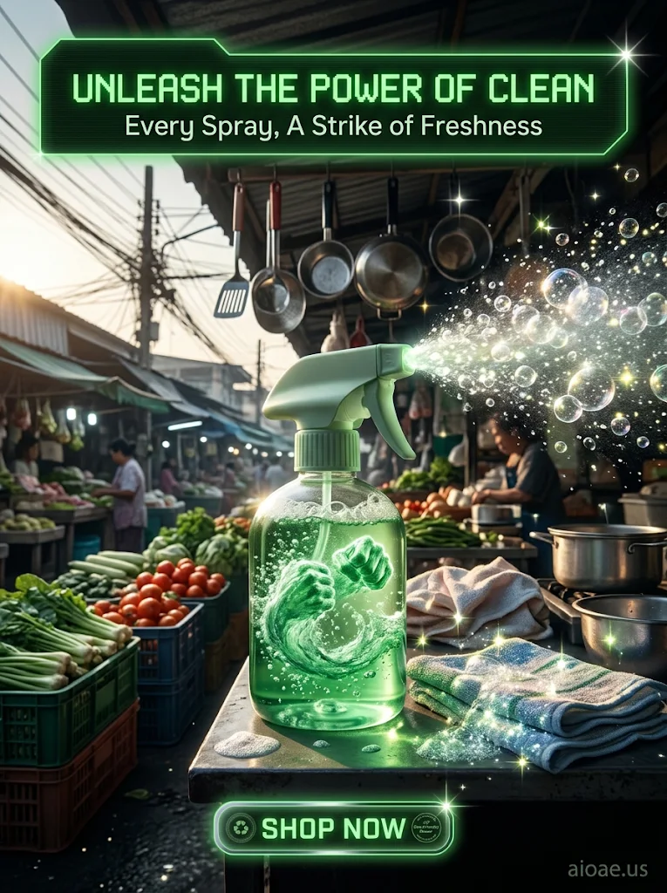

# 案例 192：黎明市集洗潔精噴霧 | Case 192: Dish Soap Spray Unleash the Power of Clean



黎明市場攤位 × 洗潔精噴霧：綠標噴霧瓶化出流動拳頭，肥皂泡如螢火蟲飛濺，Y2K 霓虹綠標語點亮清晨市集。

Dawn market stall × dish soap spray: a green-label bottle throws fluid fists mid-strike, soap bubbles glittering like fireflies — Y2K neon-green copy lighting up the morning market.

## 完整提示詞 / Full Prompt

```
SCENE: In a bustling market stall at dawn, a compact, green-label dish soap spray bottle stands center-stage, its matte plastic torso silhouetted against hanging utensils and overhead power lines. The bottle's liquid interior forms fluid fists mid-strike, launching a cascade of soap bubbles that glitter like fireflies. A stack of fresh vegetables and dish towels at the base reflect the spray's glow. The scene is illuminated by soft daylight from the left, rim-lighting the bottle's contours and creating a dramatic silhouette against a slightly blurred background of market stalls.

STYLE & LIGHT: Y2K-inspired with minimalist green logo, neon-glow text on a dark green ribbon banner, matte finish and eco-friendly messaging.

CAMERA: Wide, slightly elevated angle capturing the entire stall, foreground bottle transformation, and bustling background.

ON-IMAGE TEXT: headline "Unleash the Power of Clean"; subheadline "Every Spray, A Strike of Freshness"; CTA "Shop Now".

WATERMARK: Add the exact text "aioae.us" in the bottom-right corner at 70% transparency, with enough contrast to remain visible.
```

## 適用模型 / Recommended Models

擅長產品海報、市集場景與 Y2K 霓虹風格的模型：GPT Image（Image2）、Flux Pro、Midjourney（建議加 `--ar 3:4`）。

Models strong at product posters, market scenes and Y2K neon style: GPT Image (Image2), Flux Pro, Midjourney (add `--ar 3:4`).

## 修改說明 / How to Adapt

- 換場景：把黎明市集換成現代廚房或戶外野餐，SCENE 的攤位與蔬菜描寫跟著改，肥皂泡保留。
- 換產品：把洗潔精噴霧換成洗衣液或多功能清潔劑，SCENE 的綠標與流動拳頭描寫改成對應的清潔意象。
- 換文案：把 ON-IMAGE TEXT 的標題換成自家清潔品牌口號，副標與 CTA 同步改，構圖不用動。

- Change the setting: swap the dawn market for a modern kitchen or outdoor picnic, updating the stall and vegetable lines in SCENE while keeping the soap bubbles.
- Change the product: swap the dish soap spray for laundry detergent or a multi-purpose cleaner, reworking the green label and fluid-fist lines in SCENE into the matching cleaning image.
- Change the copy: replace the headline in ON-IMAGE TEXT with your own cleaning brand slogan, updating the subheadline and CTA to match — the composition stays intact.

---
直達本案例 / Direct link: https://aioae.us/prompt?title=Dish%20Soap%20Spray%20Unleash%20the%20Power%20of%20Clean
更多同類提示詞 / More prompts like this: [AIOAE 免費 AI 圖片提示詞庫](https://aioae.us/prompts)
