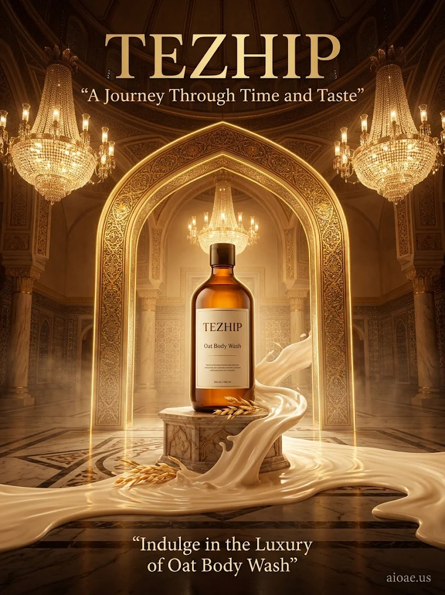

# 案例 193：鄂圖曼宮殿燕麥沐浴露 | Case 193: Tezhip Oat Body Wash A Journey Through Time and Taste



鄂圖曼宮殿 × 燕麥沐浴露：琥珀玻璃瓶立於金色拱門之下，燕麥奶如河流淌，奢華與異國風情的交會。

Ottoman palace × oat body wash: an amber glass bottle stands beneath a golden archway as oat milk flows like a river — luxury meets exotic grandeur.

## 完整提示詞 / Full Prompt

```
SCENE: A tall bottle of oat body wash stands at the center of a grand Ottoman palace hall, its amber glass catching the warm glow of the chandeliers. The bottle is framed by a magnificent archway adorned with intricate Ottoman patterns, its edges glowing with golden light. Below the bottle, a stream of oat milk flows like a river, its creamy texture swirling and pooling around the base. The scene is filled with the scent of oats and the warmth of the palace, creating a sense of luxury and indulgence.

STYLE & LIGHT: Luxurious and regal, with a warm, golden light that highlights the intricate details of the Ottoman architecture and the rich texture of the oat milk. The scene is bathed in a soft, warm glow, creating a sense of opulence and grandeur.

CAMERA: A wide-angle shot, capturing the full grandeur of the palace hall and the bottle at its center. The camera is positioned at a low angle, looking up at the bottle and the archway, emphasizing the height and majesty of the scene.

ON-IMAGE TEXT: headline "Tezhip"; subheadline "A Journey Through Time and Taste"; CTA "Indulge in the Luxury of Oat Body Wash".

WATERMARK: Add the exact text "aioae.us" in the bottom-right corner at 70% transparency, with enough contrast to remain visible.
```

## 適用模型 / Recommended Models

擅長產品海報、宮殿場景與暖金奢華光影的模型：GPT Image（Image2）、Flux Pro、Midjourney（建議加 `--ar 3:4`）。

Models strong at product posters, palace scenes and warm golden luxury lighting: GPT Image (Image2), Flux Pro, Midjourney (add `--ar 3:4`).

## 修改說明 / How to Adapt

- 換場景：把鄂圖曼宮殿換成摩洛哥庭院或日式溫泉，SCENE 的拱門與吊燈描寫跟著改，燕麥奶河保留。
- 換產品：把燕麥沐浴露換成蜂蜜洗髮水或牛奶沐浴乳，SCENE 的燕麥奶描寫改成對應的液體質地。
- 換文案：把 ON-IMAGE TEXT 的標題換成自家沐浴品牌口號，副標與 CTA 同步改，構圖不用動。

- Change the setting: swap the Ottoman palace for a Moroccan courtyard or a Japanese onsen, updating the archway and chandelier lines in SCENE while keeping the oat milk river.
- Change the product: swap the oat body wash for honey shampoo or milk bath lotion, reworking the oat milk lines in SCENE into the matching liquid texture.
- Change the copy: replace the headline in ON-IMAGE TEXT with your own bath brand slogan, updating the subheadline and CTA to match — the composition stays intact.

---
直達本案例 / Direct link: https://aioae.us/prompt?title=Tezhip%20Oat%20Body%20Wash%20A%20Journey%20Through%20Time%20and%20Taste
更多同類提示詞 / More prompts like this: [AIOAE 免費 AI 圖片提示詞庫](https://aioae.us/prompts)
