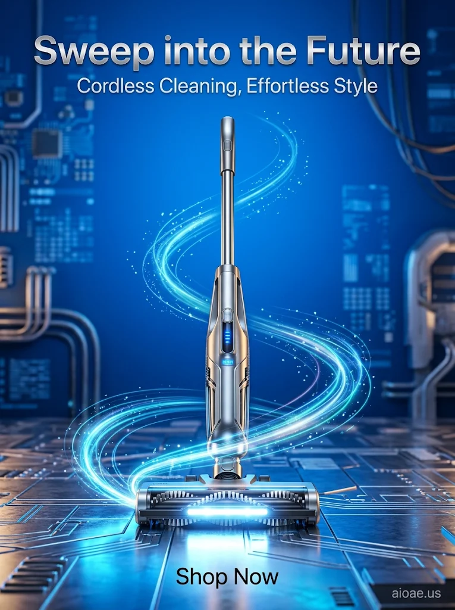

# 案例 195：未來感無線電動掃把 | Case 195: Sweep into the Future



未來藍 × 無線電動掃把：不鏽鋼掃把立於電路板背景前，環繞的光能漩渦點亮整幅科技感產品海報。

Futuristic blue × cordless electric broom: a stainless-steel broom stands before a circuit-board backdrop, wrapped in swirling ribbons of light energy — a high-tech product poster.

## 完整提示詞 / Full Prompt

```
SCENE: A futuristic, high-tech environment with a sleek, metallic surface and a bold, vibrant blue background. A cordless electric broom stands upright in the center of the frame, its handle made of a durable, stainless steel material and its head featuring a unique, innovative design with a series of small, rotating brushes. The broom is surrounded by a variety of colorful, dynamic elements, including swirling patterns of light and energy. The background is a bold, vibrant blue, with a subtle pattern of circuit boards and wires adding depth and texture. The overall composition is dynamic and futuristic, with a sense of movement and energy, and a focus on the broom's innovative design and high-tech features. The broom's handle is adorned with a bright, LED light that illuminates the surrounding area, highlighting the broom's sleek, modern design and creating a sense of freshness and vitality. The broom's head features a series of small, rotating brushes that are designed to effectively clean a variety of surfaces, from hard floors to carpets, and the broom's cordless design allows for easy maneuverability and freedom of movement. The broom is presented in a dynamic, energetic composition that emphasizes its innovative design and high-tech features, creating a balanced, harmonious composition that is both futuristic and inviting.

STYLE & LIGHT: The style is modern, futuristic, and dynamic, with a focus on color and texture. The lighting is bright and dramatic, with a cool, blue tone that enhances the metallic surface of the broom and creates a sense of freshness and vitality. The overall color palette is bold and vibrant, dominated by shades of blue, silver, and white, with pops of bright, vibrant colors from the surrounding elements. The texture is sleek and modern, with a subtle metallic sheen

CAMERA: A close-up shot with a 35mm lens, capturing the broom in sharp focus, with a shallow depth of field that blurs the background slightly. The camera angle is slightly above the broom, looking down at its sleek design, creating a sense of intimacy and immediacy. The composition is centered, with the broom as the focal point, surrounded by the colorful, dynamic elements that frame it, creating a balanced, harmonious composition

ON-IMAGE TEXT: headline "Sweep into the Future"; subheadline "Cordless Cleaning, Effortless Style"; CTA "Shop Now".

WATERMARK: Add the exact text "aioae.us" in the bottom-right corner at 70% transparency, with enough contrast to remain visible.
```

## 適用模型 / Recommended Models

擅長產品海報、科技場景與金屬質感的模型：GPT Image（Image2）、Flux Pro、Midjourney（建議加 `--ar 3:4`）。

Models strong at product posters, tech scenes and metallic textures: GPT Image (Image2), Flux Pro, Midjourney (add `--ar 3:4`).

## 修改說明 / How to Adapt

- 換產品：把掃把換成吸塵器或拖把機，SCENE 的旋轉刷頭描寫改成對應的清潔部件，藍色電路背景保留。
- 換色調：把藍色主調換成薄荷綠或曜石黑，STYLE & LIGHT 的配色與光能漩渦描寫跟著改。
- 換文案：把 ON-IMAGE TEXT 的標題換成自家清潔品牌口號，副標與 CTA 同步改，構圖不用動。

- Change the product: swap the broom for a vacuum cleaner or floor washer, reworking the rotating-brush lines in SCENE into the matching cleaning parts while keeping the blue circuit backdrop.
- Change the palette: swap the blue theme for mint green or obsidian black, updating the palette and the light-energy swirl lines in STYLE & LIGHT.
- Change the copy: replace the headline in ON-IMAGE TEXT with your own cleaning-brand slogan, updating the subheadline and CTA to match — the composition stays intact.

---
直達本案例 / Direct link: https://aioae.us/prompt?title=Sweep%20into%20the%20Future
更多同類提示詞 / More prompts like this: [AIOAE 免費 AI 圖片提示詞庫](https://aioae.us/prompts)
