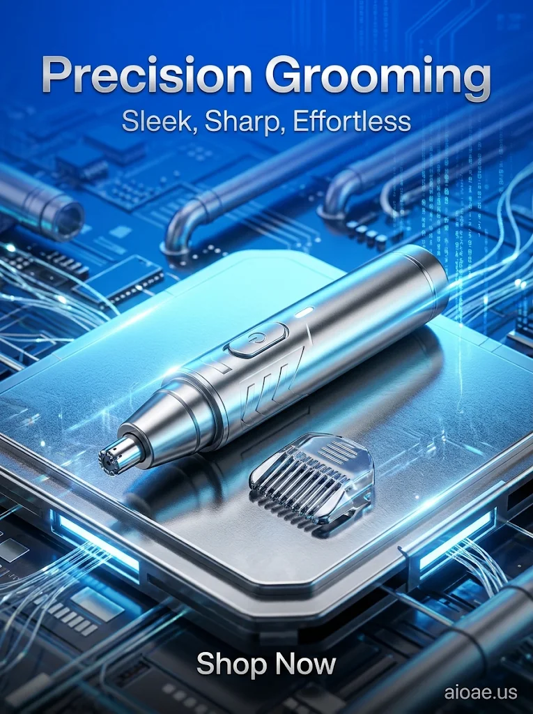

# 案例 196：精準修容：充電鼻毛修剪器 | Case 196: Precision Grooming



未來藍 × 金屬修容筆：銀色鼻毛修剪器橫置於金屬平台，電路紋理與 LED 冷光襯出俐落科技感。

Futuristic blue × metallic grooming pen: a silver nose and eyebrow trimmer lies across a metal platform, circuit textures and cool LED light giving it a crisp high-tech feel.

## 完整提示詞 / Full Prompt

```
SUBJECT: A sleek, modern rechargeable nose and eyebrow trimmer, presented in a dynamic, futuristic composition.

SCENE: The trimmer is placed on a sleek, metallic surface, with a backdrop of a futuristic, high-tech environment. The trimmer is made of a durable, stainless steel material, with a slim, ergonomic design and a bright, LED light. The trimmer is a sleek, silver color, with a subtle pattern of geometric shapes adding texture and visual interest. The background is a bold, vibrant blue, with a subtle pattern of circuit boards and wires adding depth and texture. The overall composition is dynamic and futuristic, with a sense of movement and energy.

STYLE & LIGHT: The style is modern, futuristic, and dynamic, with a focus on color and texture. The lighting is bright and dramatic, with a cool, blue tone that enhances the metallic surface of the trimmer and creates a sense of freshness and vitality.

CAMERA: A close-up shot with a 35mm lens, capturing the trimmer in sharp focus, with a shallow depth of field that blurs the background slightly. The camera angle is slightly above the trimmer, looking down at its sleek design, creating a sense of intimacy and immediacy.

ON-IMAGE TEXT: headline "Precision Grooming"; subheadline "Sleek, Sharp, Effortless"; CTA "Shop Now".

WATERMARK: Add the exact text "aioae.us" in the bottom-right corner at 70% transparency, with enough contrast to remain visible.
```

## 適用模型 / Recommended Models

擅長產品海報、科技場景與金屬質感的模型：GPT Image（Image2）、Flux Pro、Midjourney（建議加 `--ar 3:4`）。

Models strong at product posters, tech scenes and metallic textures: GPT Image (Image2), Flux Pro, Midjourney (add `--ar 3:4`).

## 修改說明 / How to Adapt

- 換產品：把修剪器換成電動牙刷或剃鬚刀，SCENE 的刀頭與修容梳描寫改成對應的部件，藍色電路背景保留。
- 換角度：把俯視特寫改成直立展示，CAMERA 的鏡頭角度與景深描寫跟著改，產品居中不變。
- 換文案：把 ON-IMAGE TEXT 的標題換成自家個護品牌口號，副標與 CTA 同步改，構圖不用動。

- Change the product: swap the trimmer for an electric toothbrush or shaver, reworking the blade-head and comb lines in SCENE into the matching parts while keeping the blue circuit backdrop.
- Change the angle: swap the top-down close-up for an upright display shot, updating the lens angle and depth-of-field lines in CAMERA while keeping the product centered.
- Change the copy: replace the headline in ON-IMAGE TEXT with your own personal-care brand slogan, updating the subheadline and CTA to match — the composition stays intact.

---
直達本案例 / Direct link: https://aioae.us/prompt?title=Precision%20Grooming
更多同類提示詞 / More prompts like this: [AIOAE 免費 AI 圖片提示詞庫](https://aioae.us/prompts)
